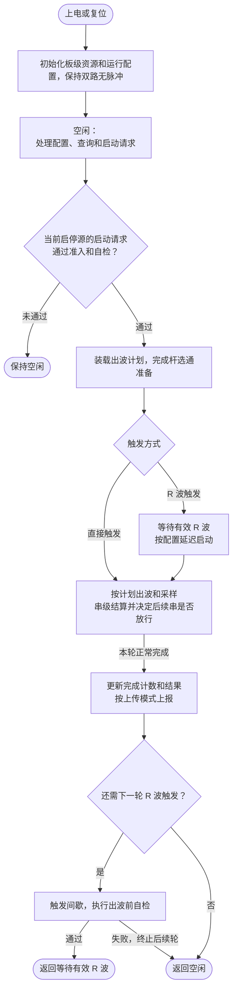

# PSG 软件主逻辑流程图

按固件目标设计概括主流程。FreeRTOS 并行调度协议、脉冲引擎、电流结算等任务，图中的箭头表示业务推进顺序。

- **中途停止或串级失约**。封锁后续输出，结束运行并回到空闲。
- **欠流或过流**。停波并进入电流异常态，`0x3D` 清除成功后回到空闲。有效端口停止和过流关断由硬件直接执行，软件随后处理状态和诊断。

[固件需求](../docs/srs/pulse-gen-firmware.md) · [任务与调度](../docs/design/firmware-architecture.md) · [脉冲引擎](../docs/design/pulse-engine.md) · [实现缺口](../docs/implementation-gaps.md)
