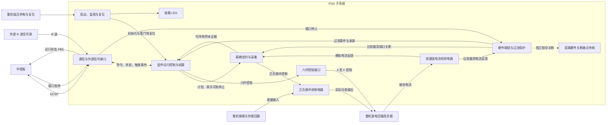

# PSG 子系统体系结构规格说明书（PSG-SyAS）

状态为评审稿，适用于 PSG v3 的目标体系结构。系统行为与验收限值由 [PSG-SyRS](../syrs/psg-subsystem-requirements.md) 规定。本规格定义子系统的组成、单元接口、控制和保护路径、软硬件分配及集成证据。固件任务和驱动由 [固件 SAD](firmware-architecture.md) 展开，实板完成情况见 [实现缺口](../implementation-gaps.md)。

## 1 子系统边界

图中实线表示功能分配与交互，虚线标出待通过原理图确认落点的独立锁存关断路径。整机供能和放电回路均按接口建模，图中的连线表示功能流向。原理图、连接器与测点决定具体电气网和装配位置。

**正负脉冲调制电路属于 PSG。** 其职责涵盖把正负脉冲控制信号转换为实际功率输出，以及执行分配给该电路的关断。调制功能所需的驱动与开关按 PSG 功率执行职责管理。原理图需要给出这些功能的器件、网络及板卡部署，以便落实接口和测量。

| 边界项 | 已确定的分工 | 需用整机电气图或接口控制文件确认 |
| --- | --- | --- |
| 储能与供能 | 储能控制板在产品通信拓扑中是独立节点。正负脉冲调制电路由 PSG 负责。 | 高压能量从哪条供能回路进入调制电路，供能端子、回流和电气隔离如何跨边界。 |
| 实际功率输出 | PSG 对调制输出的波形和关断负责。实际功率指标应在可代表整机负载输出的节点验证。 | 调制输出到负载的走线、连接器、输出与回流测点，以及测量所需负载与工况。 |
| 六杆和电流反馈 | PSG 提供六杆控制接口及双通道电流检测。 | 六杆执行器件的部署、信号穿越的连接器，以及电流传感取样对应的载流支路。 |
| 关断链 | PSG 承担端口停止、比较器保护和独立过流锁存的功能责任。 | 独立锁存如何直达双路输出的关断或保持点，是否涉及跨板硬件联锁，以及关断前后的测点。 |

这些待确认项的交付证据为整机电气方框图、相关原理图页、连接器与测点表。若相关器件全部位于同板，用板内网络和测试点关闭对应条目。 [整机通信拓扑](../spec/product-cardiac-pfa.md#1-整机拓扑与链路角色) · [PSG-23](../ambiguities.md#psg-行为与验收)

## 2 单元与责任

| 单元 | 实现分配 | 责任与状态归属 |
| --- | --- | --- |
| 通信和信号接口 | UART、GPIO、硬件事件输入及 ECSP 固件 | 中控是会话发起和掉线判定方，PSG 协议处理拥有本地会话、上传门控和事务去重。接口传递协议请求、PB4 端口事件、PB6 R 波，按运行控制发布的结果驱动 PB5。端口停止信号同时进入硬件关断路径。 |
| 运行控制 | MCU 固件的脉冲引擎和运行配置 | 唯一持有已提交配置、启停权限、运行阶段、完成计数和对外状态快照。统一应用启动门槛，生成计划并决定是否发布下一串许可。协议任务依据固件 SAD 编排请求裁定。 |
| 精确定时与采集 | MCU HRTIM、ADC、DMA 及板级执行固件 | 预装载输出，按硬件时基执行获准的脉冲串，触发 ADC，记录串边界和有效采样区间。硬件关断覆盖定时输出。 |
| 电流结算与诊断 | MCU 固件的结算和运行控制 | 结算单元拥有有效样本统计与双路串级判定，运行控制拥有异常归属、诊断快照、业务状态及清除流程。 |
| 硬件联锁 | 板级保护、MCU 外设及经原理图确认的关断执行点 | 接收已授权的端口停止、比较器过流和独立过流锁存，执行或保持双路关断。固件配置适用条件、采集事件并管理重新授权。 |
| 正负脉冲调制 | PSG 功率执行硬件 | 根据正负通道脉冲控制信号形成实际输出，响应关断链。和定时及标定共同保证实际波形，和整机供能及负载共同定义验收工况。 |
| 六杆控制 | MCU 运行控制、板级杆接口与外接或板载执行回路 | 运行控制选择杆状态，板级接口执行并提供切换时刻。导通等待满足后才使用该杆出波或进入首轮 R 波等待。 |
| 启动、复位与维护 | 板级安全电平、独立看门狗、启动固件、非易失存储和 LED | 硬件提供复位窗口的安全状态。启动固件自检并恢复默认项。任务监视器裁定喂狗，IWDG 执行硬件复位。标识服务拥有可写标识记录，软件版本和标定表来自镜像。 |

整机发布构型由板卡版本、固件提交、协议口配置、已发布的标定表、供能和负载接线共同标识。发布版 ECSP 默认使用 USART2，单板调试构型使用 USART1。固件采用 [FreeRTOS 任务化调度](../adr/0001-bare-metal-cooperative-scheduling.md) 与 [双 Bank Flash 布局](../adr/0002-dual-bank-flash-layout.md)，各构型的设备绑定见 [MCU 映射](../hw/mcu-pinmap.md)。

## 3 内部接口

| 接口 | 生产者 → 消费者 | 交接契约 |
| --- | --- | --- |
| 运行请求与配置 | 通信接口 → 运行控制 | 事务和线上状态规则由协议层编排。运行控制提供业务准入结论。配置和对应计划整笔生效，失败保持原配置。端口启动复用相同启动门槛。 |
| 序列计划与串许可 | 运行控制 → 精确定时与采集 | 计划包含回读时保留的业务配置所对应的执行参数。许可绑定运行、群、串和原定时刻，逾期、取消或标识不匹配的许可失效。后一串达到截止时仍缺许可，板级继续封锁。 |
| 正负控制与功率输出 | 精确定时 → 调制电路 → 放电回路 | PA8、PA9 为高有效驱动脉冲，禁用的极性不输出。调制电路输出实际功率脉冲。分别测量 MCU 控制信号和实际功率节点，脉宽依实际输出 50% 参考电平判定。 |
| 电流反馈与采样证据 | 电流检测 → ADC 和比较器；板级采集 → 结算 | 两通道反馈与对应极性一致。样本视图包含运行、群、串及有效区间，定义可读期和错误。TIMA 串结束和 DMA 写入边界用于归属，DMA 半传输和传输完成只提示数据就绪。 |
| 截止判定 | 结算 → 运行控制 | 交付当前串各参与通道的结算结果、可继续条件及失约信息。运行控制依据结果和截止时刻授权，板级核验对应许可。 |
| 六杆控制与切换时刻 | 运行控制 → 杆接口 → 执行回路 | 逐路驱动 A 至 F，MCU 绑定 PD13 至 PD8。板级提供实际切换时刻，等待时间以适用的导通动作起算。 |
| 保护命令和故障证据 | 端口、比较器或锁存 → 硬件关断；事件采集 → 运行控制 | 关断与诊断分路。硬件阻止输出，事件采集交付来源、硬件时刻、发生时的运行归属及有效样本边界。PG7、PG8 提供锁存状态观测，PG9 发出锁存复位命令。独立锁存的快速关断连线按 PSG-23 核对。 |
| 运行快照与事件 | 运行控制 → 通信和状态接口 | 连贯发布状态、样本统计、计数和故障信息。PB5 反映运行状态，0x31 返回查询时的状态，0x3C 是适用的事件上报。故障字与电流异常诊断按各自的协议规则发布。 |

[固件 SAD](firmware-architecture.md) · [MCU 映射](../hw/mcu-pinmap.md) · [板卡命令与状态矩阵](../spec/board-pulse-gen.md#命令状态矩阵)

## 4 运行路径

1. **上电和复位。** 从板级具备驱动能力开始，硬件保持双路无脉冲及六杆关断。固件初始化保护与定时资源、恢复运行默认项、检查锁存和标识记录。初始化完成后的正常空闲状态按默认配置为六杆全通。过流联锁及故障字 bit0 依自检结果限制启动。
2. **配置和启动。** 固件接收合法配置，根据目标脉宽、适用电压档和发布标定表生成驱动时长，按实际 HRTIM 时基量化。协议启动与端口启动共用有效配置和出波前自检。受理后准备杆及首串，直接触发执行一次序列，R 波模式进入等待再按有效边沿和配置延迟发起一轮。
3. **出波和采样。** 精确定时按已装载计划驱动调制电路。在参与通道有效功率脉冲内触发同通道采样，串结束时交付归属证据。结算按有效样本计算各通道均值、判定欠流，并给群和轮累计统计。
4. **下一串和轮。** 上一串结果允许、许可在截止前生效且杆准备满足时，才按原定时刻启动同群下一串。缺样或失约终止运行。当序列完成后计入一次完成，R 波模式的非末轮进入触发间歇，自检通过后再次等待 R 波。
5. **停止、异常和恢复。** 正常停止作废挂起触发和许可，按空闲杆规则处理。过流、欠流及串级失约分别按 SyRS 结束并发布各自的状态。合法重复握手终止原运行、使规定配置失效并保留规定的异常及非易失信息。重新出波须重新满足启动门槛。

会话状态、运行阶段和硬件封锁分别维护。会话建立、配置提交、R 波边沿和通信恢复各自只触发规定的转换。硬件关断有效时，计划装载和串许可均不能解除该封锁。

## 5 保护与恢复

| 事件 | 关断责任与保持 | 状态、恢复和验收 |
| --- | --- | --- |
| 协议停止 | 当前为协议启停时，由固件按状态矩阵受理，撤销挂起触发和有效许可并停止双路，回到空闲。 | 未完成轮不计数，按正常停止口径结算读数。TC-STOP-01。 |
| 端口停止 | 当前为端口启停时，PB4 有效负向过渡经板级硬件停止双路并持续封锁后续脉冲，路径独立于 ISR 与任务。EEV7 输出复位是 MCU 快速停波的设计方案，后续置位的持续封锁机制和实板波形按 PSG-22 闭环。 | 捕捉停止事件用于状态更新。与 R 波、定时置位或过流并发时保持关断并保留过流来源和运行归属。MCU 停波与实际功率停波分别测量。TC-STOP-02。 |
| 比较器过流 | 方案为 COMP1、COMP3 分别经 FLT4、FLT5 触发 HRTIM 硬件故障态，关断双路。运行中过流后保持停止，直至异常清除成功。系统复位转入安全初始化流程，后续出波须满足联锁和启动门槛。 | 从任一路比较器过流检出至双路实际功率停止 ≤1 µs。保存过流证据，保持停波时杆驱动状态。TC-STOP-03。 |
| 独立过流锁存 | 固定 90 A 的锁存源应直接驱动硬件关断和保持路径，独立于任务、中断调度和可配置比较器阈值。目标为双路关断。实际关断落点和连接待 PSG-23 确认。 | 从锁存成立至双路实际功率停止 ≤10 µs。PG7、PG8 用于诊断和重读。0x3D 按协议执行锁存复位和确认，成功后才可恢复启动准入。TC-STOP-03。 |
| 欠流或串级失约 | 结算判定欠流时停止两路，未发放许可的下一串保持封锁。缺样、判定迟到或许可迟到时终止运行。 | 欠流进入电流异常态并六杆全断。串级失约记录阶段与样本归属。TC-CUR-02、TC-CUR-03。 |
| 无主机控制超过上限 | PSG 负责本地限制并通过输出封锁执行停波。中控的 ECSP 掉线判定继续由中控承担。 | PSG-19 批准适用模式、起算、限制单位和值、安全态及恢复条件后，明确计时或计数责任和触发接口，再进行断链试验。 |
| 关键功能失常或复位 | 独立看门狗在监视器拒喂后复位。复位窗口由硬件保障两路无脉冲和六杆关断。 | 复位后重新完成初始化、自检和配置，维护接口提供复位原因。TC-RESET-01、TC-RESET-02。 |

运行中过流时，关断、杆状态和诊断有各自的责任。硬件使功率停止且保持封锁，运行控制停止杆对循环并保留停波时的杆驱动状态，采样与状态链保存过流归属。异常清除成功后按空闲杆规则恢复，任何后续出波均需新的受理启动。 [固件异常与安全需求](../srs/pulse-gen-firmware.md#5-异常与安全需求e-) · [停波验收](../verification/firmware.md#停止与保护) · [保护待补证据](../ambiguities.md#psg-行为与验收)

## 6 时序责任

| 系统时限或精度 | 责任分段与测点 | 当前证据与关闭条件 |
| --- | --- | --- |
| 功率波形与触发时序 | 标定和量化 → 硬件定时控制 → 调制响应 → 实际功率输出。触发延迟和触发间歇按 SyRS 指定事件测量。 | T-001～T-004、T-006、T-008、T-009。记录控制与功率波形，在支持的配置、负载及通信压力下验证。零延迟判据见 PSG-24。 |
| 最短 200 ns 配置的电流有效性 | 实际功率脉冲 → 电流检测电路稳定窗口 → ADC 采样窗 → DMA 可读时刻 → 归属和换算。 | 台架确认采样窗口与误差，合格时关闭 PSG-01。修改采样方案后全范围复验。 |
| 串级截止 | 最后有效采样结束 → 串边界与末样就绪两者中的较晚时刻 → 数据交接 → 结算 → 许可生效。杆切换及 1 µs 导通等待若占据同一窗口，应计入关键路径。 | 最短串间隔配置为 1 ms。以原定下一串启动时刻核算正余量。验收叠加通信、日志负载，按适用构型核查擦写的额外影响。TC-CUR-02、TC-CUR-03、HW-04。 |
| 群级结算 | 有效数据等待与执行分别计时，执行 ≤40 ms，二者合计 <50 ms 且小于最短群间隔。 | TC-CUR-04、PSG-02。 |
| 端口停止 | PB4 → MCU 最后一路有效输出停止；PB4 → 两路实际功率输出停止。另行检查后续脉冲封锁。 | SRS T-005-A 的 MCU 测量在规定条件下为 ≤66 ns。端到端功率停止按 PSG-03 批准的判据与时限验收，持续封锁按 PSG-22 闭环。 |
| 两条过流路径 | 分别从比较器检出和锁存成立计至双路实际功率输出停止，记录驱动停止及关断保持。 | 两条时限分别为 ≤1 µs 和 ≤10 µs。核对原理图上的实际关断路径，提交最坏工况波形。PSG-12、PSG-23、HW-02。 |
| 通信与上报 | 接收时间戳 → 解帧和裁定 → 发送仲裁 → UART 线路发送。标识写入单独统计擦写、校验与应答。 | ECSP、T-010、T-011、PSG-20、HW-04、HW-05。空闲心跳按相邻发送完成，故障上报按故障新置位至 0x11 起始位测量。 |

[固件时序要求](../srs/pulse-gen-firmware.md#4-时序需求t-) · [电流结算验证](current-settlement.md#截止时间与验证)

## 7 分配与集成验证

| 系统需求 | 软硬件分配 | 集成证据 |
| --- | --- | --- |
| SYS-01～SYS-06、SYS-09～SYS-13 | 固件校验启动和序列计划，板级硬件执行时序、调制及杆切换，整机供能和负载定义实测工况。 | 四种启停与触发组合、三种极性、最短脉宽、杆循环和间隔边界的同步波形。TC-PULSE-01、TC-STOP-01。 |
| SYS-07～SYS-08、SYS-14～SYS-15、SYS-30 | 电流检测及采集硬件产出有效样本，固件结算和授权，板级执行按许可和时序启动。通信、日志与标识服务按预算运行。 | 采样窗口、归属、分段用时及正余量，缺样和超时后的封锁证据。TC-CUR-01～TC-CUR-04、HW-04。 |
| SYS-16～SYS-17、SYS-23～SYS-25、SYS-32 | 硬件执行端口与过流关断，软件执行协议停止、欠流处置及诊断和恢复。杆控制按停止原因决定物理状态。 | 端口与过流各路径独立试验，故障并发、持续封锁和恢复波形。TC-STOP-01～TC-STOP-03。 |
| SYS-21～SYS-22、SYS-26、SYS-29 | 板级默认电平、独立看门狗、启动固件和状态输出分别承担复位安全与维护。 | 供电与复位包络、初始化与六杆波形、停滞注入、复位原因、PB5 和 LED 波形。TC-RESET-01、TC-RESET-02、PSG-20、PSG-21。 |
| SYS-18～SYS-20、SYS-28、SYS-31 | 中控管理主机会话与版本核对，PSG 协议处理、运行控制、标识服务及收发硬件共同交付。 | 协议报文、状态与电流口径、重复握手与事务回放、标识恢复、最坏应答时间。TC-COM-01～TC-COM-03。 |
| SYS-27 | 产品安全分析定义约束，PSG 运行控制与输出联锁承担本地限制，具体分段待批准。 | PSG-19 获批后的断链及恢复台架用例。 |

每份硬件分配应有适用板卡版本、原理图或接口节点和测点。每份软件分配应有适用固件提交及下游条款。联合验证先核对电气连接、默认状态与保护路径，再执行整机接口、运行、故障注入和最坏负载用例。评审结论应能从系统需求追溯到构型、原始测量和判定。

[PSG-SyRS 验证要求](../syrs/psg-subsystem-requirements.md#7-验证与待批准输入) · [评审验收用例](../verification/firmware.md) · [文档疑点与待补项](../ambiguities.md)
