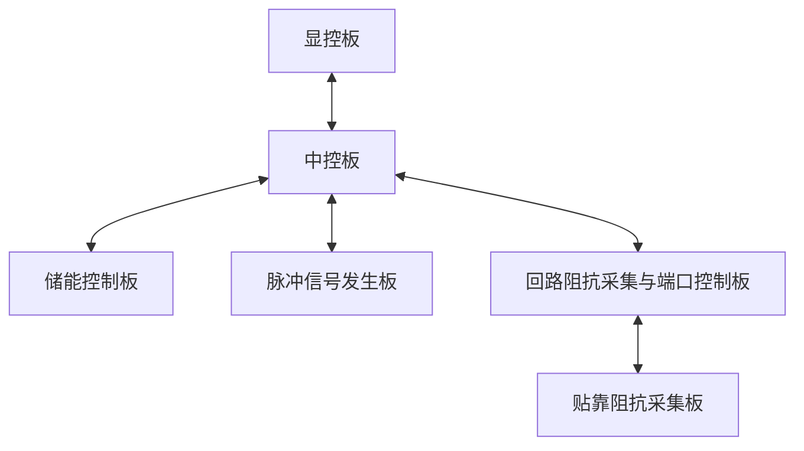

# 心脏脉冲电场消融产品串行协议规范（产品实例化）

> **状态：部分收录 —— 仅含原文 §2.1（通信架构与角色）。** 完整文档待补，缺口见 [OPEN_QUESTIONS.md](../OPEN_QUESTIONS.md) Q-028。
> 权威：产品级实例化。索引见 [README](../README.md)；参数见 [params.md](../params.md)。

## 1 已收录内容

本节收录源文档《`docs/心脏脉冲电场消融产品串行协议规范.md`（基线提交）》的全部内容。原文共 36 行，只有 §2.1 一节，收录时只做两件事：编号重排（原文 §2.1 → 本文档 §1.1）与引用补注（`PRM-xxx`、术语）。图 2-1、表 2-1、表 2-2 的条目与文字语义逐字保留，未增删任何链路、板卡或取值。原文没有 §1，也没有 §2.2 及以后各章，缺口统一登记于本文档 §2。

### 1.1 通信架构与角色（原文 §2.1）

本产品中各板卡通信拓扑见图 2-1，各链路的通信角色见表 2-1。

#### 拓扑

**图 2-1 设备各板卡通信拓扑图**

注：上图照录原文 mermaid 源码。节点标识 `UI`、`CC`、`SE`、`PSG`、`LOOP`、`CONTACT` 为原图标签，方括号内为对应板卡名称，`<-->` 表示该链路双向。

#### 角色分配（原表 2-1）

**表 2-1 各板卡通信角色**

| 通信链路 | 主机 | 从机 |
| --- | --- | --- |
| 显控板 — 中控板 | 显控板 | 中控板 |
| 中控板 — 储能控制板 | 中控板 | 储能控制板 |
| 中控板 — 脉冲信号发生板 | 中控板 | 脉冲信号发生板（本板） |
| 中控板 — 回路阻抗采集与端口控制板 | 中控板 | 回路阻抗采集与端口控制板 |
| 回路阻抗采集与端口控制板 — 贴靠阻抗采集板 | 回路阻抗采集与端口控制板 | 贴靠阻抗采集板 |

注：「主机 / 从机」按 [GLOSSARY](../../GLOSSARY.md)「参与方与寻址」两词条取义；「脉冲信号发生板（本板）」中的「本板」为原文用语，指本仓库所实例化的板卡。本表 5 条链路与图 2-1 的 5 条边一一对应。

#### 地址分配（原表 2-2）

本产品的产品地址为 0x03（[PRM-205](../params.md)），各板卡的板卡地址以及物理层参数见表 2-2。

**表 2-2 各板卡地址**

| 板卡名称 | 板卡地址 | PRM | 接口类型 | 波特率 | 数据位 | 停止位 | 校验位 | 流控制 |
| --- | --- | --- | --- | --- | --- | --- | --- | --- |
| 中控板 | 0x01 | — | UART（TTL 3.3V） | 115200 bps | 8 | 1 | 无 | 无 |
| 脉冲信号发生板 | 0x02 | PRM-206 | UART（TTL 3.3V） | 115200 bps | 8 | 1 | 无 | 无 |
| 回路阻抗采集与端口控制板 | 0x03 | — | UART（TTL 3.3V） | 115200 bps | 8 | 1 | 无 | 无 |
| 储能控制板 | 0x04 | — | UART（TTL 3.3V） | 115200 bps | 8 | 1 | 无 | 无 |
| 贴靠阻抗采集板 | 0x05 | — | UART（TTL 3.3V） | 115200 bps | 8 | 1 | 无 | 无 |

注（`PRM` 列，收录时新补，原文无此列）：

- PRM-206 是 [params.md](../params.md) `2xx` 段登记的「板卡地址」，值 0x02，与本表「脉冲信号发生板」行一致。
- 其余四块板的板卡地址在 params.md `2xx` 段尚无对应登记项，本列标 `—`。不得据本表自行新建 PRM 编号；补登记后再回填。

注（物理层各列）：`接口类型`、`波特率`、`数据位`、`停止位`、`校验位`、`流控制` 依次对应 PRM-001、PRM-002、PRM-003、PRM-004、PRM-005、PRM-006，五块板取同一组值。本表沿用原文写法保留了取值；按 [README](../README.md) §2「数值一律以 params.md 为准」，表内取值不构成独立来源。

注（覆盖范围）：本表只列中控板、脉冲信号发生板、回路阻抗采集与端口控制板、储能控制板、贴靠阻抗采集板五块板卡，未列图 2-1 与表 2-1 中出现的「显控板」的板卡地址。原文即如此，本文不补写；是否立项由 [OPEN_QUESTIONS.md](../OPEN_QUESTIONS.md) 记录，本文档不代为裁决。

## 2 未收录章节

原文在本仓库只有 §2.1，下列章节在源文档中确实不存在，按 README §3 的 `[未收录]` 标记登记。本节只列缺口与各章本应回答的问题，不写内容，也不从其它文档转抄。

| 章节 | 本应回答的问题（原文缺失） | 状态 |
| --- | --- | --- |
| §1 范围与角色 | 本规范适用于哪些产品与板卡，与 ECSP 通用层规范、板卡规范之间是什么权威关系？ | [未收录] |
| §2.2–§2.x 帧与编码 | 本产品在通用层帧格式（帧头、长度、CRC、帧尾）之外是否另有约定或取值收窄？ | [未收录] |
| §3 命令集合 | 本产品各链路分别使用哪些通用命令与板卡功能命令，各自支持到什么级别？ | [未收录] |
| §4 通信机制 | 会话、心跳、掉线判定、上传模式在产品级是否有不同于通用层的取值？ | [未收录] |
| §5 异常与应答码 | 产品级异常如何上报，各板的失败路径如何收敛到通用层应答码？ | [未收录] |
| §6 时序 | 整机上电、握手、心跳与命令应答的时序约束是什么？ | [未收录] |
| §7 版本与兼容 | 本产品期望的软件版本与硬件版本是什么，版本不符时如何处置？ | [未收录] |
| §8 符合性矩阵 | 本产品对各通用命令与板卡功能命令的支持级别如何逐条声明？ | [未收录] |
| 附录 A 变更记录 | 本产品规范的版本变更历史是什么？ | [未收录] |
| 附录 B 待评审 | 哪些条款仍待评审，与 OPEN_QUESTIONS.md 的条目如何对应？ | [未收录] |
| 附录 C 实例化清单 | 本产品由哪些板卡实例化构成，各自对应哪份板卡规范？ | [未收录] |

补充说明：

- 上表章节名沿用 README §4.1 的协议类文档骨架；其中 §4「机制」在骨架中标注为「仅通用层」，产品级是否需要重申或收窄取值，原文未给，故仍记 `[未收录]`。
- 原文 §2.1 的编号保留在 §1.1 标题中（「原文 §2.1」），以便与源文档及 OPEN_QUESTIONS.md 的证据行号对齐。
- 上述 11 条缺口同属 Q-028（产品规范仅收录 §2.1）的范围；本文档未新增 Q 编号。
