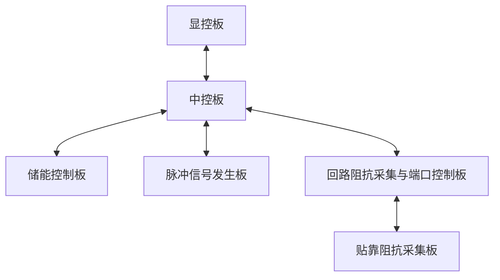

# 心脏脉冲电场消融产品串行协议规范（产品实例化）

> 状态：结构完整；产品级缺口集中见附录 A。
> 权威：产品级实例化，只收窄不放宽。索引见 [README](../README.md)；参数见 [params.md](../params.md)。

## 1 范围与角色

### 1.1 适用范围

本规范适用于心脏脉冲电场消融设备（本产品）内各板卡之间采用 ECSP 的串行链路，规定产品级实例化内容：产品地址、整机拓扑、各链路角色、板卡地址分配表与期望软件版本。这五项即 [GLOSSARY](../../GLOSSARY.md)「产品规范」词条为产品规范划定的职责范围。

- 产品地址为 0x03（[PRM-205](../params.md)）；按「产品地址」词条，同一产品内各板卡取同一产品地址，与板卡地址共同构成寻址唯一键。
- 本产品内的板卡、链路与地址见图 2-1、表 2-1、表 2-2（§2）。

不覆盖：

- 帧结构、CRC、编码、通信机制、通用命令 0x01–0x12、应答码与通用时序——由 [ecsp-general.md](ecsp-general.md) 定义；ecsp-general.md §1.1 的表把产品规范限定为「产品地址分配、整机拓扑、各链路角色与板卡地址分配表」。
- 板卡功能命令（PRM-025）及其载荷与业务语义、故障字位分配、板卡物理层参数与板卡级时序覆盖——由各板卡规范定义（ecsp-general.md §1.1、附录 C 表 10-3）。
- 各板卡的固件实现与上位机软件——产品规范不承担（GLOSSARY「产品规范」只列上述五项）；[SRS](../srs/pulse-gen-firmware.md) §1 另声明其不覆盖上位机软件与产线工装。

### 1.2 与通用层、板卡规范的关系

本规范与 [ecsp-general.md](ecsp-general.md)、[board-pulse-gen.md](board-pulse-gen.md) 同属实例化层。权威顺序按 [README](../README.md) §2：需求规格 > 通用层 > 板卡/产品规范 > MCU 配置。产品规范只允许收窄，不得放宽或改写通用层语义，也不得修改帧结构、通用命令与应答码语义（ecsp-general.md §1.1）。

| 内容 | 归属 | 依据 |
| --- | --- | --- |
| 产品地址、整机拓扑、链路角色、板卡地址表、期望软件版本 | 本规范 | GLOSSARY「产品规范」 |
| 帧格式、CRC、编码、通信机制、通用命令、应答码、通用时序 | ecsp-general.md | ecsp-general.md §1.1 |
| 板卡功能命令（PRM-025）、故障字位分配、板卡物理层参数、板卡级符合性矩阵 | 各板卡规范 | ecsp-general.md §1.1、表 10-3 |

本产品含 5 块板卡（中控板、脉冲信号发生板、回路阻抗采集与端口控制板、储能控制板、贴靠阻抗采集板，见表 2-2；显控板板卡地址待补，见 §2.3）。本仓库现有板卡规范只有脉冲信号发生板的 board-pulse-gen.md；其余四块板的板卡规范 `[待补]`（附录 A A-03～A-06），因此本规范对各板的命令范围、故障位分配与符合性只能声明到「对应规范」一层（§4、§8）。

同一事实在通用层与本规范都出现时，以通用层为准；发现冲突记 GitHub Issue 并在正文标 `[待补]`，不在本规范就地择一。

## 2 通信架构与角色

本节给出整机拓扑、各链路角色与板卡地址分配，见图 2-1、表 2-1、表 2-2。表 2-2 的 `PRM` 列与「显控板」行由本规范补齐，见表注。

本产品中各板卡通信拓扑见图 2-1，各链路的通信角色见表 2-1。

### 2.1 拓扑

**图 2-1 设备各板卡通信拓扑图**

注：节点标识 `UI`、`CC`、`SE`、`PSG`、`LOOP`、`CONTACT` 为图的标签，方括号内为对应板卡名称，`<-->` 表示该链路双向。

### 2.2 角色分配

**表 2-1 各板卡通信角色**

| 通信链路 | 主机 | 从机 |
| --- | --- | --- |
| 显控板 — 中控板 | 显控板 | 中控板 |
| 中控板 — 储能控制板 | 中控板 | 储能控制板 |
| 中控板 — 脉冲信号发生板 | 中控板 | 脉冲信号发生板（本板） |
| 中控板 — 回路阻抗采集与端口控制板 | 中控板 | 回路阻抗采集与端口控制板 |
| 回路阻抗采集与端口控制板 — 贴靠阻抗采集板 | 回路阻抗采集与端口控制板 | 贴靠阻抗采集板 |

注：「主机 / 从机」按 [GLOSSARY](../../GLOSSARY.md)「参与方与寻址」两词条取义；「脉冲信号发生板（本板）」中的「本板」指本仓库所实例化的板卡。本表 5 条链路与图 2-1 的 5 条边一一对应。

### 2.3 地址分配

本产品的产品地址为 0x03（[PRM-205](../params.md)），各板卡的板卡地址以及物理层参数见表 2-2。

**表 2-2 各板卡地址**

| 板卡名称 | 板卡地址 | PRM | 接口类型 | 波特率 | 数据位 | 停止位 | 校验位 | 流控制 |
| --- | --- | --- | --- | --- | --- | --- | --- | --- |
| 中控板 | 0x01 | PRM-211 | UART（TTL 3.3V） | 115200 bps | 8 | 1 | 无 | 无 |
| 脉冲信号发生板 | 0x02 | PRM-206 | UART（TTL 3.3V） | 115200 bps | 8 | 1 | 无 | 无 |
| 回路阻抗采集与端口控制板 | 0x03 | PRM-212 | UART（TTL 3.3V） | 115200 bps | 8 | 1 | 无 | 无 |
| 储能控制板 | 0x04 | PRM-213 | UART（TTL 3.3V） | 115200 bps | 8 | 1 | 无 | 无 |
| 贴靠阻抗采集板 | 0x05 | PRM-214 | UART（TTL 3.3V） | 115200 bps | 8 | 1 | 无 | 无 |
| 显控板 | `[待补]` | — | — | — | — | — | — | — |

注（`PRM` 列对应 params.md 的登记项）：

- 脉冲信号发生板 0x02 对应 [PRM-206](../params.md)（params.md `2xx` 段登记的「板卡地址」）。
- 中控板 0x01、回路阻抗采集与端口控制板 0x03、储能控制板 0x04、贴靠阻抗采集板 0x05 分别对应 PRM-211、PRM-212、PRM-213、PRM-214，均登记于 params.md `2xx` 段。其中 PRM-211、PRM-213 的名称只写「板卡地址（产品内）」、未写板名，与本表的对应关系按取值一致确定；PRM-212、PRM-214 的名称已写明板名。PRM-211、PRM-213 的名称未写板名一事另见附录 A A-17。
- 显控板目前无板卡地址，本列标 `[待补]`。不得据本表自行新建 PRM 编号；后续新增板卡时先登记 params.md，再回填本列。

注（物理层各列）：`接口类型`、`波特率`、`数据位`、`停止位`、`校验位`、`流控制` 依次对应 PRM-001、PRM-002、PRM-003、PRM-004、PRM-005、PRM-006，表内五块板取同一组值。显控板行未给出这六项取值，标 `—`，不适用该组值。表内取值只作展示；按 [README](../README.md) §2「数值一律以 params.md 为准」，它们不构成独立来源。

注（覆盖范围）：表 2-2 列中控板、脉冲信号发生板、回路阻抗采集与端口控制板、储能控制板、贴靠阻抗采集板五块板卡。显控板在图 2-1 与表 2-1 中是主机，其板卡地址待补，故补一行并将 `板卡地址` 列标 `[待补]`，其余列填 `—`；该缺口登记于附录 A A-01、A-02。

注（两个地址字段）：产品地址（PRM-205，0x03）与板卡地址（PRM-206、PRM-211～PRM-214）是两个字段，按 GLOSSARY「产品地址」「板卡地址」取义。产品地址 0x03 与回路阻抗采集与端口控制板的板卡地址 0x03 数值相同但字段不同，不得混用。

## 3 帧与编码

本产品不另作约定，沿用 [ecsp-general.md](ecsp-general.md) §2（帧与编码）：

| 内容 | 本产品处理 | 依据 |
| --- | --- | --- |
| 物理层参数 | 表 2-2 按板列出取值；链路两端一致性待核对 | ecsp-general.md §2.1；PRM-001～PRM-006；附录 A A-02 |
| 唯一帧结构、长度语义、地址字段填写规则 | 不另作约定 | ecsp-general.md §2.2；PRM-007～PRM-010、PRM-014 |
| 帧校验（CRC16-MODBUS） | 不另作约定 | ecsp-general.md §2.3；PRM-015～PRM-023 |
| 数据载荷编码（字节序、整数、浮点、字符串） | 不另作约定 | ecsp-general.md §2.4；PRM-014 |
| 帧类型（请求 / 应答 / 主动上报 / 特殊会话） | 不另作约定 | ecsp-general.md §2.5 |

- 产品级不设帧字段，也不改变帧长上限与最小应答帧长；两者按板卡规范声明的取值（PRM-011、PRM-012）。
- 本产品没有产品级帧约定，本节按「无收窄」处理；若后续补入产品级帧约定，回改本节。链路参数一致性核对仍待补（附录 A A-02）。

## 4 命令集合

本产品不新增命令码，命令集合按通用层的命令码区段划分。本节只声明区段归属与本产品的已知范围，不写命令卡片。

| 区段 | 归属 | 本产品处理 | 依据 |
| --- | --- | --- | --- |
| 0x00 | 保留 | 不使用 | ecsp-general.md §3 |
| 0x01–0x12 | 通用命令（已定义区） | 语义由通用层裁决，本规范不另作约定；各板支持级别由各板卡规范声明 | ecsp-general.md §3、§9.1；PRM-024 |
| 0x13–0x2F | 保留区，其中 0x22–0x2F 为板卡扩展段 | 本产品不占用保留区；扩展段取值由各板卡规范定义，同一产品内不得冲突 | ecsp-general.md §3；PRM-024 |
| 0x30–0xEF | 板卡功能命令 | 语义由各板卡规范定义；本产品能声明范围的只有脉冲信号发生板（0x30–0x43，0x44/0x45 保留未定义），其余四块板 `[待补]` | ecsp-general.md §1.1、§9.2；PRM-025；board-pulse-gen.md §1.4、§3.1 |

- 通用命令 0x01–0x12 的语义、载荷与应答码不在本规范重写（ecsp-general.md §3.2）。本产品不使用哪些通用命令：产品级清单 `[待补]`；已知一条板卡级事实是脉冲信号发生板不实现 0x08、0x09、0x0A，一律应答 0x04（[SRS I-023](../srs/pulse-gen-firmware.md)），其余四块板 `[待补]`（附录 A A-07）。
- 产品级事件与周期上报：不得占用 PRM-024 的命令码（ecsp-general.md 表 10-2 第 7 项）。产品级事件 `[待补]`（附录 A A-08）。
- 各链路的命令范围以各板卡规范为准；本产品 5 块板卡中只有脉冲信号发生板有板卡规范（附录 A A-03～A-06）。

## 5 通信机制

本产品不另作约定，沿用 [ecsp-general.md](ecsp-general.md) §4（上电与握手、幂等控制、长耗时命令、复位恢复、低功耗）与 §6.2（心跳监控）。下表只声明产品级是否有覆盖值，不复述通用层条文。本规范未声明覆盖，故按 ecsp-general.md §6.3 的默认值执行。

| 机制 | 本产品覆盖值 | 依据 |
| --- | --- | --- |
| 会话建立与握手 | 无覆盖；时限与重发取值见 PRM-108、PRM-114 | ecsp-general.md §4.2、§6.3 |
| 心跳 | 无覆盖；取值见 PRM-111、PRM-113 | ecsp-general.md §6.2；PRM-111 |
| 掉线判定 | 无覆盖；判据见 PRM-112 | ecsp-general.md §6.2.1、§6.3 |
| 上传模式 | 无覆盖；上电默认值见 ecsp-general.md C-0x0F-02；门控例外由板卡规范声明 | ecsp-general.md §3.2（0x0F）、C-0x0F-05、C-0x11-06 |
| 长耗时命令与复位恢复 | 无覆盖 | ecsp-general.md §4.4、§4.5 |
| 低功耗 | 无覆盖；本产品各板是否实现 `[待补]`；脉冲信号发生板不实现，回 0x04 | ecsp-general.md §4.6；SRS I-031 |

- 产品级覆盖值本身 `[待补]`：没有可据的产品级取值（附录 A A-11）。
- 板卡规范对本板可声明门控例外（如脉冲信号发生板 0x11 的门控例外，board-pulse-gen.md C-0x11-02）；本规范不代板卡声明。

## 6 时序

本产品不另作约定，沿用 [ecsp-general.md](ecsp-general.md) §6 的应答时限与覆盖规则；整机级时序与产品级覆盖值 `[待补]`（附录 A A-09、A-10）。

| 时序项 | 取值 | 依据 |
| --- | --- | --- |
| 获取类、设置类、动作类应答时限 | PRM-101、PRM-102、PRM-103 | ecsp-general.md §6.1、§6.3 |
| 设置硬件版本 0x03、设置序列号 0x05 首次应答 | PRM-104、PRM-105 | ecsp-general.md §6.1 |
| 系统复位 0x07 应答时限 | PRM-106 | ecsp-general.md §6.1 |
| 在线升级 0x0C 首次应答 | PRM-107 | ecsp-general.md §6.1 |
| 会话建立总时限（含握手重试与版本核对） | PRM-108 | ecsp-general.md §6.3 |
| 心跳周期、掉线判据、心跳检查周期 | PRM-111、PRM-112、PRM-113 | ecsp-general.md §6.2 |
| 上电至首帧握手上报（板卡级，仅脉冲信号发生板有来源） | PRM-116 | SRS T-010、I-009 |
| 整机各板上电顺序、中控板开始握手的时刻、整机就绪窗口 | — | `[待补]`（附录 A A-09） |
| 产品级覆盖值（是否放宽上述时限） | 无 | `[待补]`（附录 A A-10） |

- 握手、命令应答与版本核对的流程见 ecsp-general.md §4.2、§7.2；本节不重复。
- 帧内半包超时 PRM-115 属板卡级取值（SRS T-011 引用），本规范不另作约定。

## 7 版本与兼容

本节只声明本产品的版本范围与处置，版本核对机制沿用通用层。

- 期望软件版本由主机在固件中固化，格式为 7 字节定长 ASCII `X.Y.Z.N`（PRM-201）；上电默认版本 `0.0.0.0`（PRM-203）。核对方式与「版本不符」的会话状态见 ecsp-general.md §4.2.1（3）、§7.2 与表 4-1。
- 版本不符时的处置：主机应将该从机置为「版本不符」，不得下发业务命令并报警（ecsp-general.md §7.2）；产品级处置（报警方式、其它链路是否继续运行、恢复路径）`[待补]`（附录 A A-13）。
- 协议版本采用 V X.Y 格式、不设独立帧字段、随固件版本管理（ecsp-general.md §7.1）；协议版本与固件版本的对应表按通用层表 9-1 的模板填写，本产品 `[待补]`（附录 A A-12）。
- 硬件版本（PRM-207，7 字节 ASCII）与序列号（PRM-202）属通用命令 0x03–0x06 的范围，本规范不另作约定。

本产品各从机的期望软件完整版本 `[待补]`（通用层表 10-2 第 6 项要求填写）：

| 板卡 | 板卡地址 | 期望软件完整版本 | 状态 |
| --- | --- | --- | --- |
| 中控板 | 0x01 | — | `[待补]` |
| 脉冲信号发生板 | 0x02 | — | `[待补]` |
| 回路阻抗采集与端口控制板 | 0x03 | — | `[待补]` |
| 储能控制板 | 0x04 | — | `[待补]` |
| 贴靠阻抗采集板 | 0x05 | — | `[待补]` |

## 8 符合性矩阵

本产品含 5 块板卡（中控板、脉冲信号发生板、回路阻抗采集与端口控制板、储能控制板、贴靠阻抗采集板）。命令级符合性由各板卡规范按 ecsp-general.md §9.1 的符合性矩阵声明；本表只声明每块板对应的规范与状态，不重复命令级支持级别。

| 板卡 | 板卡地址（PRM） | 对应规范 | 状态 |
| --- | --- | --- | --- |
| 中控板 | 0x01（PRM-211） | 无：本仓库无该板卡规范 | `[待补]`：命令范围、故障字分配、符合性矩阵均未定义（附录 A A-03） |
| 脉冲信号发生板 | 0x02（PRM-206） | [board-pulse-gen.md](board-pulse-gen.md) | 已有：§6 符合性矩阵覆盖 0x11、0x12 与 0x30–0x43 共 22 条；0x08/0x09/0x0A 不支持、应答 0x04（SRS I-023） |
| 回路阻抗采集与端口控制板 | 0x03（PRM-212） | 无：本仓库无该板卡规范 | `[待补]`：命令范围、故障字分配、符合性矩阵均未定义（附录 A A-04） |
| 储能控制板 | 0x04（PRM-213） | 无：本仓库无该板卡规范 | `[待补]`：命令范围、故障字分配、符合性矩阵均未定义（附录 A A-05） |
| 贴靠阻抗采集板 | 0x05（PRM-214） | 无：本仓库无该板卡规范 | `[待补]`：命令范围、故障字分配、符合性矩阵均未定义（附录 A A-06） |

- 显控板在表 2-1 中是显控板—中控板链路的主机，其板卡地址待补，也不在表 2-2 的五块从机板卡内，故不列入本表（附录 A A-01、A-02）。
- 中控板在表 2-1 中既是显控板的从机，又是其余四块板的主机；两种角色对应的板卡行为都要求由板卡规范定义，本仓库尚无该规范（附录 A A-03）。
- 故障字分配（bit0 与保留位 bit1–bit7）与 0x22–0x2F 应答码扩展段须在同一产品内不冲突（故障字见 ecsp-general.md 表 5-3；扩展段见其表 10-2 第 8 项）；各板规范未齐，核对结果 `[待补]`（附录 A A-14、A-16）。

## 附录 A 待补清单

本表集中列出仍无来源的内容。编号 B-xx 仅用于本文档内引用。`[待补]` 表示该内容没有可引用的通用层或板卡级来源。

| 编号 | 缺失内容 | 缺什么 | 影响 | 关联 |
| --- | --- | --- | --- | --- |
| A-01 | 显控板板卡地址 | 表 2-2 未列显控板，GLOSSARY 无取值 | 显控板—中控板链路的帧板卡地址无权威取值，寻址唯一键（产品地址, 板卡地址）在文档层不闭合 | §2；表 2-2 |
| A-02 | 链路参数一致性核对 | 显控板—中控板链路的接口类型、波特率、数据位、停止位、校验位、流控制；各链路两端的最大帧长是否一致（见 PRM-011） | ecsp-general.md 表 10-2 第 4 项无法完成；两端参数不同会导致链路不可用，超长帧丢弃行为也可能不一致 | §3；表 2-2 |
| A-03 | 中控板板卡规范 | 命令范围、故障字位分配、板卡物理层参数、符合性矩阵 | 中控板既是显控板的从机、又是其余四块板的主机，其命令语义与应答行为无规范，§8 该行无法判定 | §4、§8 |
| A-04 | 回路阻抗采集与端口控制板板卡规范 | 命令范围、故障字位分配、板卡物理层参数、符合性矩阵 | 该板命令范围、故障位与符合性无来源，§4 无法声明其命令区段 | §4、§8 |
| A-05 | 储能控制板板卡规范 | 命令范围、故障字位分配、板卡物理层参数、符合性矩阵 | 同上 | §4、§8 |
| A-06 | 贴靠阻抗采集板板卡规范 | 命令范围、故障字位分配、板卡物理层参数、符合性矩阵 | 同上 | §4、§8 |
| A-07 | 各板通用命令支持级别与「不使用 / 不实现」清单 | 5 块板对 0x01–0x12 的逐条支持级别；0x08/0x09/0x0A 等可选命令是否实现（仅脉冲信号发生板有 SRS I-023） | §4「本产品不使用哪些命令」只能给出一块板；主机无法按 ecsp-general.md §9.1 固化各节点命令表 | §4 |
| A-08 | 产品级事件与周期上报 | 是否存在产品级事件、是否新增周期上报、占用哪个命令码段 | ecsp-general.md 表 10-2 第 7 项无法核对；「不得占用 PRM-024 区段」的约束无法验证 | §4 |
| A-09 | 整机时序 | 各板上电顺序、中控板开始握手的时刻、整机就绪 / 自检窗口 | §6 只能引用通用层默认值与本板 PRM-116；整机上电验收无判据 | §6 |
| A-10 | 产品级时序覆盖值 | 是否放宽 ecsp-general.md §6.3 的各类时限及取值 | 主机超时判据只能按默认值固化；整机若另有要求，文档无落点 | §6 |
| A-11 | 产品级通信机制覆盖值 | 会话、心跳、掉线判定、上传模式是否有产品级取值 | §5 只能写「沿用」；整机若要求更严（如更短的掉线判据），文档无落点 | §5 |
| A-12 | 各从机的期望软件完整版本与协议版本对应 | 5 块板的期望版本（`X.Y.Z.N`）；协议版本↔固件版本对应表（通用层表 9-1 模板） | §7 版本核对只有格式与处置，没有可比对的期望值，验收无法判定「版本相符」 | §7 |
| A-13 | 版本不符的产品级处置 | 报警方式、其它链路是否继续运行、恢复路径 | 通用层只到「版本不符 + 报警」，整机行为无规范 | §7 |
| A-14 | 板卡扩展应答码 0x22–0x2F 的冲突核对 | 各板是否使用扩展段及其取值 | ecsp-general.md 表 10-2 第 8 项无法核对；同一产品内可能冲突 | §4 |
| A-15 | 产品级异常与应答码收敛 | 各板失败路径如何收敛到通用层应答码；是否需要产品级统一异常上报策略 | 原缺口清单中的「异常与应答码」一项仍无答案；整机故障处理策略缺 | §8 |
| A-16 | 故障字位分配的产品内核对 | 各板 bit0 与 bit1–bit7 的分配（仅脉冲信号发生板有 board-pulse-gen.md §4） | ecsp-general.md 表 5-3 要求同一产品内各板分配不冲突；整机故障字含义无法统一，0x11/0x12 的主机处置无权威依据 | §8 |
| A-17 | PRM-211、PRM-213 的板名 | params.md 这两项只写「板卡地址（产品内）」，未写对应板卡；本表按取值一致确定 | PRM 登记表无法按名称反查板卡，参数与板卡的关联只靠取值和表 2-2，换产品时易错配 | §2.3 |

以上 17 条均无现有规范来源，正文未代填；补齐后回填对应章节。

