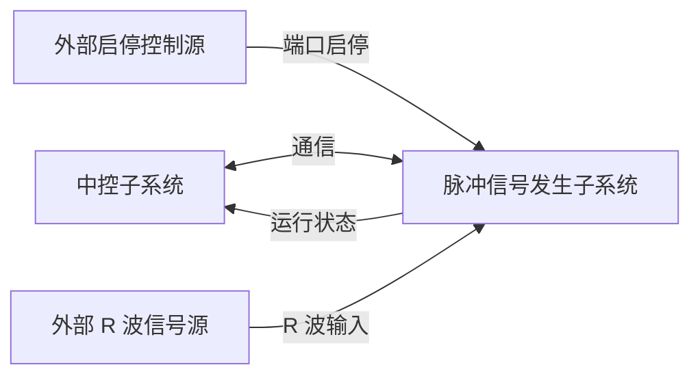
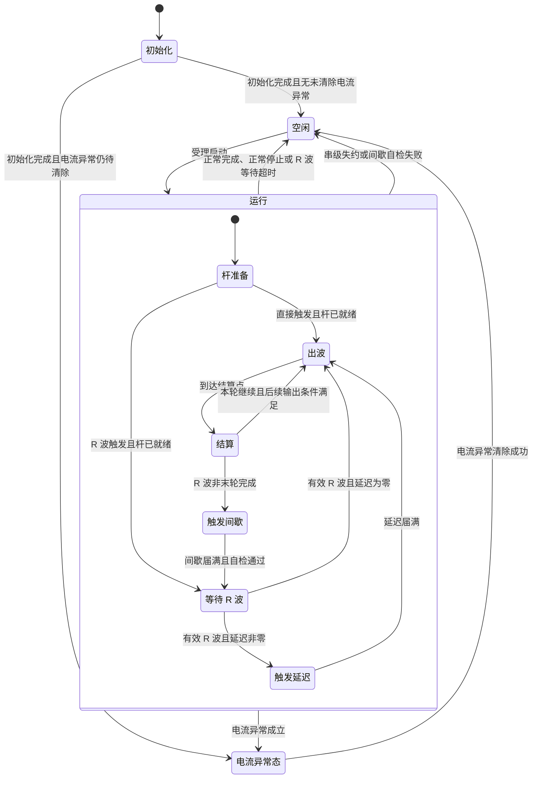

# 脉冲信号发生子系统需求规格说明书（PSG-SyRS）

## 1 引言

### 1.1 系统目的

脉冲信号发生子系统用于为心脏脉冲电场消融整机提供受控脉冲输出。它接受中控子系统的配置驱动双通道脉冲输出、控制六杆选通、采集脉冲输出电流、在停止或保护条件成立时终止脉冲输出以及提供状态与诊断数据供中控子系统使用。

### 1.2 系统范围

本规格规定 PSG 对整机交付的功能、时序、安全行为、外部交互及验收判据。PSG 负责双通道功率脉冲输出和关断、电流测量与保护、六杆选通，以及与中控、外部 R 波信号源和维护工装的交互。

### 1.3 系统概述

#### 1.3.1 系统上下文

下图表示系统外部交互及功能方向。

#### 1.3.2 系统功能摘要

脉冲信号发生子系统校验中控子系统的配置与启动条件，按直接或 R 波触发输出脉冲序列，控制实际功率波形及六杆选通。它采集双通道电流并判定欠流与过流，向中控子系统提供运行状态、计数、电流和故障信息，并提供设备标识维护。

#### 1.3.3 用户特征

整机操作员通过整机人机界面发起操作，由中控向 PSG 提交请求。生产、联调和维护人员读写设备标识，核对本地指示、复位原因及实际输出。

### 1.4 术语

| 术语 | 定义 |
| --- | --- |
| PSG | 脉冲信号发生子系统。 |
| 中控 | 与 PSG 交换控制、配置、状态及诊断信息的整机子系统。 |
| 启停控制源 | PSG 受理常规启动和停止所依据的请求来源，可设置为通信启停或端口启停。 |
| 一次运行 | 从 PSG 受理一次启动开始，至本次运行因正常完成、停止、异常或复位而结束。一次运行可含一轮或多轮。 |
| 一轮 | 执行一次已配置的完整脉冲序列。 |
| 电流异常 | PSG 对任一通道判定的过流或欠流。 |
| R 波接收窗口 | PSG 在每轮等待期间接受有效 R 波正向过渡的时间区间，包含开放时刻，不含超时截止时刻。窗口在受理本轮有效 R 波或结束运行时关闭。 |
| 运行结果形成 | PSG 确定本次运行的结束原因和最终已完成轮数。 |
| 触发间歇 | R 波触发模式下，从非末轮正常完成到下一轮 R 波接收窗口开放的时间。 |
| 重新建立通信 | PSG 自本次初始化以来已经成功建立过通信，中控随后发起一次新的有效通信建立操作。 |
| 应答时间 | 从 PSG 完整收到有效请求到 PSG 开始返回应答的时间。 |

### 1.5 需求标识与验证

每项系统需求使用唯一 SYS 编号。第 3 节按编号规定验证场景、通过判据和留存证据。系统验收所需的整机分配见附录 B。

## 2 系统需求

### 2.1 功能需求

#### 2.1.1 启停与触发

| ID | 子系统需求 |
| --- | --- |
| SYS-01 | PSG 应允许中控将启停控制源设为通信启停或端口启停。写入条件见 SYS-47，默认值见 SYS-105。中控应能查询当前设置。 |
| SYS-02 | PSG 应允许中控将输出触发模式设为直接触发或 R 波触发。写入条件见 SYS-47，默认值见 SYS-105。中控应能查询当前设置。 |
| SYS-03 | 通信命令或端口启停与直接触发或 R 波触发形成的四种组合均应可用。 |
| SYS-04 | PSG 应只接受当前选定启停控制源发起的常规启动与停止。通信启停使用中控请求。端口启停使用有效正向过渡请求启动、有效负向过渡请求停止。端口持续有效不得重复启动。 |
| SYS-05 | PSG 应仅在空闲时受理启动。 |
| SYS-06 | 存在尚未清除的电流异常记录时，PSG 应拒绝启动。 |
| SYS-07 | 任一通道的过流或欠流判定仍有效时，PSG 应拒绝启动。 |
| SYS-08 | PSG 应仅在出波前自检通过时受理启动。 |
| SYS-09 | PSG 应仅在本次初始化后已成功配置两路输出电压、两路电流阈值和序列参数时受理启动。 |
| SYS-10 | R 波触发模式下，PSG 应仅在本次初始化后已成功配置 R 波触发参数时受理启动。 |
| SYS-11 | 运行设置被拒绝时，PSG 应保持该请求涉及的配置和物理杆状态。 |
| SYS-12 | 直接触发模式下，若受理启动后未发生停止、保护关断或复位，PSG 应在 5 ms 内产生首个实际功率脉冲。一次直接触发运行只安排一轮。 |
| SYS-13 | R 波触发模式下，若受理启动后未发生停止、保护关断或复位，PSG 应在 5 ms 内开放首轮 R 波接收窗口。 |
| SYS-14 | PSG 应以每轮 R 波接收窗口内到达的第一个有效正向过渡触发一轮，并在受理该过渡时关闭本轮接收窗口。 |
| SYS-15 | PSG 应允许中控在空闲时设置和查询 R 波触发次数，允许值为 1–300 次，步进为 1 次。 |
| SYS-16 | PSG 应允许中控在空闲时设置和查询每轮 R 波触发延迟，允许值为 0–300 ms，步进为 1 ms。 |
| SYS-17 | PSG 应允许中控在空闲时设置和查询 R 波触发间歇，允许值为 200–2000 ms，步进为 1 ms。触发间歇仅适用于 R 波触发的非末轮。 |
| SYS-18 | PSG 应忽略在 R 波接收窗口之外到达的 R 波输入。此类输入不得启动、延后或留作触发任何一轮。窗口开放时输入若已为高，须等待新的有效正向过渡。 |
| SYS-19 | PSG 应在非末轮后的触发间歇内执行出波前自检。间歇届满且自检通过后方可开放下一轮 R 波接收窗口。自检失败时应结束本次运行。 |
| SYS-125 | 每轮 R 波接收窗口自开放时刻起计 10 s。若在截止时刻前没有有效 R 波输入，PSG 应在截止时关闭窗口、取消剩余轮次并结束本次运行。恰在截止时刻到达的边沿按超时处理。 |
| SYS-126 | R 波等待超时且与中控通信可用时，PSG 应在结果形成后的 50 ms 内开始向中控主动报告一次超时结果，包含超时原因和本次运行已正常完成的轮数。 |

#### 2.1.2 脉冲输出、杆控制与电流监测

| ID | 子系统需求 |
| --- | --- |
| SYS-20 | PSG 应按合法配置在实际功率回路输出正单极性、负单极性或双极性脉冲。 |
| SYS-21 | 每路非零目标脉冲持续时间应可配置为 200–5000 ns，配置步进为 1 ns。 |
| SYS-22 | 目标脉冲持续时间为零的通道应无脉冲。 |
| SYS-23 | 两路目标脉冲持续时间同时为零时，PSG 应拒绝该序列设置。 |
| SYS-24 | PSG 应支持每个序列配置 1–20 个脉冲群。 |
| SYS-25 | PSG 应支持每群配置 1–300 个脉冲串。启用杆对循环时还应满足 SYS-34。 |
| SYS-26 | PSG 应支持每串配置 1–256 个相同波形的重复单元。 |
| SYS-27 | PSG 应支持配置 1–100 ms 的脉冲串间隔，配置步进为 10 µs。 |
| SYS-28 | PSG 应支持配置 50–10000 ms 的脉冲群间隔，配置步进为 1 ms。 |
| SYS-29 | PSG 应支持配置脉冲间隔。单极性时为 1000–100000 ns，双极性时为 1000–50000 ns，两者的配置步进均为 1 ns。 |
| SYS-30 | 双极性时，PSG 应支持配置 1000–50000 ns 的极性间间隔，配置步进为 1 ns。单极性时该配置值应为 0 ns。 |
| SYS-31 | 杆对循环未启用时，PSG 应按杆选通配置使六杆全通，或仅导通 AB、CD、EF、BC、FA、DE 中选定的一对。 |
| SYS-32 | 启用杆对循环时，PSG 正常空闲时应选通 AB。 |
| SYS-33 | 启用杆对循环时，PSG 每群应从 AB 起按 AB、CD、EF、BC、FA、DE 循环，每串仅导通一对。 |
| SYS-34 | 启用杆对循环时，PSG 应只受理每群串数为 6 的倍数的配置。 |
| SYS-35 | PSG 应从每个非零功率输出脉冲获得有效的同通道电流测量值，覆盖最短非零脉冲。 |
| SYS-36 | PSG 应将电流测量结果归属实际发生的脉冲串。 |
| SYS-37 | 禁用通道不应参与电流结算。 |
| SYS-38 | 当参与通道在一串内的有效电流测量值的算术平均值低于该通道的欠流阈值时，PSG 应判定该通道欠流。 |
| SYS-39 | 任一路欠流时，PSG 应终止运行并停止两路输出。 |
| SYS-40 | 同群下一串截止时缺样、未完成判定或启动条件未生效，PSG 应终止运行并禁止下一串。 |
| SYS-41 | 因下一串截止条件未满足而终止运行时，PSG 应保留可区分缺少有效样本、判定未完成和启动条件未及时生效的诊断。 |

#### 2.1.3 输出电压与电流阈值

参数按 SYS-46 校验，启动准入按 SYS-09 判定。系统固定的过流保护上限见 SYS-85。

| 配置项 | 允许范围与组合约束 |
| --- | --- |
| 输出电压 | 正、负通道各为 1–4000 V，配置步进为 1 V。0 V 表示未配置。 |
| 电流检测阈值 | 正、负通道均满足 0 A < 本通道欠流阈值 < 本通道过流阈值 ≤ 90 A，四个阈值应同时设置。非有限值应拒绝。 |

#### 2.1.4 中控交互与运行结果

| ID | 子系统需求 |
| --- | --- |
| SYS-42 | PSG 初始化完成后，应受理中控首次发起的有效通信建立请求，并向中控确认通信已建立。 |
| SYS-43 | 通信建立后，PSG 应向中控提供本规格规定的配置、控制、状态查询和主动报告功能。 |
| SYS-44 | PSG 不得因内容不完整或完整性检查失败的请求而改变业务状态、配置或输出计划。 |
| SYS-45 | 通信建立前，PSG 应拒绝来自中控的运行配置、启停和异常清除请求。 |
| SYS-46 | PSG 应拒绝不满足规定范围、步进或取值组合约束的设置请求，并向中控返回拒绝结果。 |
| SYS-47 | PSG 应仅在空闲时受理运行配置和杆选通设置。运行或处于电流异常态时提交该类请求，PSG 应向中控返回拒绝结果。 |
| SYS-48 | 中控重复提交同一次通信建立、启动、停止、异常清除或复位请求时，PSG 应至多执行一次该操作。 |
| SYS-49 | PSG 应向中控提供正、负两通道各自的输出状态，可区分停止、运行、过流和欠流。 |
| SYS-50 | PSG 应向中控提供每路普通电流结果。正常完成、正常停止或串级失约时，结果取本轮该通道已取得的有效脉冲电流测量值的算术平均值。轮间无当前轮时停止，保留上次结果。 |
| SYS-51 | 发生电流异常时，PSG 应向中控提供与本次异常关联的两路诊断电流，且应能识别各结果所属的通道。 |
| SYS-52 | PSG 应向中控提供本次运行已完成的轮数。受理启动时该值清零，每轮正常完成时加 1，未完成的轮不计入。 |
| SYS-53 | PSG 应允许中控查询当前设备故障及其种类。 |
| SYS-54 | 通信已建立时，PSG 应就新出现的设备故障主动向中控报告其种类。 |
| SYS-55 | PSG 在空闲或电流异常态下应受理中控的有效异常清除请求。异常条件已解除时应清除相应记录并返回成功。异常条件仍有效时应保留记录并报告清除失败。 |
| SYS-127 | 一次运行正常完成且与中控通信可用时，PSG 应在结果形成后的 50 ms 内开始向中控主动报告一次正常完成结果，包含本次运行已完成的轮数。直接触发完成一轮即正常完成。R 波触发达到配置轮数时正常完成。 |

通信重新建立触发软件复位后，失联期间未送达的运行结果无需补报。异常记录和启动条件按 SYS-90 执行。

### 2.2 可用性需求

#### 2.2.1 终端操作与工程可用性范围

整机操作员通过整机界面操作 PSG。整机承担直接面向操作员的操作防误触、临床界面和声光提示。PSG 向中控提供运行状态、拒绝原因和异常中止原因，供整机提示使用。PSG 本地的可用性要求面向生产装配、研发联调和售后维护。

#### 2.2.2 工程装配与维护

| ID | 子系统需求 |
| --- | --- |
| SYS-57 | 初始化完成后，PSG 的本地运行心跳指示应每隔 1000 ms ±100 ms 改变一次亮灭状态。 |
| SYS-129 | 对于 PSG 采用可插拔连接的供电、中控通信、端口启停、R 波输入和功率输出线束，任一线束在正常装配和维修插接操作中应只能与用途相符的连接位置形成有效连接。 |
| SYS-130 | PSG 应提供本地可辨识的诊断指示，使工程人员能分别判断供电是否正常、初始化是否完成且控制功能可响应，以及是否因设备故障禁止启动。 |

#### 2.2.3 整机运行提示所需信息

| ID | 子系统需求 |
| --- | --- |
| SYS-56 | PSG 应在运行时将运行状态输出置高，在空闲和电流异常态置低。 |
| SYS-131 | 与中控的通信已建立时，PSG 应向中控提供可区分的配置拒绝、启动拒绝和异常中止原因。至少应区分运行期间禁止修改配置、启动请求与当前启停控制源不匹配以及 R 波等待超时。 |
| SYS-132 | PSG 处于空闲且已选定端口启停时，若端口输入的有效状态在进入空闲或选定端口启停前已经存在，PSG 应向中控提供「等待端口释放后重新动作」状态。端口输入恢复无效后，PSG 应撤销该状态。 |

配置操作防错见 SYS-11、SYS-44～SYS-47。

### 2.3 性能需求

| ID | 子系统需求 |
| --- | --- |
| SYS-58 | 实际功率脉冲持续时间误差应在 ±(目标值的 2% + 20 ns) 内。持续时间以两次过渡的 50% 参考电平出现时刻之差计。 |
| SYS-59 | 在标定区间外的适用工作点，实际功率脉冲持续时间误差还应在目标值的 ±5% 内。 |
| SYS-60 | 实际功率输出的脉冲间隔相对配置值的误差应在 ±(配置值的 1% + 50 ns) 内。 |
| SYS-61 | 实际功率输出的极性间间隔相对配置值的误差应在 ±(配置值的 1% + 50 ns) 内。 |
| SYS-62 | 实际功率输出的脉冲串间隔相对配置值的误差应在 ±(配置值的 1% + 10 µs) 内。 |
| SYS-63 | 实际功率输出的脉冲群间隔相对配置值的误差应同时满足 ±1 ms 和 ±(配置值的 1%)。 |
| SYS-64 | R 波触发延迟配置为非零值时，从有效 R 波正向过渡到本轮首个实际功率脉冲开始的实测时间，相对配置值的误差应同时满足 ±1 ms 和 ±(配置值的 1%)。 |
| SYS-65 | 触发间歇的实际持续时间相对配置值的误差应同时满足 ±1 ms 和 ±(配置值的 1%)。 |
| SYS-66 | R 波触发延迟配置为 0 ms 时，PSG 应在有效 R 波正向过渡后直接开始本轮实际功率输出。在相同工况及除触发延迟外相同的配置下，0 ms 档首个实际功率脉冲应早于 1 ms 档。0 ms 档的绝对延迟上限见附录 B。 |
| SYS-67 | 使用新导通的杆进行出波前，PSG 应保证从该杆收到导通控制信号至实际功率脉冲开始至少经过 1 µs。 |
| SYS-68 | R 波触发时，PSG 应在首轮 R 波接收窗口开放前完成适用的杆选通及导通等待。直接触发时，PSG 应在首个实际功率脉冲开始前完成适用的杆准备。 |
| SYS-69 | PSG 在脉冲窗口内不得切换杆。 |
| SYS-70 | 电流测量误差应在 ±(读数的 2% + 0.2 A) 内。 |
| SYS-71 | 同一群内，只有上一串的有效样本齐备、判定允许继续输出且启动条件在原定开始前已满足，下一串才应按原定时序启动。 |
| SYS-72 | 最坏适用负载下，群级结算从等待数据至结算完成的总用时应小于 50 ms 且小于最短群间隔。 |
| SYS-73 | 在适用的通信、设备标识更新及诊断记录负载下，PSG 应保持实际功率输出满足规定的波形、时序和下一串启动条件。 |
| SYS-74 | 从 PSG 供电进入规定工作范围开始，PSG 应在 500 ms 内完成向中控发送启动通知。 |
| SYS-75 | 与中控通信已建立且持续空闲时，从 PSG 上一次向中控发送信息完成到随后通信心跳发送完成的间隔应为 1000 ms ±100 ms。 |
| SYS-76 | 接收中断或收到无效请求后，PSG 应能够正常受理随后接收到的有效请求。 |
| SYS-77 | 首次通信建立、查询、设置、启停和软件复位请求的应答时间应 ≤50 ms，硬件版本和序列号写入请求的首次应答时间应 ≤3000 ms。 |
| SYS-78 | 与中控通信可用时，PSG 应在设备故障首次成为有效后的 50 ms 内开始向中控报告该故障。 |

### 2.4 系统接口需求

| 外部交互 | 方向及系统可观察行为 | 对应条款 |
| --- | --- | --- |
| 控制、配置与诊断 | 中控与 PSG 双向交互。中控提交请求，PSG 返回业务结果并提供规定的状态、拒绝原因及诊断。 | SYS-42～SYS-55、SYS-74～SYS-78、SYS-87～SYS-95、SYS-116～SYS-122、SYS-126～SYS-128、SYS-131～SYS-132 |
| 端口启停输入 | 外部启停控制源向 PSG 提供启动正向过渡及停止负向过渡。 | SYS-04、SYS-96～SYS-100 |
| 运行状态输出 | PSG 向中控指示是否存在正在执行的运行。 | SYS-56 |
| R 波输入 | 外部 R 波信号源向 PSG 提供同步基准。接收窗口内的有效正向过渡触发一轮。 | SYS-13～SYS-19、SYS-64～SYS-66、SYS-125 |
| 功率输出与电流测量 | 整机向 PSG 提供供能条件。PSG 向负载提供正、负两路功率脉冲，并测量各参与通道的输出电流。 | SYS-20～SYS-30、SYS-35～SYS-41、SYS-58～SYS-73 |
| 六杆选通 | PSG 控制 A 至 F 六杆的实际选通。 | SYS-31～SYS-34、SYS-67～SYS-69、SYS-106、SYS-111～SYS-115 |
| 供电与复位 | 整机提供低压电源及适用的外部复位条件。 | SYS-104～SYS-107 |
| 装配与维护 | PSG 为生产、调试及维护提供线束连接防错、本地诊断指示、设备标识、故障检查和复位原因查询。 | SYS-49～SYS-55、SYS-57、SYS-116～SYS-124、SYS-129～SYS-130 |

### 2.5 系统运行

| ID | 子系统需求 |
| --- | --- |
| SYS-83 | PSG 按配置的过流阈值判定任一通道过流后，应在 1 µs 内停止两路实际功率输出。 |
| SYS-84 | PSG 按 SYS-85 的固定电流上限判定任一通道过流后，应在 10 µs 内停止两路实际功率输出。 |
| SYS-133 | 任一通道的实际电流首次满足适用过流判据时，PSG 应在附录 B 确定的端到端时限内停止两路实际功率输出。端到端用时覆盖判定和停波。 |
| SYS-85 | 正、负两通道的固定过流保护上限均应为 90 A，且不得随运行配置改变。 |
| SYS-86 | PSG 应在所有适用运行配置下检测参与通道的过流和欠流。固定电流上限保护应在所有适用运行配置下有效。 |
| SYS-87 | 收到中控发起的有效通信重新建立请求时，PSG 应判定原控制关系失效，并执行与 SYS-128 相同的软件复位。 |
| SYS-88 | PSG 应在软件复位时使复位前的序列参数、输出电压、电流阈值及 R 波触发参数失效。 |
| SYS-89 | PSG 完成软件复位后，与中控的通信状态应为待建立。 |
| SYS-90 | 软件复位后，PSG 应保留复位前尚未清除的电流异常记录，并继续按 SYS-06 和 SYS-07 判定启动条件。 |
| SYS-91 | PSG 应在软件复位后保留有效的设备标识。 |
| SYS-92 | PSG 应在软件复位时将普通电流读数和已完成轮数清零。 |
| SYS-93 | 从 PSG 完整收到有效通信重新建立请求起，PSG 应在 500 ms 内完成软件复位及初始化，并可受理复位后的首次通信建立请求。受理该请求后，PSG 应向中控确认通信已建立，应答时限按 SYS-77 执行。 |
| SYS-94 | PSG 应将软件复位后用于恢复通信的首次有效建立操作作为首次通信建立处理。该操作不得再次引发软件复位。 |
| SYS-95 | 重新建立通信后，PSG 应在取得有效的新运行配置并受理新的启动请求后方可重新出波。 |
| SYS-96 | 端口启停模式下，运行中的有效负向过渡应触发双路实际功率停止。停止时限与测量起止点见 SYS-109。 |
| SYS-97 | 端口停止生效后，PSG 应持续阻止本次运行的后续脉冲。 |
| SYS-98 | 即使常规控制处理失去响应，PSG 也应在有效端口停止输入后按 SYS-96 停止两路实际功率输出。 |
| SYS-99 | 常规控制处理失去响应期间，端口停止后的后续脉冲封锁应保持有效。 |
| SYS-100 | 端口停止与过流并发时，PSG 应记录发生过流的通道，并保留该过流记录与本次运行的关联。 |
| SYS-101 | 常规控制处理失去响应期间，PSG 应在发生过流时停止两路实际功率输出，并符合 SYS-83、SYS-84 和 SYS-133 中适用的停波时限。 |
| SYS-102 | 运行中过流后，PSG 应保持停止直至异常清除成功。 |
| SYS-103 | 过流关断后，PSG 应重新满足适用启动条件并受理新的启动后才可出波。 |
| SYS-128 | 收到中控发起的有效软件复位请求时，PSG 应执行软件复位，从完整收到请求起 5 ms 内停止两路实际功率输出，并终止原运行、取消其全部后续输出。复位过程及结果应符合 SYS-88～SYS-92 和 SYS-104～SYS-107。 |
| SYS-104 | 上电及系统复位时，从功率输出具备被驱动的条件起至初始化完成，PSG 两路实际功率输出应无脉冲。 |
| SYS-105 | 初始化完成时，PSG 的启停控制源应为通信启停，触发模式应为直接触发，杆对循环应关闭。正常初始化的杆选通见 SYS-106。 |
| SYS-106 | 在无要求保持既有选通的有效保护条件时，PSG 应在初始化完成前应用六杆全通的默认选通，即使与中控的通信尚未建立。 |
| SYS-107 | 系统复位后，PSG 应重新满足适用启动条件并受理新的启动后才可出波。 |
| SYS-108 | 与中控通信中断期间，PSG 应按已生效配置继续执行已受理的运行，并执行适用的停止、超时和保护条件。该要求适用于两种启停控制源和本次运行的各阶段。收到有效通信重新建立请求时，PSG 应按 SYS-87 执行软件复位。 |
| SYS-109 | 运行中，PSG 应在收到来自当前启停控制源的有效停止输入后 5 ms 内停止两路实际功率输出。通信启停从 PSG 完整收到有效停止请求起算，端口启停从有效负向过渡起算。 |
| SYS-110 | 运行中接受有效正常停止后，PSG 应取消本次运行的全部后续输出，并在无其他异常时结束运行并返回空闲。 |
| SYS-111 | 欠流时，PSG 应六杆全断。 |
| SYS-112 | 过流时，PSG 应停止杆对循环，并保持停波时的杆驱动状态直至异常清除。 |
| SYS-113 | 运行中过流异常清除成功并回到空闲后，PSG 应恢复规定的空闲选通。杆对循环未启用时按 SYS-31，启用时按 SYS-32。 |
| SYS-114 | 任一通道的固定电流上限保护条件仍有效时，PSG 应按 SYS-07 拒绝启动。 |
| SYS-115 | 固定电流上限保护生效后，PSG 应保持保护生效时的六杆选通状态，直至该过流异常清除。回到空闲后，PSG 应恢复适用的空闲选通。 |

### 2.6 系统模式和状态

启停控制源和触发模式分别配置，见 SYS-01～SYS-02，组合见 SYS-03。PSG 具有初始化、空闲、运行和电流异常态。受理启动后进入运行。运行可经历杆准备、等待 R 波、触发延迟、出波、结算和触发间歇。上电或复位时进入初始化。

软件复位从当前状态进入初始化。通信恢复按 SYS-87～SYS-95 处理。有效保护条件持续适用，启动须满足 SYS-05～SYS-10 及 SYS-114。

### 2.7 物理特征

尺寸、重量、安装边界、供电及功耗上限和散热约束待整机分配，见附录 B。

### 2.8 环境条件

工作和存储温湿度、海拔、振动冲击、外壳防护及电磁兼容条件待整机分配，见附录 B。

### 2.9 系统安全性

请求完整性、控制准入及设备标识保全见 SYS-44～SYS-48 和 SYS-117～SYS-122。功能安全及停止要求见 §2.5。

### 2.10 信息管理

| ID | 子系统需求 |
| --- | --- |
| SYS-116 | PSG 应允许中控查询当前运行软件的完整发布版本标识。 |
| SYS-117 | PSG 应支持查询硬件版本和序列号。 |
| SYS-118 | PSG 应允许中控设置设备的硬件版本和序列号。 |
| SYS-119 | 硬件版本和序列号应独立持久化，PSG 应在启动时保留有效记录。 |
| SYS-120 | 硬件版本或序列号记录缺失或校验失败时，PSG 应在启动时独立修复对应记录，使其在后续启动中保持有效。硬件版本默认值为 `0.0.0.0`，序列号默认值为 `SN0000000000`。 |
| SYS-121 | PSG 应使用与该运行软件版本配套的有效标定数据。 |
| SYS-122 | 持久化写入失败时，PSG 应保持已生效的运行配置和标定数据。 |

普通电流、异常诊断和计数的清除及保留规则见 SYS-50～SYS-55、SYS-90 和 SYS-92。

### 2.11 策略与法规

适用于 PSG 的法规、标准及政策要求待整机分配，见附录 B。

### 2.12 系统生命周期保障

| ID | 子系统需求 |
| --- | --- |
| SYS-123 | PSG 应通过维护接口提供可查询的复位原因，至少应能区分运行监控触发的自主复位与正常复位。 |
| SYS-124 | PSG 应监测运行控制、停机与保护状态处理，以及已受理的中控控制请求处理。任一功能在需要处理时持续无进展达到附录 B 确定的上限，PSG 应按规定时限自主复位，即使其他功能仍可运行。 |

可测试性证据见 §3。MTBF、MTTR、可用率、备品备件及维修交付要求待整机分配。

### 2.13 包装、搬运、运输与存储

运输、搬运和包装属于整机交付范围。PSG 的存储环境要求见 §2.8。

## 3 验证

验证矩阵按需求编号列出场景、通过判据和证据。安全优先和交付必需均为交付要求。一个场景覆盖多条需求时，各条需求分别判定。时间差使用同一测量时基。

- 启停及 R 波输入的有效过渡时刻在 PSG 接收侧测定。正、负两路实际功率波形在 PSG 与负载的交界处同步测量。
- 首个实际功率脉冲开始时刻为首个有效脉冲起始过渡到达其 50% 参考电平的时刻。停波时刻为两路实际输出均进入规定停止区间的时刻，后续不得出现本次运行的有效脉冲。
- 过流端到端停波从参考电流首次满足适用过流判据起算。SYS-83 和 SYS-84 从 PSG 作出相应过流判定起算。两类计时均以两路实际功率输出停止为终点。
- 电流测量与跨串、群结算验证覆盖 200 ns 最短非零脉冲、1 ms 最短串间隔及 50 ms 最短群间隔。各工况叠加可同时发生的通信、标识更新和诊断负载，在整机允许的组合内验证最坏用时和余量。

### 3.1 功能需求

| ID | 优先级 | 方法 | 验证场景 | 通过判据 | 应留存的证据 |
| --- | --- | --- | --- | --- | --- |
| SYS-01 | 交付必需 | 测试 | 上电初始化并建立通信。查询默认启停控制源，在空闲依次设置并查询两种来源。 | 上电默认通信启停。两种设置均生效且读回一致。 | 初始化、设置结果及读回记录。 |
| SYS-02 | 交付必需 | 测试 | 上电初始化并建立通信。查询默认触发模式，在空闲依次设置并查询两种模式。 | 上电默认直接触发。两种设置均生效且读回一致。 | 初始化、设置结果及读回记录。 |
| SYS-03 | 交付必需 | 测试 | 逐一配置四种组合，读回两项配置。满足启动条件后，用选定来源启动，在运行中用该来源停止。R 波组合在等待阶段提供有效正向过渡。 | 四种组合均可配置且读回一致。每种组合均由选定来源启动及中途停止，并按选定方式触发序列。 | 四组配置读回、启停输入、R 波输入及双路实际功率的同步记录。 |
| SYS-04 | 交付必需 | 测试 | 在两种启停控制源设置下，分别从选定与未选定来源发起启动和停止。端口启动另覆盖持续高电平和再次正向过渡。 | 仅选定来源产生预期启动或停止。端口持续高电平期间无重复启动。 | 启停设置、输入、运行状态及双路实际功率同步记录。 |
| SYS-05 | 安全优先 | 测试 | 通信和端口启停分别在空闲与运行状态发起启动，其他启动条件齐备。运行中发起后记录至该运行完成。 | 空闲的对照启动可受理。运行中的启动请求不会重置当前运行，也不会立即或在该运行完成后发起新运行。 | 通信启动请求或端口边沿、运行状态及双路实际功率波形。 |
| SYS-06 | 安全优先 | 测试 | 分别形成过流和欠流记录，在异常条件解除后、记录清除前，经两种启停控制源发起启动。清除后再发起新的启动。 | 记录清除前拒绝启动且双路无输出。清除后，其他启动条件齐备时可受理新的启动。 | 异常记录、启动输入、异常清除结果和实际功率波形。 |
| SYS-07 | 安全优先 | 测试 | 在适用工况下分别保持正、负通道的过流或欠流判定有效，经两种启停控制源发起启动。 | 任一过流或欠流判定仍有效时，启动均被拒绝，双路无实际功率输出。 | 通道及异常状态、启动输入、受理结果及双路实际功率波形。 |
| SYS-08 | 安全优先 | 测试 | 在其他启动条件齐备时，分别用两种启停控制源请求启动并使出波前自检成功或失败。 | 通过时可受理，失败时不进入运行且双路无输出。 | 自检结果、启动输入、受理结果、故障状态及双路实际功率波形。 |
| SYS-09 | 安全优先 | 测试 | 逐项缺少两路输出电压、两路电流阈值或序列参数中的一类，分别经两种启停控制源请求启动。补齐后发起新的启动。 | 任一项缺失时拒绝启动且双路无输出。补齐后若其他门槛满足则可启动。 | 配置有效性、启动输入、受理结果与功率波形。 |
| SYS-10 | 安全优先 | 测试 | 选择 R 波触发，分别在触发参数未配置和成功配置后，从两种来源发起启动。 | 未配置时拒绝启动。配置有效且其他条件满足时受理启动。 | 设置与查询、两种启动输入、受理结果及功率波形。 |
| SYS-11 | 安全优先 | 测试 | 覆盖运行和电流异常态、非法取值和非法组合下被拒绝的设置，包含杆选通和其他运行配置。 | 被拒绝时对应设置与实际杆状态均保持原值。 | 请求、拒绝结果、前后设置及杆状态。 |
| SYS-12 | 交付必需 | 演示、测试 | 选择直接触发，分别从两种启停控制源发起有效启动，记录受理时刻和双路实际功率波形，等待序列自然完成。 | 从启动受理到任一路首个实际功率脉冲开始均 ≤5 ms。每次运行输出一轮。 | 启动受理时刻、双路实际功率波形及轮数。 |
| SYS-13 | 安全优先 | 测试 | 受理 R 波模式启动后，分别在不同偏移施加一个有效正向过渡，另测保持无有效过渡的场景。 | 从受理启动到首轮 R 波接收窗口开放 ≤5 ms。没有符合接收条件的输入时双路无脉冲。 | 启动受理、R 波输入、窗口开放测定及双路实际功率同步记录。 |
| SYS-14 | 安全优先 | 测试 | 在首轮和后续接收窗口分别施加负向过渡、有效正向过渡和紧随其后的额外正向过渡。 | 每轮只接受该窗口内的首个有效正向过渡，一次有效过渡只启动一轮。 | R 波输入波形、窗口时刻、双路功率波形和完成轮数。 |
| SYS-15 | 安全优先 | 测试 | 分别设置 1 次和 300 次并运行，另提交 0 和 301。 | 边界值准确读回并完成规定轮数，越界值被拒绝，额外 R 波不启动新一轮。 | 配置与读回、逐轮出波记录及完成轮数。 |
| SYS-16 | 安全优先 | 测试 | 分别设置并读回 0 ms、1 ms、300 ms，另提交 301 ms。 | 范围内的测试值均可写入并读回，301 ms 被拒绝。实际延迟按 SYS-64、SYS-66 判定。 | 边界和越界设置、结果及读回记录。 |
| SYS-17 | 安全优先 | 测试 | 分别设置并读回 200 ms、201 ms、2000 ms，另提交 199 ms 和 2001 ms。在多轮运行中观察间歇位置。 | 范围内的测试值均可写入并读回，超界值被拒绝。间歇只出现在非末轮与下一轮之间，其时长误差按 SYS-65 判定。 | 设置和读回、双路功率波形、非末轮完成和下一轮窗口开放时刻。 |
| SYS-18 | 安全优先 | 测试 | 分别在首轮窗口开放前、触发延迟、出波、结算和触发间歇期施加 R 波正向过渡。另测窗口开放时输入持续为高，随后施加新的正向过渡。 | 窗口外的输入不改变延迟、不增加输出，也不被用于后续窗口。持续高电平不触发，新有效正向过渡可触发。 | R 波输入、阶段时间、双路实际功率输出与完成轮数同步记录。 |
| SYS-19 | 安全优先 | 测试 | 分别设置非末轮间歇中的自检通过和失败条件。在间歇结束后施加有效正向过渡。 | 自检在间歇内执行。通过时可进入下一轮等待。失败时结束运行且不再出波。 | 自检时刻与结果、R 波输入、运行状态及双路功率波形。 |
| SYS-125 | 安全优先 | 测试 | 分别在首轮和已完成若干轮后的接收窗口测试无 R 波。分别在各轮开放后 10 s 前、恰在截止及截止后注入有效正向过渡。后续轮改变前一轮等待用时。 | 每轮独立计时。截止前有效输入可触发一轮。截止时及之后的过渡无输出，余下轮次被取消且本次运行结束。 | 各轮窗口开放及边沿时刻、双路实际功率波形、运行结果。 |
| SYS-126 | 交付必需 | 测试 | 保持通信可用并施加最坏适用通信负载，分别使首轮和后续轮等待超时，以正常停止和正常完成作对照。 | 每次在超时结果形成后的 50 ms 内开始报告一次超时结果，包含原因与本次已完成轮数。首轮超时时计数为零。对照场景无超时结果。 | 结果形成及报告开始时刻、报告内容、逐轮输出和适用负载。 |
| SYS-20 | 交付必需 | 测试 | 分别以正单极性、负单极性和双极性配置运行。 | 输出极性与配置相符，单极性时未参与通道无脉冲。 | 极性配置和双路实际功率波形。 |
| SYS-21 | 交付必需 | 测试 | 逐路配置 200 ns、201 ns、5000 ns，并测试超界的 199 ns 和 5001 ns。另一通道使用合法值。 | 规定范围内的测试值可写入并读回，超界值被拒绝。出波持续时间误差按 §2.3 判定。 | 设置结果、读回及边界配置的实际功率波形。 |
| SYS-22 | 交付必需 | 测试 | 分别将正路和负路目标持续时间设为零，另一通道设为合法非零值后运行。 | 零目标通道无脉冲，非零目标通道按配置输出。 | 通道配置和双路实际功率波形。 |
| SYS-23 | 交付必需 | 测试 | 在有效序列配置下提交两路目标持续时间均为零的设置，并读回有效配置。 | 非法设置被拒绝，原配置保持。 | 设置、拒绝结果和前后读回记录。 |
| SYS-24 | 交付必需 | 测试 | 分别配置并运行 1 群和 20 群序列，另提交 0 群和 21 群。 | 合法边界输出相应群数，越界设置被拒绝。 | 群配置、拒绝结果、功率波形及群数统计。 |
| SYS-25 | 交付必需 | 测试 | 停用杆对循环，单独改变每群串数，测试 1、300 及边界外计数。 | 合法边界输出相应串数，非法值被拒绝。 | 串数配置、拒绝结果、功率波形及串数统计。 |
| SYS-26 | 交付必需 | 测试 | 单独改变每串重复单元数，测试 1、256 及边界外计数。 | 合法边界输出相应单元数且每个单元采用同一波形配置，非法值被拒绝。 | 重复单元配置、拒绝结果和双路实际功率波形。 |
| SYS-27 | 交付必需 | 测试 | 设置并读回 1 ms、1.01 ms、100 ms，并测试 0.99 ms 和 100.01 ms。 | 合法边界和步进值可写入并准确读回，超界值被拒绝。 | 串间隔设置和读回记录。 |
| SYS-28 | 交付必需 | 测试 | 设置并读回 50 ms、51 ms、10000 ms，并测试 49 ms 和 10001 ms。 | 合法边界和步进值可写入并准确读回，超界值被拒绝。 | 群间隔设置和读回记录。 |
| SYS-29 | 交付必需 | 测试 | 分别用正单极性、负单极性和双极性配置测试。单极性写入 1000、1001、100000 ns，双极性写入 1000、1001、50000 ns。各组增测低于下限和高于上限 1 ns 的值。 | 各极性模式下，范围内的测试值均可写入并准确读回，超界值被拒绝且保留原配置。 | 分极性记录的设置及读回结果。 |
| SYS-30 | 交付必需 | 测试 | 正、负单极性分别测试 0 ns 和非零值。双极性测试 1000、1001、50000 ns，以及 0、999、50001 ns。 | 单极性仅接受 0 ns。双极性范围内的测试值均可写入并准确读回，非法值被拒绝且保留原配置。 | 分极性记录的设置及读回结果。 |
| SYS-31 | 交付必需 | 测试 | 关闭杆对循环，分别配置六杆全通和六种杆对，核对 A 至 F 各路实际选通结果。 | 六路实测状态与选通配置逐位一致。 | 选通配置及六杆实际选通记录。 |
| SYS-32 | 交付必需 | 测试 | 启用杆对循环，分别观察启动前和正常完成或中途停止后的空闲状态。 | 各正常空闲场景均仅选通 AB。 | 杆对循环设置、运行状态及六杆实际选通记录。 |
| SYS-33 | 交付必需 | 测试 | 运行含至少两群且每群含多个完整杆对周期的序列。 | 每群从 AB 开始，每串仅规定杆对导通，循环顺序和群边界符合要求。 | 含群和串边界的六杆实际选通与双路功率同步波形。 |
| SYS-34 | 交付必需 | 测试 | 分别测试合法倍数与非倍数，覆盖先配置序列和先启用杆对循环两种顺序。 | 合法组合可运行，形成非法组合的操作被拒绝。 | 序列设置、杆对循环设置、拒绝结果与读回。 |
| SYS-35 | 交付必需 | 测试 | 覆盖正、负及双极性输出，包括最短非零脉冲，将脉冲电流测量值与可溯源参考信号逐一对齐。 | 每个非零功率脉冲都有同通道有效读数，且测量落入对应脉冲的电流有效时段。 | 有效时段依据、双路功率与参考电流同步波形、逐脉冲测量结果。 |
| SYS-36 | 交付必需 | 测试 | 施加使相邻脉冲串电流可区分的负载，核对串边界前后的测量值。 | 各测量值只归入产生该值的脉冲串。 | 功率波形、串边界时刻与带通道及串索引的测量记录。 |
| SYS-37 | 交付必需 | 测试 | 分别禁用正、负通道，运行合法单极性序列并检查结算。 | 结算仅使用参与通道样本，禁用通道不影响结论。 | 通道配置、两路功率波形及逐通道结算记录。 |
| SYS-38 | 安全优先 | 测试 | 为两路安排可区分的串内样本，覆盖均值在低于、等于及高于各自阈值的情况。 | 各参与通道仅在本串有效样本均值低于该通道阈值时判为欠流。 | 阈值配置、有效样本清单、均值复算及欠流诊断。 |
| SYS-39 | 安全优先 | 测试 | 分别触发仅正路、仅负路及双路欠流，在仍有后续脉冲计划时观察处置。 | 各场景均终止当前运行，双路后续输出停止。 | 欠流来源、运行状态、双路功率波形及故障记录。 |
| SYS-40 | 安全优先 | 测试 | 分别造成缺少有效样本、结果迟到或下一串启动条件未及时生效。 | 三类失约均终止当前运行且无下一串输出。 | 失约条件、原定截止、运行状态和双路实际功率波形。 |
| SYS-41 | 安全优先 | 测试 | 分别造成缺样、判定迟到或下一串启动条件未及时生效，并查询运行终止后的诊断。 | 诊断可区分三种失约原因。 | 失约条件、时间记录及诊断查询结果。 |
| SYS-42 | 交付必需 | 测试 | 上电初始化后，中控发起首次有效通信建立操作，再查询一项允许的系统状态。 | 中控收到通信已建立的确认，查询可正常完成。 | 初始化、建立确认和后续查询记录。 |
| SYS-43 | 交付必需 | 测试 | 完成通信建立，分别执行合法配置、控制和状态查询，并触发一个规定的主动报告场景。 | 中控能提交并取得相应业务结果。规定的主动报告可被中控取得。 | 操作、结果及主动报告记录。 |
| SYS-44 | 交付必需 | 测试 | 分别向 PSG 提交不完整或完整性检查失败的请求，覆盖空闲及仍有计划输出的运行。 | 无效请求对业务状态、配置及原输出计划无影响。 | 请求、配置、状态及双路实际功率记录。 |
| SYS-45 | 交付必需 | 测试 | 通信建立前分别提交运行配置、启停和异常清除请求，建连后再按适用条件提交。 | 建连前禁止这些请求产生业务动作。建连后可按各项条件受理。 | 通信建立时刻、请求与状态或输出结果。 |
| SYS-46 | 交付必需 | 测试 | 逐类提交合法参数、边界外参数、非法枚举和违反组合约束的参数。两路电压分别测试 1 V、4000 V、0 V、4001 V。每路电流阈值分别覆盖合法组合且过流阈值等于 90 A、欠流阈值为 0 A、两阈值相等或次序反转、过流阈值大于 90 A，以及非有限值。 | 合法参数被受理且读回一致。超范围或违反组合约束的设置被拒绝，原配置和业务状态保持。 | 逐参数记录设置、受理结果、前后读回和业务状态。 |
| SYS-47 | 交付必需 | 测试 | 在空闲、运行及电流异常态分别提交参数合法的运行配置和杆选通请求。 | 空闲时可受理。处于其他两个状态时拒绝，原配置与杆状态保持。 | 各状态中的请求、结果、配置与杆状态。 |
| SYS-48 | 交付必需 | 测试 | 分别重发同一次通信建立、启动、停止、异常清除和复位请求，覆盖重发发生在操作完成前和完成后。 | 每次操作最多产生一次业务效果。重发同一次初次建立请求不触发软件复位。 | 请求记录及对应通信建立、运行、清除或复位次数。 |
| SYS-49 | 交付必需 | 测试 | 在正常运行、停止、过流、欠流及异常清除后分别查询正、负通道状态。 | 查询结果按通道区分停止、运行、过流和欠流。 | 通道状态查询、异常工况及输出记录。 |
| SYS-50 | 交付必需 | 测试 | 分别自然完成、在已有有效测量时停止和因串级失约终止，再在触发间歇中停止作对照。 | 有当前轮时，结果与该轮各通道有效测量值的算术平均值一致。间歇中停止保留前次结果。 | 有效测量清单、复算表和中控读回结果。 |
| SYS-51 | 交付必需 | 测试 | 分别使正、负通道发生过流或欠流，读取诊断电流。连续运行两次并使异常发生在不同通道或运行阶段。 | 中控能识别两个诊断电流结果对应的通道，且结果归属本次电流异常。 | 异常时间、运行记录、通道标识及中控取得的诊断结果。 |
| SYS-52 | 交付必需 | 测试 | 直接触发自然完成一次。多轮 R 波触发下在每轮后查询计数，再开始新运行并中途停止一轮。 | 受理新启动时计数清零。每次完整序列正常完成后加 1，未完成轮不计入。 | 运行与停止输入、逐轮功率波形和计数查询。 |
| SYS-53 | 交付必需 | 测试 | 分别在无故障、单故障及适用的多故障条件下查询设备故障。 | 查询结果与实际存在的故障及其种类一致。 | 故障条件、发生与消除时刻及查询记录。 |
| SYS-54 | 交付必需 | 测试 | 建立通信后分别使规定的设备故障首次出现，覆盖空闲和运行中适用场景。 | 中控主动收到新出现故障的报告，并可识别种类。 | 故障证据、通信状态及报告时刻和内容。 |
| SYS-55 | 交付必需 | 测试 | 在空闲或电流异常态请求异常清除，分别保持和解除异常条件。 | 条件仍有效时保留记录并报告失败。条件解除后清除相应记录并报告成功。 | 清除请求和结果、异常条件及前后查询结果。 |
| SYS-127 | 交付必需 | 测试 | 保持通信可用并施加最坏适用通信负载，分别运行一轮直接触发及三轮 R 波触发至正常完成，以正常停止和等待超时作对照。 | 各次正常完成结果形成后 50 ms 内开始报告一次。两种运行的完成轮数分别为 1 和 3，三轮运行的前两轮无整次运行正常完成报告。对照场景无正常完成报告。 | 逐轮实际输出、结果形成及报告开始时刻、报告内容和适用负载。 |

### 3.2 可用性需求

| ID | 优先级 | 方法 | 验证场景 | 通过判据 | 应留存的证据 |
| --- | --- | --- | --- | --- | --- |
| SYS-57 | 交付必需 | 测试 | 记录初始化完成后本地运行心跳指示连续多次改变亮灭的时刻。 | 相邻亮灭变化的实测间隔均在 900–1100 ms 内。 | 本地心跳指示记录及间隔测量表。 |
| SYS-129 | 安全优先 | 检查、演示 | 检查适用线束和连接位置。在断电条件下，对每条线束演示正确接合及与用途不符的可接触连接位置的插接尝试。 | 每条线束能与正确位置有效接合。所有用途不符的组合在正常插接操作中均无法形成有效连接。 | 线束与连接位置清单、逐组检查和演示记录。 |
| SYS-130 | 交付必需 | 检查、演示 | 分别观察供电异常、供电正常但控制功能未就绪、控制功能已就绪及设备故障禁止启动时的本地指示。 | 本地观察可独立判断供电是否正常、控制功能是否已就绪和是否因设备故障禁止启动。 | 各工况及本地指示观察记录。 |
| SYS-56 | 交付必需 | 测试 | 跨越空闲、运行各阶段及电流异常态，监视状态输出。 | 运行的各阶段均为高，空闲和电流异常态均为低。 | 对外运行状态输出波形，以及同一时间基准下的运行阶段和故障记录。 |
| SYS-131 | 安全优先 | 测试 | 通信建立后，分别在运行期间请求修改配置、在选定端口启停时从通信侧请求启动，以及使 R 波等待超时。 | 中控取得的三个原因均与实际情况对应，彼此可区分。 | 操作请求、状态变化和中控收到的原因记录。 |
| SYS-132 | 安全优先 | 测试 | 上电前保持端口输入有效。配置满足启动条件后，在空闲时选定端口启停。另测端口输入保持有效直至运行正常完成的工况。两种工况均查询中控状态，再释放端口并施加新的有效启动正向过渡。 | 空闲期间，持续有效的端口输入不启动 PSG，中控可识别等待释放状态。端口释放时该状态消失。重新动作后，PSG 按启动条件受理请求。 | 启停控制源设置、端口输入波形、中控状态和启动受理记录。 |

### 3.3 性能需求

| ID | 优先级 | 方法 | 验证场景 | 通过判据 | 应留存的证据 |
| --- | --- | --- | --- | --- | --- |
| SYS-58 | 交付必需 | 测试 | 对参与通道覆盖目标持续时间的边界和标定工作点。 | 各实测持续时间与目标值的差均在规定误差带内。 | 目标值、实际功率波形及误差计算。 |
| SYS-59 | 交付必需 | 测试 | 在支持的标定外推点按持续时间测量定义测量参与通道。 | 每个外推点同时满足通用持续时间误差带和 ±5%。 | 标定表、外推点配置、50% 参考电平波形及两项误差计算。 |
| SYS-60 | 交付必需 | 测试 | 测量单极性和双极性重复单元中的脉冲间隔，覆盖配置边界。 | 每个实测脉冲间隔的误差均在规定误差带内。 | 序列配置、带测点标记的功率波形及误差计算表。 |
| SYS-61 | 交付必需 | 测试 | 测量双极性重复单元的极性间间隔，覆盖配置边界。 | 每个实测极性间间隔的误差均在规定误差带内。 | 序列配置、带极性过渡标记的双路功率波形及误差计算表。 |
| SYS-62 | 交付必需 | 测试 | 覆盖串间隔配置边界，记录同一群内相邻串的实际功率输出。 | 各实测串间隔误差均在规定误差带内。 | 串间隔配置、双路实际功率波形及误差计算。 |
| SYS-63 | 交付必需 | 测试 | 配置多群序列，覆盖群间隔边界并在实际功率输出测量。 | 各群间隔误差同时满足两项容差。 | 群间隔配置、相邻群波形和两项误差计算。 |
| SYS-64 | 交付必需 | 测试 | 以 1 ms、300 ms 及中间值运行多轮，记录每轮有效 R 波正向过渡与首个实际功率脉冲。 | 各轮实测延迟同时满足配置值的 ±1% 和 ±1 ms。 | 配置读回、R 波输入和双路实际功率的同步波形及误差计算。 |
| SYS-65 | 交付必需 | 测试 | 配置 200 ms、2000 ms 及中间值，测量从非末轮正常完成到下一轮 R 波接收窗口开放的时间。 | 各轮触发间歇同时满足配置值的 ±1% 和 ±1 ms。 | 配置读回、各轮输出及正常完成时刻、接收窗口开放测定与误差计算。 |
| SYS-66 | 交付必需 | 测试 | 在相同工况和相同序列下分别配置 0 ms 和 1 ms。在 PSG 接收侧记录有效 R 波正向过渡，并在功率输出测点记录首个有效脉冲起始过渡。 | 按 §3 测得的 0 ms 档延迟小于 1 ms 档延迟，且 0 ms 档符合附录 B 确定的绝对上限。绝对上限或适用工况待定时，记录实测值。 | 同一时基下的 R 波输入与双路实际功率波形、配置记录和实测延迟。 |
| SYS-67 | 安全优先 | 测试 | 使杆对在相邻串之间切换，捕捉新杆导通和相应输出开始。 | 使用新导通杆的输出均在规定导通等待结束后开始。 | 杆驱动和实际功率输出同步波形及每次等待的实测值。 |
| SYS-68 | 安全优先 | 测试 | 在需要杆准备的配置下分别进行直接启动和 R 波启动，在首轮窗口边界附近施加 R 波。 | 适用杆准备在直接触发首个脉冲或 R 波接收窗口开放前完成。 | 杆选通波形、实际功率波形及接收窗口开放测定。 |
| SYS-69 | 安全优先 | 测试 | 使用需要切换杆的合法多串序列，测量各切换相对输出窗口的位置。 | 脉冲窗口内各杆状态均保持稳定。 | 六路杆驱动与双路实际功率同步波形。 |
| SYS-70 | 交付必需 | 测试 | 同步记录可溯源参考电流、实际功率输出和有效电流测量结果，覆盖各参与通道及适用工作点。 | 各参与通道的测量误差均在规定误差带内。 | 参考电流、功率波形、测量值及逐点误差计算。 |
| SYS-71 | 安全优先 | 测试 | 在最短适用串间隔下，分别安排上一串齐样且允许输出、缺样、判定不允许及启动条件迟到。 | 条件齐备时下一串按原定时序输出。任一条件未满足时无下一串输出。 | 样本及判定记录、原定输出时刻与实际功率波形。 |
| SYS-72 | 安全优先 | 测试、分析 | 在附录 B 确定的最坏适用并发负载下，覆盖 §3 的最短群间隔，测量从等待数据至群级结算完成的用时。 | 实测总用时同时小于 50 ms 和最短群间隔。 | 并发负载、运行配置、实测用时及相对两项上限的余量。 |
| SYS-73 | 安全优先 | 测试 | 配置可同时出现的最短出波与串、群间隔条件，并在运行期间施加整机允许同时发生的通信、标识更新及诊断负载。 | 波形、时序和下一串启动条件均符合相应要求。 | 运行配置、各并发负载、双路实际功率波形及逐串时序记录。 |
| SYS-74 | 交付必需 | 测试 | 在规定上电工况同步测量供电进入工作范围的时刻和启动通知输出完成的时刻。 | 实测间隔 ≤500 ms。 | 供电记录、启动通知及同步时刻。 |
| SYS-75 | 交付必需 | 测试 | 与中控通信建立后，分别测量持续空闲及发送一条业务信息后恢复空闲的工况。每次从最近一条信息发送完成测至随后通信心跳发送完成。 | 各工况下，持续空闲时心跳发送完成的间隔均在 900–1100 ms 内。 | 信息发送完成、心跳发送完成及间隔计算记录。 |
| SYS-76 | 交付必需 | 测试 | 分别中断一个正在接收的请求、提交无效请求。随后提交可受理的有效请求。 | 后续有效请求可正常完成且业务结果正确。 | 输入事件、后续请求及业务结果。 |
| SYS-77 | 交付必需 | 测试 | 分别测试首次通信建立、查询、设置、启停、软件复位和两种设备标识写入。记录有效请求完整到达及应答开始。 | 前五类请求的应答时间 ≤50 ms。硬件版本或序列号写入的首次应答时间 ≤3000 ms。 | 请求与应答的同步时间记录及逐项实测用时。 |
| SYS-78 | 交付必需 | 测试 | 保持与中控通信可用并施加最坏适用通信负载，使设备故障首次成为有效，同步记录开始报告时刻。 | 两时刻之差 ≤50 ms。 | 故障成立、报告开始及负载的同步记录。 |

### 3.4 外部交互

分别通过配置与控制请求、端口启停、R 波输入、运行指示、实际功率输出、六杆选通、供电与复位以及维护交互验证 §2.4。各接口按其对应 SYS 条款判定。同步记录施加的输入、取得的系统结果及适用的边界条件。

### 3.5 系统运行

| ID | 优先级 | 方法 | 验证场景 | 通过判据 | 应留存的证据 |
| --- | --- | --- | --- | --- | --- |
| SYS-83 | 安全优先 | 测试 | 分别使正、负通道达到配置阈值对应的过流工况，测量从 PSG 判定过流到两路实际功率输出均停止的时间。 | 各适用工况的判定至停波时间均 ≤1 µs。 | 参考电流、过流判定时刻、双路实际功率同步波形及实测延迟。 |
| SYS-84 | 安全优先 | 测试 | 分别使正、负通道达到固定电流上限保护工况，测量从 PSG 作出对应过流判定到两路实际功率输出均停止的时间。 | 各适用工况的判定至停波时间均 ≤10 µs。 | 参考电流、固定上限过流判定时刻、双路实际功率同步波形及实测延迟。 |
| SYS-133 | 安全优先 | 测试、分析 | 在配置过流阈值和固定电流上限的适用工况下，同步记录参考电流与双路实际功率波形。 | 从参考电流首次满足适用过流判据至两路实际功率输出均停止的时间，符合附录 B 确定的端到端上限。 | 参考电流波形、过流判据及其生效时刻、双路实际功率波形和实测延迟。 |
| SYS-85 | 安全优先 | 检查、测试 | 在不同运行设置下核对正、负通道的固定过流保护上限。 | 两通道的固定保护上限均为 90 A，各运行设置下数值相同。 | 运行设置、参考电流和实际功率输出记录。 |
| SYS-86 | 安全优先 | 检查、测试 | 在各适用运行配置下分别施加过流、欠流及达到固定电流上限的工况，覆盖正、负通道。 | 各配置下均能判定参与通道的过流及欠流。固定电流上限保护符合 SYS-84。 | 运行配置、参考电流、通道异常状态及双路实际功率波形。 |
| SYS-87 | 安全优先 | 测试 | 覆盖两种启停控制源及运行各阶段，发起一次新的有效通信建立请求。另在空闲和电流异常态复验。 | PSG 判定原控制关系失效并执行软件复位。从完整收到重建请求到两路实际功率输出均停止 ≤5 ms，原运行的后续脉冲被取消，复位后按 SYS-88～SYS-95 恢复。 | 建连及重建请求、复位时刻、双路实际功率波形及恢复结果。 |
| SYS-88 | 安全优先 | 测试 | 设置有效的序列、输出电压、电流阈值和 R 波触发参数。分别经直接软件复位和重新建立通信触发复位，复位后核对有效性。 | 四类旧配置均已失效，不能用于满足新启动门槛。 | 复位前后配置及有效性、启动受理结果。 |
| SYS-89 | 安全优先 | 测试 | 在通信已建立时分别执行两种软件复位，观测复位结束至首次通信建立的过程。 | 软件复位完成后通信处于待建立状态。 | 复位、通信建立及业务请求记录。 |
| SYS-90 | 安全优先 | 测试 | 分别形成过流、欠流记录，保持记录未清除。覆盖异常条件已解除和仍有效的情况，软件复位后查询并尝试启动。 | 未清除的记录保留，符合 SYS-06 或 SYS-07 的情况均拒绝启动且双路无输出。 | 异常记录、复位事件、诊断及双路实际功率波形。 |
| SYS-91 | 安全优先 | 测试 | 写入有效设备标识，分别经两种方式触发软件复位后读回。 | 硬件版本和序列号仍有效且保持原值。 | 复位前后设备标识读回。 |
| SYS-92 | 安全优先 | 测试 | 使两路普通电流读数和已完成轮数取非零值，分别经两种方式触发软件复位后查询。 | 普通电流读数和已完成轮数均清零。 | 复位前后普通电流和轮数读回。 |
| SYS-93 | 安全优先 | 测试 | 在原通信已建立时发起有效重新建立请求。从完整收到该请求起计，在 500 ms 时施加有效的首次通信建立请求。 | 至 500 ms 时 PSG 已完成复位初始化并受理首次建立。PSG 按 SYS-77 的 50 ms 时限应答，向中控确认通信已建立。 | 两次请求的接收时刻、复位及初始化记录、建立确认和应答时间。 |
| SYS-94 | 安全优先 | 测试 | 先建立通信，再发起一次新的建立。观察软件复位后的首次有效建立和随后允许的中控业务请求。 | 首次建立正常完成，之后能执行适用业务，未发生第二次软件复位。 | 复位次数、通信建立和业务结果记录。 |
| SYS-95 | 安全优先 | 测试 | 重新建立通信后依次覆盖不重新配置、补齐配置但未启动、发起有效新启动。 | 前两种场景双路无输出。新的有效启动仅按新运行配置出波。 | 配置、启动及双路实际功率同步记录。 |
| SYS-96 | 安全优先 | 测试、分析 | 在端口启停模式下，对适用输出极性施加有效停止负向过渡，测量至两路实际功率输出均停止的时间。 | 各场景均满足 SYS-109 的 5 ms 上限。 | 端口输入与双路实际功率同步波形、停止测量判据和计算结果。 |
| SYS-97 | 安全优先 | 测试 | 在端口模式运行中施加有效停止，覆盖临近原计划出波时刻的情况。 | 停止后未产生原计划的任何后续脉冲。 | 端口停止、原计划出波时间及双路实际功率同步记录。 |
| SYS-98 | 安全优先 | 检查、测试 | 在常规控制处理失去响应期间，从端口施加有效停止。覆盖正、负两通道参与的工况。 | 在控制处理保持失去响应时，双路实际功率输出仍按 SYS-96 停止。 | 控制处理失常记录、端口停止及双路实际功率同步波形。 |
| SYS-99 | 安全优先 | 检查、测试 | 在常规控制处理失去响应期间，于后续脉冲原定开始前施加有效端口停止，保持失常跨过后续脉冲时刻。 | 失常期间双路实际功率输出保持停止，未产生任何后续脉冲。 | 控制处理失常记录、停止输入、原计划时刻及实际功率波形。 |
| SYS-100 | 安全优先 | 测试 | 使有效端口停止分别与正、负通道过流并发，覆盖邻近 R 波输入或计划出波时刻。 | 过流记录指明发生过流的通道并关联当次运行。 | 过流和端口事件、运行标识、故障查询及双路实际功率波形。 |
| SYS-101 | 安全优先 | 检查、测试 | 在常规控制处理失去响应期间，分别对正、负通道施加 SYS-83、SYS-84 和 SYS-133 适用的过流工况。 | 双路实际功率输出均停止，判定后和端到端的用时各自符合适用时限。 | 控制失常记录、参考电流、过流判定时刻及双路实际功率的同步记录。 |
| SYS-102 | 安全优先 | 检查、测试 | 在过流后尝试重新启动，覆盖未清除、清除失败和成功清除。 | 成功清除前始终保持停止，双路无后续输出。 | 清除请求及结果、保护条件、启动尝试与实际功率波形。 |
| SYS-103 | 安全优先 | 检查、测试 | 成功清除过流后先不发起启动，再分别发起不满足条件和满足条件的新启动。 | 清除成功本身不恢复出波。仅受理满足启动条件的新请求后才可出波。 | 清除请求及结果、启动输入、配置读回、运行状态与双路实际功率波形。 |
| SYS-128 | 安全优先 | 测试 | 在空闲、运行及电流异常态发起有效软件复位请求。运行中覆盖仍有后续输出的工况，在同一时基记录完整收到请求及实际功率停止。 | 从完整收到请求至两路实际功率输出均停止 ≤5 ms，并取消原运行后续脉冲。复位后旧配置、数据和初始化状态符合适用条款。 | 请求接收时刻、复位记录、双路实际功率波形及复位后查询结果。 |
| SYS-104 | 安全优先 | 测试 | 覆盖附录 B 确定的冷上电、欠压及适用复位工况，复位前覆盖空闲、运行和电流异常态。 | 从功率输出具备被驱动的条件起至初始化完成，双路实际功率输出无脉冲。 | 供电、复位、输出具备驱动条件及初始化完成的时间，与实际功率同步波形。 |
| SYS-105 | 安全优先 | 测试 | 在软件复位前将启停控制源、触发模式和杆对循环设为非默认值，复位初始化后读回。另测冷上电后的读回。 | 两种场景均为通信启停、直接触发和杆对循环关闭。 | 冷上电及复位记录、前后设置读回。 |
| SYS-106 | 安全优先 | 测试 | 在无要求保持旧选通的保护条件下，保持与中控未建立通信，记录初始化时六杆状态。 | 初始化完成前六杆全通，且无需通信已建立。 | 初始化时刻、通信状态和六杆实际选通记录。 |
| SYS-107 | 安全优先 | 测试 | 运行中复位，初始化完成后先观察无新启动的情况，再分别发起条件不齐备和齐备的新启动。 | 原运行不恢复，初始化后仅在满足条件并受理新启动后可出波。 | 复位及初始化记录、配置通信记录、新启动输入和双路功率波形。 |
| SYS-108 | 安全优先 | 分析、测试 | 覆盖两种启停控制源和两种触发模式。受理运行后在适用阶段断开与中控的通信，保持中断直至运行结束。R 波模式提供所需有效触发，另测断线期间发生 R 波超时及适用的停止、保护条件。 | 无停止、超时或保护事件时，本次运行按原配置完成。其余工况按所触发的停止、超时或保护条款结束运行。 | 断线时刻、原运行配置、R 波及停止输入、双路实际功率波形和实际输出轮数。 |
| SYS-109 | 安全优先 | 测试 | 分别通过通信和端口停止运行中的实际功率输出，覆盖适用极性、两路各自最后停止和适用负载。 | 从有效停止输入起至两路实际功率输出均停止 ≤5 ms。 | 有效停止输入、双路实际功率同步波形、测量判据及最坏延迟。 |
| SYS-110 | 安全优先 | 测试 | 在直接出波以及 R 波等待、触发延迟、出波、结算和触发间歇中，经两种启停控制源发起有效正常停止。停止后继续施加原计划的 R 波或等待原定出波时刻。 | 停止后无本次运行的后续功率脉冲，在无其他异常时回到空闲，未完成轮不计入。 | 停止及 R 波输入、双路实际功率波形、状态和最终轮数。 |
| SYS-111 | 安全优先 | 测试 | 分别使任一通道及两通道欠流，在有杆导通时观察故障处置。 | 各欠流场景均使六杆全断。 | 欠流诊断、双路功率输出与六杆状态同步波形。 |
| SYS-112 | 安全优先 | 测试 | 在杆对循环中选非空闲杆对，于下一次计划切换前触发过流。保持异常并跨过原计划切换时刻。 | 原计划的后续切换均未发生，清除前保留停波时的杆驱动状态。 | 过流时刻、原计划杆对切换、六杆状态和双路功率的同步记录。 |
| SYS-113 | 安全优先 | 测试 | 分别关闭和开启杆对循环，在有杆导通时触发过流。过流条件解除并成功清除后，观察实际选通。 | 回到空闲时，关闭杆对循环的场景恢复已配置选通，开启场景只选通 AB。 | 异常清除结果、杆选通配置及清除前后实际选通。 |
| SYS-114 | 安全优先 | 测试 | 保持任一通道的固定电流上限保护条件有效，分别经两种启停控制源发起启动。 | 启动均被拒绝，双路无实际功率输出。 | 保护条件、启动输入、受理结果及双路实际功率波形。 |
| SYS-115 | 安全优先 | 测试 | 使固定电流上限保护生效，覆盖初始化和运行的适用工况。解除过流条件并清除异常后核对杆选通。 | 异常清除前保持保护生效时的选通。清除并回到空闲后恢复适用空闲选通。 | 保护生效和异常清除事件、六杆实际选通及相关配置。 |

### 3.6 信息管理

| ID | 优先级 | 方法 | 验证场景 | 通过判据 | 应留存的证据 |
| --- | --- | --- | --- | --- | --- |
| SYS-116 | 交付必需 | 检查、测试 | 查询当前软件版本并与部署的实际发布版本核对。 | 查询值与正在运行的软件的完整发布版本标识一致。 | 发布和部署记录以及中控查询结果。 |
| SYS-117 | 交付必需 | 测试 | 分别读取设备的硬件版本和序列号。 | 两项查询均返回与设备有效记录一致的值。 | 设备标识记录及查询结果。 |
| SYS-118 | 交付必需 | 测试 | 分别提交有效和无效的硬件版本或序列号设置请求。 | 有效设置生效并可读回。无效设置被拒绝且有效值保持。 | 设置、拒绝和读回记录。 |
| SYS-119 | 交付必需 | 测试 | 分别更新其中一项并复位读回，保留另一项为不同的已知有效记录。 | 更新项在复位后保留，另一有效记录保持。 | 写入、复位和复位前后读回记录。 |
| SYS-120 | 交付必需 | 测试 | 逐项使硬件版本或序列号记录缺失、校验失败。保留另一项为可识别的有效值。启动后读回，再次复位后复核。 | 只修复缺失或无效的记录。硬件版本读回 `0.0.0.0`，序列号读回 `SN0000000000`，以被修复的记录为准。另一项保留原值，修复结果跨复位有效。 | 故障设置、两次启动记录及设备标识读回。 |
| SYS-121 | 交付必需 | 检查、测试 | 核对当前发布构型的标定数据及本次运行使用的标定数据。 | 实际使用的标定数据与当前发布构型一致。 | 固件发布记录及对应的标定数据版本和使用记录。 |
| SYS-122 | 交付必需 | 测试 | 使持久化标识写入失败，并比较操作前后生效的运行配置及标定数据。 | 已生效的运行配置与标定数据保持。 | 失败记录、操作前后运行配置和标定数据版本。 |

### 3.7 系统生命周期保障

| ID | 优先级 | 方法 | 验证场景 | 通过判据 | 应留存的证据 |
| --- | --- | --- | --- | --- | --- |
| SYS-123 | 交付必需 | 演示、测试 | 分别触发运行监控自主复位和正常软件复位，通过维护交互读取复位原因。 | 两种复位原因可查询并能区分，各与实际触发条件相符。 | 复位触发记录及维护查询结果。 |
| SYS-124 | 安全优先 | 测试 | 分别使运行控制、停机与保护状态处理和已受理的中控控制请求处理在有待处理事项时持续无进展，保持其他功能可运行。以正常等待 R 波、无待处理请求和通信中断时正常执行已受理运行为对照。 | 各功能达到附录 B 规定的无进展上限时触发自主复位，并符合相应复位时限。复位期间满足 SYS-104，对照场景中的正常等待或空闲不判为功能失常。 | 触发条件、无进展起点、复位时刻、其他功能活动及双路实际功率波形。 |

验证记录应包含受试 PSG 的版本与设置、供电、负载、测点、仪器、测量判据及同步原始记录。记录所用的有效电流测量时段、启动受理与 R 波窗口边界的测定方法，以及适用的测量不确定度。涉及串级或群级截止时，记录实测用时及相对时限的余量。每条需求按该条适用的判据和整机输入独立判定。

## 附录 A 系统边界条件

- 中控发起配置、控制、查询和通信建立。中控负责判断与 PSG 的通信是否可用。通信中断期间的运行及重新建立通信的处置见 SYS-108 和 SYS-87。
- 整机向 PSG 提供规定的供电、供能、负载及外部输入条件。
- 系统验收使用明确的受试版本、运行设置、外部负载和同一测量时基。

## 附录 B 整机分配与验收输入

下列输入由整机分配。已确定的系统时限和测量口径见第 2、3 节。

| 项目 | 影响条款 | 尚缺的整机输入 |
| --- | --- | --- |
| 有效输入与功率停止区间 | SYS-04、SYS-12～SYS-14、SYS-18、SYS-58～SYS-69、SYS-96、SYS-109、SYS-125、SYS-128 | 启停及 R 波的有效输入电气与时序判据，实际功率停止区间的电气限值及适用负载。 |
| 过流端到端停波上限 | SYS-83～SYS-86、SYS-101、SYS-133 | 配置阈值和固定电流上限的过流生效边界，以及从实际电流满足判据至双路实际功率停止的允许用时。 |
| 零延迟 R 波绝对上限 | SYS-66 | 有效 R 波正向过渡至 0 ms 档首个实际功率脉冲开始的绝对上限，以及适用工况。 |
| 自主复位时限 | SYS-124 | 各关键控制功能最长允许无进展时间，以及达到该条件后的自主复位时限。 |
| 供电、复位及负载工况 | §2.4、§2.7、SYS-35～SYS-41、SYS-70～SYS-78、SYS-93、SYS-104～SYS-107、SYS-126～SYS-128 | 供电范围、上电斜率、欠压与适用复位条件、供能和负载边界，以及允许同时发生的通信、标识更新和诊断负载。 |
| 物理、环境、法规及保障指标 | §2.7、§2.8、§2.11、§2.12 | 安装、散热、环境、适用法规、可靠性及维修保障的整机分配。 |
