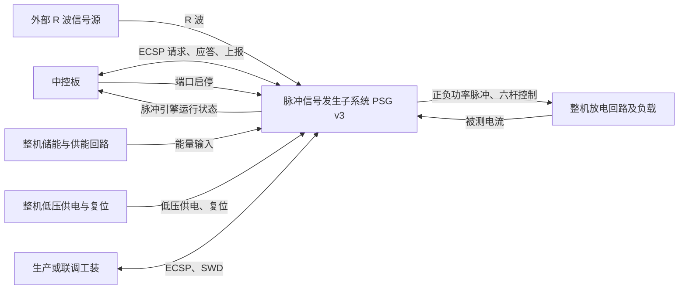
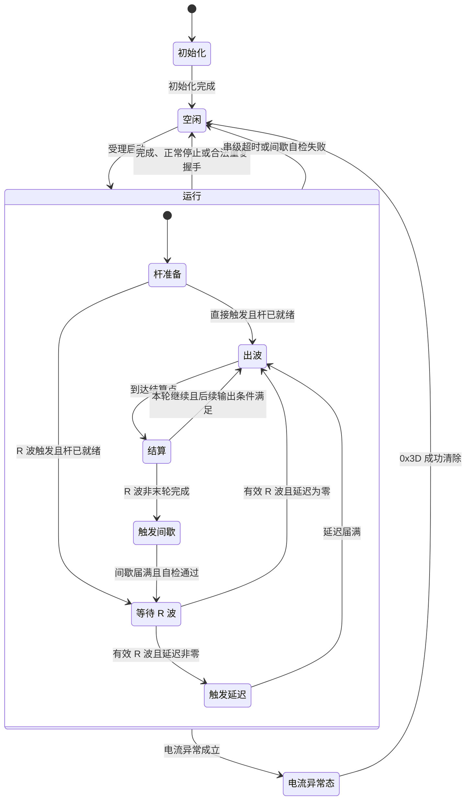

# 脉冲信号发生子系统需求规格说明书（PSG-SyRS）

状态为评审稿。适用子系统为 PSG v3。

## 1 引言

### 1.1 系统目的

PSG 为心脏脉冲电场消融整机提供受控脉冲输出。它按中控配置和指定的触发条件驱动正、负通道及六杆，采集输出电流，在停止或保护条件成立时终止输出，并提供状态与诊断数据供整机控制和维护使用。

### 1.2 系统范围

本规格适用于脉冲信号发生子系统 PSG v3。PSG 包含 MCU 及固件、通信与离散信号接口、正负脉冲调制电路、双通道电流检测、独立过流锁存保护和六杆控制接口。PSG 对实际功率输出的波形及关断负责。硬件版本和当前镜像的软件完整版本按 §2.10 识别。

中控业务决策、掉线判定、外部 R 波生成、储能控制、整机负载及人机界面由整机或相应外部单元负责。PSG 的低功耗、在线升级和远程系统自检命令支持范围以板卡符合性矩阵为准。供能、回流、功率输出、反馈测点和六杆执行回路的板级部署按 PSG-23 确认。 [整机拓扑](../spec/product-cardiac-pfa.md#1-整机拓扑与链路角色) · [板卡符合性矩阵](../spec/board-pulse-gen.md#6-符合性矩阵) · [PSG-SyAS](../design/psg-subsystem-architecture.md#1-子系统边界)

### 1.3 系统概述

#### 1.3.1 系统上下文

下图表示外部交互及功能方向。功率端子、供能回流和六杆执行位置按批准的整机电气图确认。

#### 1.3.2 系统功能摘要

PSG 校验配置与启动条件，按直接或 R 波触发执行序列，控制实际功率波形及六杆选通。它采集双通道电流，按串判定欠流并处理过流、端口停止及复位，向中控发布运行状态、计数、电流和故障信息，并提供设备标识维护。

#### 1.3.3 用户特征

整机操作员通过整机人机界面发起业务操作，由中控板向 PSG 下发命令。生产、联调和维护人员按板卡协议和工装规程读写设备标识，检查报文、板载 LED、复位原因及测试波形。相关维护任务需要串口诊断、板卡接口和台架操作能力。

### 1.4 定义、首字母缩略词和缩写

| 缩写或术语 | 定义 |
| --- | --- |
| PSG | 脉冲信号发生子系统。 |
| SyRS / SyAS | 子系统需求规格说明书 / 子系统体系结构规格说明书。 |
| BRS / StRS / ConOps | 商业需求规格 / 干系人需求规格 / 运行概念。 |
| SRS / HRS | 软件需求规格 / 硬件需求规格。本项目的 SRS 对应 PSG 固件。 |
| ECSP | 本项目的板间串行通信协议。 |
| RVM / RTM | 需求验证矩阵 / 需求追溯矩阵。 |
| SWD | 串行线调试接口。 |
| N/A / TBD / TBR | 不适用 / 待确定 / 待评审确认。 |

脉冲持续时间、过渡出现时刻、触发间歇、出波、齐样、过流锁存及电流异常态按[项目术语表](../../GLOSSARY.md)使用。

### 1.5 参考资料

- 整机边界、链路角色、地址和版本以产品通信配置为依据。BRS、StRS 和 ConOps 的正式文档号及适用条款待产品方提供。 [产品通信配置](../spec/product-cardiac-pfa.md)
- 外部协议的物理层、帧、命令、会话和应答以适用的通用规范及板卡实例为依据。 [ECSP 通用规范](../spec/ecsp-general.md) · [PSG 板卡协议](../spec/board-pulse-gen.md)
- 软件分配、板级接口和验收用例见下游文件。正式 HRS 文档号及条款见附录 B。 [PSG-SyAS](../design/psg-subsystem-architecture.md) · [固件 SRS](../srs/pulse-gen-firmware.md) · [MCU 引脚表](../hw/mcu-pinmap.md) · [验收用例](../verification/firmware.md)
- 安全分析、法规分配及待批准的测量条件见附录 B。已裁决与待补的工程输入以疑点记录为依据。 [文档疑点与待补项](../ambiguities.md)

## 2 系统需求

本章的 SYS 条款规定 PSG 应交付的行为、对外接口及可观测的验收结果。接口信号的 MCU 绑定、实时任务预算、采样实现和器件关断路径由下游规格分配。各条的优先级、验证方法和依据分别见 §3 和附录 C。

### 2.1 功能需求

| ID | 子系统需求 |
| --- | --- |
| SYS-01 | PSG 应支持协议或端口启停与直接或 R 波触发的四种组合。常规启动和中途停止仅由当前配置的启停输入源发起。 |
| SYS-02 | PSG 应仅在空闲、电流异常已清除、过流联锁满足且出波前自检通过时受理启动。启动需要已成功配置两路输出电压、两路电流阈值和序列参数，R 波触发还需要有效的触发参数。运行设置被拒绝时，应保持涉及的配置和物理杆状态。 |
| SYS-03 | 采用直接触发时，PSG 应在受理启动且完成适用的杆准备后执行一次序列。 |
| SYS-04 | 采用 R 波触发时，PSG 应在完成杆准备后进入等待阶段。每个等待阶段的有效 R 波正向过渡应触发一轮，直至完成配置的 1–300 轮。每轮接受 0–300 ms 触发延迟，非末轮之间接受 200–2000 ms 触发间歇。间歇内应忽略 R 波并执行出波前自检。 |
| SYS-05 | PSG 应按合法配置在实际功率回路输出正单极性、负单极性或双极性脉冲。每路非零目标脉冲持续时间为 200–5000 ns，目标为零的通道应无脉冲，两路同时为零应拒绝。序列支持 1–20 群、每群 1–300 串、每串 1–256 个相同波形的重复单元。脉冲串间隔为 1–100 ms，脉冲群间隔为 50–10000 ms。脉冲间隔与极性间间隔的配置范围按板卡协议 0x34，杆对循环另受 SYS-06 约束。 |
| SYS-06 | PSG 应逐路控制 A 至 F 六杆。杆对循环未启用时应按杆选通配置执行，初始化的默认选通按 SYS-26。启用杆对循环时，正常空闲为 AB，每群从 AB 起按 AB、CD、EF、BC、FA、DE 循环，每串仅导通一对，且每群串数为 6 的倍数。异常时的杆状态按 SYS-32。 |
| SYS-07 | PSG 应获得每个非零功率输出脉冲的同通道有效电流测量值，覆盖最短非零脉冲。测量结果应归属实际发生的脉冲串，禁用通道不参与电流结算。 |
| SYS-08 | PSG 应以各参与通道的串内有效样本均值判定欠流。任一路欠流应终止运行并停止两路。下一串截止时缺样、未完成判定或启动条件未生效，应终止运行、禁止下一串并保留失约诊断。 |
| SYS-18 | PSG 应作为 ECSP 从机建立会话，提供所支持的配置、控制、状态查询及主动上报。应按协议校验帧、会话、参数和状态。应按事务规则处理重传并避免重复执行非幂等动作。 |
| SYS-28 | PSG 应提供双通道状态与电流、已完成触发次数及故障字。计数仅包含完成的序列。普通电流与异常诊断分别按对应样本口径发布，查询、上报和清除按板卡协议执行。 |

[板卡命令总表](../spec/board-pulse-gen.md#31-命令总表) · [序列参数 0x34](../spec/board-pulse-gen.md#0x34-设置序列参数设置类) · [板卡状态矩阵](../spec/board-pulse-gen.md#命令状态矩阵)

### 2.2 可用性需求

| ID | 子系统需求 |
| --- | --- |
| SYS-29 | PSG 应通过状态输出向中控指示脉冲引擎的运行状态，运行时为高电平，空闲和电流异常态为低电平。板载 LED 应在初始化后每隔标称 1000 ms 翻转一次，实板误差带见 PSG-20。 |

配置操作防错见 SYS-02 和 SYS-18。面向整机操作员的界面、学习曲线及无障碍访问要求为 N/A。

### 2.3 性能需求

| ID | 子系统需求 |
| --- | --- |
| SYS-09 | 实际功率输出的脉冲持续时间相对目标值的误差应在 ±(目标值的 2% + 20 ns) 内，标定外推点还应满足 ±5%。脉冲持续时间以两次过渡的 50% 参考电平出现时刻之差计。 |
| SYS-10 | 实际功率输出的脉冲间隔及极性间间隔相对配置值的误差应在 ±(配置值的 1% + 50 ns) 内。 |
| SYS-11 | 实际功率输出的脉冲串间隔相对配置值的误差应在 ±(配置值的 1% + 10 µs) 内。 |
| SYS-12 | 脉冲群间隔、非零触发延迟及触发间歇相对配置值的误差应同时满足 ±1 ms 和 ±(配置值的 1%)。群间隔在实际功率输出测量，触发延迟从有效 R 波计至本轮首个脉冲间隔开始，触发间歇从非末轮完成计至再次等待 R 波。0 ms 触发延迟应在有效 R 波后立即开始本轮首个脉冲间隔，可测判据见 PSG-24。 |
| SYS-13 | 出波使用新导通的杆前，应满足 1 µs 导通等待。首轮等待 R 波前也应完成适用的杆准备。脉冲窗口内不得切换杆。 |
| SYS-14 | 电流测量误差应在 ±(读数的 2% + 0.2 A) 内。验收同步记录参考电流、实际功率波形和电流反馈测点。 |
| SYS-15 | 同一群内，只有上一串齐样、判定允许且放行条件在原定开始前已满足，下一串才应按原定时序启动。最坏适用负载下，群级结算从等待数据至结算完成的总用时应小于 50 ms 且小于最短群间隔。 |
| SYS-30 | 在有效运行配置及适用通信、日志和标识写入负载下，已开始的出波应持续满足规定的波形、时序及串级截止条件。 |
| SYS-34 | 上电至首帧握手上报发送完成应 ≤500 ms。会话已连接且链路持续空闲时，心跳以最近一帧发送完成为基准，目标间隔为 1000 ms。半包超时为 50 ms，应答时限按 ECSP 和板卡覆盖规则，其中获取、设置、动作及握手默认 ≤50 ms，0x03 和 0x05 首次应答 ≤3000 ms，0x07 应答 ≤50 ms。心跳实板误差及故障上报时限见 PSG-20。 |

[ECSP 应答时限](../spec/ecsp-general.md#61-命令应答时限) · [心跳监控](../spec/ecsp-general.md#62-心跳监控) · [半包计时](../spec/ecsp-general.md#半包计时与重新同步)

### 2.4 系统接口

| ID | 子系统需求 |
| --- | --- |
| SYS-33 | PSG 与中控的 ECSP 链路应支持 3.3 V TTL UART、115200 bps、8 数据位、1 停止位、无校验、无流控。应使用产品地址 0x03、PSG 地址 0x02，遵循 ECSP 帧结构、CRC 和载荷编码，并支持板卡协议规定的帧长上限，其中请求、应答和上报分别为 449、450 和 22 字节。 |

表中 MCU 引脚编号供联调定位。连接器和整机接线按适用板卡版本确认。

| 接口 | 方向及约定 | 对应条款 |
| --- | --- | --- |
| ECSP 控制与诊断 | 中控板 ↔ PSG。中控发起请求，PSG 应答或按协议主动上报。命令载荷、应答码及支持项见板卡协议。 | SYS-18～SYS-20、SYS-28、SYS-31、SYS-33～SYS-34 |
| 端口启停输入 | 中控板 → PSG。选定端口启停时，正向过渡请求启动，负向过渡触发停止。MCU 绑定 PB4。 | SYS-01～SYS-02、SYS-23～SYS-24 |
| 脉冲引擎运行状态输出 | PSG → 中控板。高电平表示运行，含等待 R 波及结算等阶段。MCU 绑定 PB5。 | SYS-29 |
| R 波输入 | 外部 R 波信号源 → PSG。完成杆准备且处于等待 R 波时，正向过渡有效。MCU 绑定 PB6。 | SYS-04、SYS-12～SYS-13 |
| 功率与电流反馈 | 整机供能 → PSG 调制电路 → 放电回路。电流检测关联实际载流支路。供能、回流、负载及测点见 PSG-23。 | SYS-05、SYS-07、SYS-09～SYS-17、SYS-23 |
| 六杆控制 | PSG → 六杆执行回路。接口逐路对应 A 至 F，执行器件的部署按 PSG-23 确认。 | SYS-06、SYS-13、SYS-26、SYS-32 |
| 供电与复位 | 整机低压供电与复位链路 → PSG，适用边界见 PSG-21。 | SYS-26 |
| 维护 | 生产或联调工装 ↔ PSG。ECSP 用于设备标识和诊断，SWD 用于烧写、调试及检查复位原因。 | SYS-21、SYS-28、SYS-31 |

离散接口的连接器、引脚配对、信号电平门限、负载及有效输入的时序限制见附录 B。 [产品链路配置](../spec/product-cardiac-pfa.md#3-psg-链路配置) · [ECSP 帧与编码](../spec/ecsp-general.md#2-帧与编码) · [板卡帧长上限](../spec/board-pulse-gen.md#帧长和载荷上限) · [MCU 引脚分配](../hw/mcu-pinmap.md#1-引脚分配)

### 2.5 系统运行

| ID | 子系统需求 |
| --- | --- |
| SYS-16 | 任一通道过流检出后，PSG 应在 ≤1 µs 内停止两路实际功率输出。 |
| SYS-17 | 任一路独立过流锁存成立后，PSG 应在 ≤10 µs 内停止两路实际功率输出。两路锁存阈值均固定为 90 A，运行配置不得修改阈值或屏蔽保护。 |
| SYS-20 | PSG 应在合法重复握手时终止原运行，使序列、输出电压和电流阈值的旧配置失效，恢复会话默认项，保留规定的故障锁存、电流异常记录和非易失数据，并在处理完成后成功应答且保持已连接。重新出波应满足 SYS-02 并受理新的启动。 |
| SYS-23 | 在端口启停模式下，自端口停止输入的有效负向过渡起，PSG 应按批准的端到端时限和停止判据停止两路实际功率输出，并封锁后续脉冲。时限、测量判据及适用工况见 PSG-03。 |
| SYS-24 | 端口停止的关断及持续封锁应独立于任务和中断调度。端口停止与过流并发时，PSG 应保留过流来源及其运行归属。 |
| SYS-25 | 比较器过流检出和独立过流锁存触发的两路关断均应独立于任务和中断调度。运行中过流后，PSG 应保持停止直至异常清除成功。系统复位应按 SYS-26 进入安全初始化。任何重新出波均须满足 SYS-02 并受理新的启动。 |
| SYS-26 | 上电及复位期间，从板级具备驱动能力起至初始化完成，两路实际功率输出应无脉冲。PSG 应在初始化时恢复上电默认配置，默认选通为六杆全通，正常初始化完成前应应用该选通，无需等待 ECSP 握手。异常时的杆状态按 SYS-32，重新受理启动须满足 SYS-02。适用供电、复位工况见 PSG-21。 |
| SYS-27 | 超过获批的无主机控制连续输出上限时，PSG 应自行停波并进入规定的安全态。适用模式、识别或起算条件、轮数或时长上限、安全态和恢复条件见 PSG-19。 |
| SYS-32 | 正常中途停止时，PSG 应停止后续输出并回到空闲，未完成轮不计数。欠流时应六杆全断。过流时应停止杆对循环并保持停波时的杆驱动状态，按异常清除流程恢复。故障字 bit0 置位时，应执行协议和固件基线规定的启动联锁及杆保持规则。 |

降级运行模式和独立维护运行模式为 N/A。维护活动按 §2.4、§2.10 和 §2.12 执行，保护停波及安全恢复按本节执行。 [板卡重复握手](../spec/board-pulse-gen.md#重复握手与恢复) · [故障字](../spec/board-pulse-gen.md#4-故障字位分配) · [SRS 异常与安全需求](../srs/pulse-gen-firmware.md#5-异常与安全需求e-)

### 2.6 系统模式和状态

启停输入源和触发模式分别配置，组合见 SYS-01。脉冲引擎以空闲、运行和电流异常态作为业务状态。启动后的杆准备属于运行，后续适用阶段包括等待 R 波、触发延迟、出波、结算和触发间歇。上电或复位时先经过安全初始化窗口。

- 任一状态下发生系统复位时，均转入安全初始化。合法重复握手结束原运行并按 SYS-20 保留电流异常记录。故障字 bit0 置位时，即使处于空闲也阻止受理启动。
- ECSP 会话状态独立于脉冲引擎。上电或系统复位后按协议建立会话，合法重复握手按 SYS-20 恢复业务条件。
- 硬件输出封锁独立于业务状态。无主机控制超限后的安全态及其恢复迁移待 PSG-19 批准。

### 2.7 物理特征

TBD。适用板卡或组件的尺寸、重量、安装边界、连接器位置、供电及功耗上限、材质和散热约束由产品方及硬件责任方提供。供能和负载边界、供电与复位工况分别见 PSG-23 和 PSG-21。

### 2.8 环境条件

TBD。适用的工作与存储温湿度、海拔、振动冲击、外壳防护分配及 EMC 试验条件由整机环境规格分配到 PSG，并明确受试构型、负载和通过判据。

### 2.9 系统安全性

独立的信息安全和网络安全条款为 N/A。接口数据完整性、会话与命令准入、事务去重及标识持久化校验分别见 SYS-18、SYS-31 和 SYS-33。功能安全及停波要求见 §2.5。

### 2.10 信息管理

| ID | 子系统需求 |
| --- | --- |
| SYS-19 | PSG 应通过 0x02 提供当前运行镜像的软件完整版本。本版产品基线期望值为 0.0.0.0，对应 ECSP V1.0。 |
| SYS-31 | PSG 应支持硬件版本和序列号的查询、写入、独立持久化及启动校验恢复。应保留有效记录，记录缺失或校验失败时写回对应的默认值及校验信息。软件版本和标定数据应取自当前发布镜像。非易失写入失败不得改变已生效的运行配置或标定。 |

普通电流、异常诊断和计数的清除及保留规则见 SYS-20、SYS-28 及板卡协议。产品级历史归档、隐私数据处理和备份策略为 N/A。 [产品版本](../spec/product-cardiac-pfa.md#2-地址版本与板卡规范) · [固件 SRS 标识规则](../srs/pulse-gen-firmware.md#5-异常与安全需求e-)

### 2.11 策略与法规

TBD。由产品方提供整机适用的法规、标准及内部政策清单，明确分配至 PSG 的要求、适用构型和验收证据。固件工程约束在 SRS N 类条款中管理。

### 2.12 系统生命周期保障

| ID | 子系统需求 |
| --- | --- |
| SYS-21 | PSG 应通过维护接口提供可查询的复位原因，至少支持区分看门狗复位与正常复位。 |
| SYS-22 | 任一关键控制功能持续失常时，PSG 应能自主复位，即使其他功能仍可运行。复位期间应满足 SYS-26。 |

可测试性证据见 §3。MTBF、MTTR、可用率、备品备件及维修交付要求待整机分配。

### 2.13 包装、搬运、运输与存储

N/A。当前 PSG 作为整机集成子系统，运输、搬运和包装由整机交付范围管理。PSG 的存储环境分配见 §2.8。

## 3 验证

需求验证矩阵（RVM）逐条列出适用方法及证据。方法采用分析（Analysis）、检查（Inspection）、演示（Demonstration）和测试（Test）。评审优先级按风险标为「安全优先」或「交付必需」，两类条款均是交付要求。已有用例只覆盖所列场景时，应按照同一行补齐系统级证据。

| ID | 优先级 | 验证方法 | 验证场景及证据 |
| --- | --- | --- | --- |
| SYS-01 | 交付必需 | 测试 | 覆盖四种启停与触发组合，验证未选中的来源及已选来源的停止。关联 TC-STOP-01、TC-STOP-02。 |
| SYS-02 | 安全优先 | 测试 | 分别移除启动必需配置，注入电流异常、过流和出波前自检失败，核对拒绝、无输出及设置拒绝后的配置与杆状态。 |
| SYS-03 | 交付必需 | 演示、测试 | 受理直接启动后，记录杆准备及功率波形，验证一次序列后进入空闲。 |
| SYS-04 | 安全优先 | 测试 | 覆盖触发次数和延迟、间歇配置边界，核对有效 R 波、间歇内 R 波及自检失败的处置。 |
| SYS-05 | 交付必需 | 测试 | TC-PULSE-01 覆盖极性和零时长组合。补测群、串、重复单元和间隔的合法边界，以及实际功率输出。 |
| SYS-06 | 交付必需 | 测试 | 逐路记录杆状态，覆盖上电默认、杆选通、杆对顺序、群边界及非法串数。 |
| SYS-07 | 交付必需 | 测试 | TC-CUR-01。同步记录最短非零功率脉冲、反馈有效窗口、各脉冲的电流测量值及跨串归属。见 PSG-01。 |
| SYS-08 | 安全优先 | 测试 | 单路及双路欠流试验核对双路停止。TC-CUR-03 覆盖缺样、判定及许可迟到，核对运行终止、诊断和后续无输出。 |
| SYS-09 | 交付必需 | 测试 | TC-PULSE-01，另测标定边界与外推点。按实际功率输出 50% 参考电平计算误差，外推点同时核对两项容差。 |
| SYS-10 | 交付必需 | 测试 | 测量单、双极性重复单元的脉冲间隔及双极性极性间间隔，覆盖配置边界。 |
| SYS-11 | 交付必需 | 测试 | 测量合法边界配置及最短间隔下的功率波形。关联 TC-CUR-02。 |
| SYS-12 | 交付必需 | 测试 | 对齐实际功率输出、R 波和运行阶段记录，核对群间隔、非零触发延迟和触发间歇的双重容差。零延迟按 PSG-24。 |
| SYS-13 | 安全优先 | 测试 | 对齐杆切换、R 波与功率波形，核对导通等待及脉冲窗口内杆状态。 |
| SYS-14 | 交付必需 | 测试 | TC-CUR-01。用可溯源的参考电流测量有效窗口和读数误差。 |
| SYS-15 | 安全优先 | 测试、分析 | TC-CUR-02～TC-CUR-04。核对最短串、群间隔下的出波时刻、失约封锁及最坏负载的群级总用时和正余量。见 PSG-02。 |
| SYS-16 | 安全优先 | 测试 | TC-STOP-03。分别触发各通道比较器，测过流检出至最后一路实际功率输出停止的时间。见 PSG-12、PSG-23。 |
| SYS-17 | 安全优先 | 检查、测试 | TC-STOP-03。核对两路 90 A 固定阈值，改变运行配置后分别触发独立锁存，验证保护持续有效及双路停波时限。见 PSG-12、PSG-23。 |
| SYS-18 | 交付必需 | 测试 | 按支持声明验证握手、请求与上报，覆盖非法帧、未握手、状态拒绝及重传。TC-COM-01 覆盖事务副作用和回放。 |
| SYS-19 | 交付必需 | 检查、测试 | 将产品期望版本与发布构型核对。TC-COM-03 验证 0x02 返回当前镜像的构建版本。 |
| SYS-20 | 安全优先 | 测试 | 在运行及电流异常态分别执行合法重复握手。核对停波、旧配置失效、会话默认项、保留记录以及启动须重新受理。 |
| SYS-21 | 交付必需 | 演示、测试 | TC-RESET-02。通过维护接口分别读出看门狗与正常复位原因。 |
| SYS-22 | 安全优先 | 测试 | TC-RESET-02。逐个阻塞关键功能，保持其余功能仍可运行，记录自主复位。 |
| SYS-23 | 安全优先 | 测试、分析 | TC-STOP-02。测端口有效停止至双路实际功率停止，检查后续脉冲封锁。端到端通过条件见 PSG-03，接口测点见 PSG-23。 |
| SYS-24 | 安全优先 | 检查、测试 | 审查关断及保持路径，使用 TC-STOP-02 覆盖延迟软件处理、紧邻后续置位事件及过流并发，核对持续封锁和过流归属。见 PSG-22。 |
| SYS-25 | 安全优先 | 检查、测试 | 审查两条硬件停波路径，以 TC-STOP-03 验证无需软件响应即可关断、异常清除前持续停止以及清除后需新启动。 |
| SYS-26 | 安全优先 | 测试 | TC-RESET-01。在批准的冷上电、外部、调试器、软件、看门狗及欠压复位工况中，确认初始化窗口内双路功率无脉冲。保持 ECSP 未连接，确认正常初始化完成前应用六杆全通并恢复默认配置。见 PSG-21。 |
| SYS-27 | 安全优先 | 分析、测试 | PSG-19 批准后，在各适用模式下撤销主机控制，验证起算、超限停波、安全态及恢复。 |
| SYS-28 | 交付必需 | 测试 | 核对正常完成、中途停止、欠流、过流、串级超时和异常清除前后的 0x31、0x3C 与 0x11/0x12。关联 TC-CUR-03、TC-STOP-03、TC-COM-02。 |
| SYS-29 | 交付必需 | 测试 | 同步记录运行各阶段及空闲、电流异常时的状态电平，测量板载 LED 相邻翻转间隔。见 PSG-20。 |
| SYS-30 | 安全优先 | 测试 | 在适用的通信积压、坏帧、日志和标识擦写负载下测量实际功率输出与串级截止。关联 TC-CUR-02、HW-04。 |
| SYS-31 | 交付必需 | 检查、测试 | TC-COM-03，另覆盖正常写入、格式拒绝、写入失败以及重新上电后的持久化、校验和默认记录修复。 |
| SYS-32 | 安全优先 | 测试 | TC-STOP-01～TC-STOP-03，另注入欠流和 bit0 联锁。同步核对两路输出、杆状态、计数及异常清除恢复。 |
| SYS-33 | 交付必需 | 检查、测试 | 核对链路两端配置，测量信号及帧，验证地址、CRC、编解码、命令定长或变长限制及最大请求、应答和上报。 |
| SYS-34 | 交付必需 | 测试 | 记录上电首帧、各类时限和半包重同步。TC-COM-02 覆盖空闲心跳和故障上报，另核对 0x03、0x05 和 0x07 的特定时限。见 PSG-20、HW-04、HW-05。 |

验证记录应关联需求、用例、板卡版本、固件提交、运行配置、供电、负载、测点、仪器及原始波形或报文。待批准的限值、工况或测点缺失时，可以记录实测结果，验收结论待输入和证据齐备后签署。 [已有验收用例](../verification/firmware.md) · [文档疑点与待补项](../ambiguities.md)

## 附录 A 假设与依赖关系

- 中控板是 PSG 链路的 ECSP 主机，负责期望版本核对、版本不符处置及掉线判定。掉线后由中控发起合法重复握手，PSG 按 SYS-20 响应。无主机控制连续输出的本地保护按 SYS-27 处理。 [产品版本不符处置](../spec/product-cardiac-pfa.md#4-版本不符处置) · [ECSP 心跳监控](../spec/ecsp-general.md#62-心跳监控)
- 整机应提供与 PSG 接口兼容的启停、R 波、供能、供电与复位条件。储能控制板是独立通信节点，功率回路接线和验收负载以整机发布构型为准。 [产品拓扑](../spec/product-cardiac-pfa.md#1-整机拓扑与链路角色) · [PSG-SyAS 系统边界](../design/psg-subsystem-architecture.md#1-子系统边界)
- 系统验收须使用适用的 PSG 板卡、发布固件、标定数据及获批测点。MCU 驱动、状态与关断波形可用于分段验证，实际功率输出要求以规定的功率测点判定。 [PSG-SyAS 时序责任](../design/psg-subsystem-architecture.md#6-时序责任)

## 附录 B 待定项列表

PSG、HW 和整机 A 编号沿用项目疑点登记。评审批注、批准依据和关闭证据以该登记为准。 [文档疑点与待补项](../ambiguities.md)

| 跟踪项 | 类别 | 影响 | 需提供的输入或证据 |
| --- | --- | --- | --- |
| PSG-01、PSG-02 | TBR | SYS-07、SYS-14～SYS-15 | 最短非零脉冲的实际功率和有效采样窗、样本归属，以及最短串和群间隔的最坏用时与余量。 |
| PSG-03、PSG-22 | TBD / TBR | SYS-23～SYS-24 | 批准端口至实际功率的停止判据、上限及适用工况，确认后续置位被持续封锁。 |
| PSG-12、PSG-23、HW-02 | TBR | SYS-05～SYS-07、SYS-09～SYS-17、SYS-23～SYS-26 | 提供适用板卡版本的电气图、接口和测点表，核对独立锁存关断保持路径与比较器故障输入配置，并提交两条过流路径的双路停波波形。 |
| PSG-19 | TBD | SYS-27 | 批准无主机控制的识别或起算条件、适用模式、连续轮数或时长上限、安全态及恢复条件。 |
| PSG-20 | TBD | SYS-28～SYS-29、SYS-34 | 批准空闲心跳误差带、故障字新置位至 0x11 起始位的最大时限及负载条件，并单独批准 LED 翻转误差带。 |
| PSG-21 | TBD / TBR | SYS-26、§2.4、§2.7 | 批准供电边界、上电斜率、欠压及调试器复位工况，提交双路功率输出及六杆切换至默认选通的同步波形。 |
| PSG-24 | TBD | SYS-12 | 批准 0 ms 触发延迟的可测起止事件、可接受的实际延迟及适用负载。 |
| HW-04、HW-05 | TBR | SYS-30、SYS-34 | 提交标识擦写期间实板时序及应答数据、半包计时实测误差和验收误差带。 |
| 整机 A-09～A-11、A-15 | TBD | §2.4、附录 A | 提供整机上电顺序、就绪窗口、通信时限或会话覆盖，以及整机失败处置策略。现行 PSG 契约以产品通信配置和 ECSP 基线为准。 |
| 离散信号接口 | TBD | §2.4 | 批准连接器端子、信号门限、负载、输入时序及适用板卡版本。 |
| 上游正式基线与硬件分配 | TBD | §1.5、附录 C | 提供 BRS、StRS、ConOps 的文档号与适用需求 ID，以及 HRS 和硬件接口控制文件的版本及条款号。 |
| 物理、环境及法规适用项 | TBD | §2.7、§2.8、§2.11 | 由产品方分配安装、功耗、散热、环境、适用法规标准及验证条件。 |
| 可靠性和维修保障 | TBD | §2.12 | 明确 MTBF、MTTR、可用率及备品备件的适用范围、指标和验证方式。 |

## 附录 C 需求双向追溯矩阵

上游列记录每项需求目前可查的项目依据。正式 StRS 条款 ID 为 TBD，整机通信配置、协议和评审裁决提供当前追溯起点。下游 SRS 条款按 ID 映射。硬件列给出当前 SyAS/接口分配，正式 HRS 条款 ID 为 TBD。N/A 表示该行无独立硬件需求分配。

从下游反查时，可按 SRS 条款或板级分配在本矩阵定位 SYS ID，并交叉核对 SRS §7 和 SyAS §7。 [产品通信配置](../spec/product-cardiac-pfa.md) · [板卡协议](../spec/board-pulse-gen.md) · [项目裁决](../ambiguities.md#已裁决条款定位) · [SRS §7](../srs/pulse-gen-firmware.md#7-追溯矩阵) · [SyAS §7](../design/psg-subsystem-architecture.md#7-分配与集成验证)

| SyRS ID | 当前上游依据 | 下游 SRS 条款 | 下游硬件分配或接口参考 |
| --- | --- | --- | --- |
| SYS-01 | 板卡 0x30、0x32、0x3E 及状态矩阵 | F-001～F-003、F-012、F-013、I-018 | 端口启停与 R 波输入。 |
| SYS-02 | 板卡状态矩阵、PSG-04、PSG-18 | F-004、F-016、I-011、E-002、E-003 | 启停输入、过流检出及锁存联锁。 |
| SYS-03 | 板卡 0x30、0x32 的直接触发 | F-005、F-011、F-031 | 杆控制与功率执行。 |
| SYS-04 | 板卡 0x32、0x36、PSG-18 | F-006～F-011、F-031、I-014、E-003 | 外部 R 波、杆控制与锁存自检。 |
| SYS-05 | 板卡 0x34、0x35；功率接口待补 PSG-23 | F-017～F-026、I-013 | 定时、正负脉冲调制及负载接口。 |
| SYS-06 | 板卡 0x40～0x43、PSG-12 | F-027～F-034、F-048～F-050、I-019、I-020 | 六杆控制接口。 |
| SYS-07 | 采样验收裁决 PSG-01、PSG-13 | F-035～F-038、T-007 | 电流检测与采样。 |
| SYS-08 | 板卡 0x38、PSG-01、PSG-08 | F-038、F-039、F-041～F-043、F-045～F-047 | 电流检测及按条件放行后续功率输出。 |
| SYS-09 | 标定与时序裁决 PSG-11 | F-024、F-025、T-001、T-006、T-009 | 定时及实际功率输出。 |
| SYS-10 | 板卡 0x34、PSG-11 | F-020、T-002、T-009 | 定时及实际功率输出。 |
| SYS-11 | 板卡 0x34、PSG-01 | F-021、T-003、T-009 | 定时及实际功率输出。 |
| SYS-12 | 板卡 0x34、0x36、PSG-24 | F-008、F-009、F-021、T-004 | R 波输入、定时及实际功率输出。 |
| SYS-13 | 板卡杆对循环和杆选通基线 | F-031～F-033 | 六杆驱动及导通时序。 |
| SYS-14 | 电流测量验收 PSG-01；现有误差基线 SRS T-007 | F-035、T-007 | 电流检测与采样。 |
| SYS-15 | 串级截止及群级总预算裁决 PSG-01、PSG-02 | F-038～F-042、T-003、T-004 | 采样交接及下一串输出封锁。 |
| SYS-16 | 过流时限裁决 PSG-12 | E-001、T-005 | 比较器至双路实际功率关断。 |
| SYS-17 | 板卡 0x38、PSG-12 | I-015、E-001、E-010、T-005 | 90 A 独立锁存至双路实际功率关断。 |
| SYS-18 | 产品链路角色、ECSP 会话和事务、板卡符合性矩阵 | I-006、I-007、I-010～I-012、I-017、I-022、I-026、I-028、I-029 | ECSP 通信接口。 |
| SYS-19 | 产品通信配置 §2、ECSP 0x02、PSG-07 | I-010、I-024 | N/A |
| SYS-20 | 板卡重复握手、PSG-05、PSG-17 | I-012、E-004、E-005 | 停止原运行所需的双路输出封锁。 |
| SYS-21 | 现有维护基线 SRS E-008-C、TC-RESET-02 | E-008-C、I-027 | SWD 和硬件复位原因。 |
| SYS-22 | 现有复位保障基线 SRS E-008、TC-RESET-02 | E-008-A、E-008-B | 独立看门狗与复位。 |
| SYS-23 | 板卡状态矩阵、PSG-03 | F-012-B、T-005-B | 端口输入至双路实际功率关断。 |
| SYS-24 | 端口停止独立性及并发裁决 PSG-03、PSG-22 | F-012-B、F-012-D、T-005-A | 端口硬件关断、持续封锁及过流事件采集。 |
| SYS-25 | 过流保护及保持裁决 PSG-12、PSG-23 | E-001～E-005、E-010、I-021 | 两条过流硬件关断及保持路径。 |
| SYS-26 | 上电与复位安全输入 PSG-21、PSG-07，板卡 0x42、0x43 的默认选通 | E-006、E-009、F-033 | 初始化期间双路功率输出封锁及六杆默认选通。 |
| SYS-27 | 安全裁决 PSG-19 | TBD，待 SRS 分解 | 安全态和输出封锁分配待 PSG-19 批准。 |
| SYS-28 | 板卡 0x11、0x12、0x31、0x3C、0x3D 及 PSG-08、PSG-09、PSG-17 | F-043～F-047、I-021、I-028、E-004 | 状态及故障上报链路。 |
| SYS-29 | 状态指示裁决 PSG-06、PSG-20 | F-014、F-015 | 中控运行状态输出和板载 LED。 |
| SYS-30 | 出波不受通信和日志扰动的时序基线、PSG-16、HW-04 | T-008、N-003～N-005 | 定时、通信收发、标识存储。 |
| SYS-31 | ECSP 0x02～0x06、PSG-07、PSG-10 | I-024、E-007、E-009、F-026 | 非易失标识存储。 |
| SYS-32 | 正常停止以及欠流和过流处置、PSG-09、PSG-12、PSG-18 | F-012、F-028、F-042、F-044、E-003～E-005、I-021 | 双路关断及六杆物理状态。 |
| SYS-33 | 产品通信配置 §2、§3，ECSP §2，板卡帧长限制 | I-001～I-006、I-025 | UART 物理层及发布构型的协议口。 |
| SYS-34 | ECSP §4～§6、板卡链路基线、PSG-14、PSG-20 | I-008、I-009、I-023、I-028、T-010、T-011 | UART 收发及实板计时。 |
