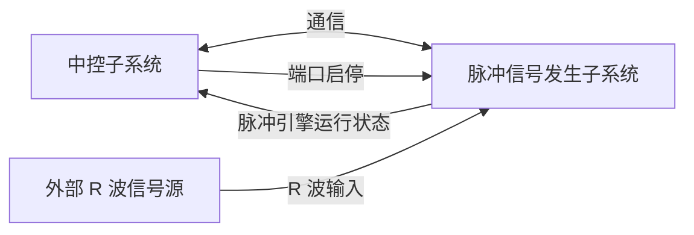
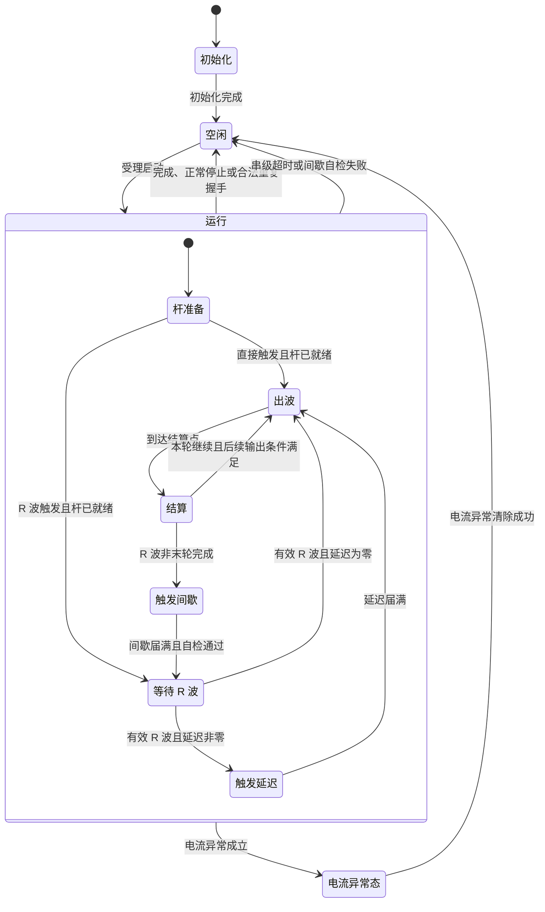

# 脉冲信号发生子系统需求规格说明书（PSG-SyRS）

## 1 引言

### 1.1 系统目的

脉冲信号发生子系统用于为心脏脉冲电场消融整机提供受控脉冲输出。它接受中控子系统的配置驱动双通道脉冲输出、控制六杆选通、采集脉冲输出电流、在停止或保护条件成立时终止脉冲输出以及提供状态与诊断数据供中控子系统使用。

### 1.2 系统范围

本规格规定 PSG 对整机交付的功能、性能、外部接口和验收要求。PSG 负责双通道功率脉冲输出和关断、电流测量与保护、六杆选通，以及与中控、外部 R 波信号源和维护工装的交互。子系统单元、软硬件责任及器件实现见 [PSG-SyAS](../design/psg-subsystem-architecture.md#2-单元与责任)。

### 1.3 系统概述

#### 1.3.1 系统上下文

下图表示系统外部交互及功能方向。

#### 1.3.2 系统功能摘要

脉冲信号发生子系统校验中控子系统的配置与启动条件，按直接或 R 波触发输出脉冲序列，控制实际功率波形及六杆选通。它采集双通道电流并判定欠流与过流，向中控子系统提供运行状态、计数、电流和故障信息，并提供设备标识维护。

#### 1.3.3 用户特征

整机操作员通过整机人机界面发起业务操作，由中控板向 PSG 下发命令。生产、联调和维护人员按适用接口规范及工装规程读写设备标识，核对通信报文、本地指示、复位原因和测试波形。

### 1.4 定义、首字母缩略词和缩写

| 缩写或术语 | 定义 |
| --- | --- |
| PSG | 脉冲信号发生子系统。 |
| SyRS / SyAS | 子系统需求规格说明书 / 子系统体系结构规格说明书。 |
| SRS | 软件需求规格说明书 |
| RVM / RTM | 需求验证矩阵 / 需求追溯矩阵。 |
| N/A / TBD / TBR | 不适用 / 待确定 / 待评审确认。 |

### 1.5 参考资料

- 整机链路角色、地址、版本和当前构型见 [产品通信配置](../spec/product-cardiac-pfa.md)。
- 当前接口的会话、报文和板卡功能见 [ECSP 通用规范](../spec/ecsp-general.md) 与 [PSG 板卡协议](../spec/board-pulse-gen.md)。
- 系统边界内的软硬件分配与实现见 [PSG-SyAS](../design/psg-subsystem-architecture.md)。待批准的接口与验收输入见 [文档疑点与待补项](../ambiguities.md)。

## 2 系统需求

### 2.1 功能需求

#### 2.1.1 启停控制功能需求

| ID | 描述 | 验证方法 |
| --- | --- | --- |
| SYS-001 | 当处于空闲状态且通过通信接口接收到来自中控的有效“设置启停控制源”命令时，PSG 应将启停控制源设置为指定的通信控制或端口控制（上电默认值为端口控制）。 | T |
| SYS-002 | 当处于空闲状态且通过通信接口接收到来自中控的有效“设置输出触发模式”命令时，PSG 应将输出触发模式设置为指定的直接触发或 R 波同步触发（上电默认值为直接触发）。 | T |
| SYS-003 | 当 PSG 未处于空闲状态时若接收到更改启停控制源或输出触发模式的命令时，PSG 应拒绝修改并向中控返回拒绝响应码。| T |
| SYS-005 | 当启停控制源为通信控制且处于空闲状态时，若通过通信接口接收到中控的“启动命令”时，PSG 应产生内部启动请求事件，并在接收到“停止命令”时产生内部停止请求事件（此模式下忽略端口输入的过渡信号） | T |
| SYS-006 | 当启停控制源为端口控制且处于空闲状态时，若检测到物理启停端口输入的正向过渡，PSG 应产生内部启动请求事件，并在检测到端口的负向过渡时产生内部停止请求事件（此模式下忽略通信启停命令）。 | T |
| SYS-007 | 当 PSG 处于运行状态时，一旦从当前生效的启停控制源接收到“停止请求”（即收到通信停机命令，或端口控制模式下检测端口输入的负向过渡），PSG 应在 ≤ 10 ms 内终止输出或取消 R 波等待，立即返回空闲状态。 | T |
| SYS-008 | 当输出触发模式为直接触发时且 PSG 处于空闲状态时，一旦产生内部启动请求事件，PSG 应在 ≤ 5 ms 内立即进入【运行状态】并开始输出。 | T |
| SYS-009 | 当输出触发模式为R波同步触发且 PSG 处于空闲状态时，一旦产生内部启动请求事件，PSG 应在 ≤ 5 ms 内进入【等待触发状态】并监听 R波 同步信号，在未检测到有效 R 波信号前不得产生输出。 | T |
| SYS-010 | 当 PSG 处于【等待触发状态】时，一旦检测到有效的【R波同步信号】，B子系统 应在 【≤ 2 ms】（硬实时同步延迟指标）内立即进入【激活输出状态】并执行输出。 | T |
| SYS-011 | 当 PSG 处于【等待触发状态（Armed）】尚未检测到 R 波时，若产生内部【停机有效信号】（如 A 发送停机命令，或操作员松开硬线脚踏开关），B子系统 应在 【≤ 10 ms】 内立即退回【停机就绪状态】，取消本次待触发动作。 | T |
| SYS-012 | 当 PSG 进入【等待触发状态（Armed）】后，若连续 【≥ 3000 ms】 未检测到有效的 R 波同步信号，PSG 应退回【空闲状态】并向中控 上报“R波等待超时告警”。 | T |
| SYS-013 | 在进入【待触发状态】的瞬间，B子系统 应清除此前缓存的任何历史 R 波检测标志，仅响应进入【待触发状态】之后新到达的 R 波脉冲（防止误用旧脉冲导致打在 T 波易颤期等危险时刻）。 | T |

#### 2.1.2 R波触发模式下的需求

| ID | 描述 | 验证方法 |
| --- | --- | --- |
| SYS-014 | 当处于【停机就绪状态】时，B子系统 应支持通过 A子系统 的通信配置命令设置R波触发延迟时间：范围 0-200 ms，分辨率 1ms，默认值 0ms | T |
| SYS-015 | 当处于【停机就绪状态】时，B子系统 应支持通过 A子系统 的通信配置命令设置触发输出次数：范围 1-100 次，步进 1，默认值 0 | T |
| SYS-016 | 当处于【停机就绪状态】时，B子系统 应支持通过 A子系统 的通信配置命令设置输出后不应期：范围 0-200 ms，分辨率 1ms，默认值 0ms | T |
| SYS-016 | 当【输出触发模式】为 R波同步触发 且接收到有效启动请求时，B子系统 应将内部【已完成触发计数器（n）】清零，清除历史 R 波缓存标志，并在 【≤ 5 ms】 内进入【等待R波同步】子状态。 | T |
| SYS-016 | 当处于【等待R波同步】子状态并检测到有效 R 波触发信号时，B子系统 应立即进入【触发延迟计时】子状态；在持续等待达配置的 R波触发延迟时间（T_trig_dly）（计时误差 【≤ ±0.5 ms】）后，B子系统 应立即启动单次输出并进入【输出执行】子状态。 | T |
| SYS-016 | • 当单次输出正常结束时，B子系统 应立即停止输出并将【已完成触发计数器（n）】加 1：
	• 若 n == N_target（已达到目标触发次数），B子系统 应在 【≤ 10 ms】 内自动退出运行序列返回【停机就绪状态】，并向 A子系统 上报“序列输出正常完成”状态；
	• 若 n < N_target（未达到目标触发次数），B子系统 应立即进入【输出后不应期】子状态。 | T |
| SYS-016 | 当进入【输出后不应期】子状态后，B子系统 应保持输出关闭并持续计时达配置的 输出后不应期（T_inhibit）；在 T_inhibit 计时结束瞬间，B子系统 应清除该期间内可能产生的任何 R 波硬件锁存标志，并重新进入【等待R波同步】子状态以执行下一轮触发循环。 | T |
| SYS-016 | 当 B子系统 处于【触发延迟计时】、【输出执行】或【输出后不应期】任一子状态期间，若外部再次输入 R 波脉冲信号，B子系统 应忽略该脉冲，不得重置当前正在进行的计时器或触发额外输出。 | T |
| SYS-016 | 在任意一轮循环的【等待R波同步】子状态期间，若连续等待超过 【3000 ms】 仍未检测到有效 R 波信号，B子系统 应立即终止剩余未执行的触发次数、自动返回【停机就绪状态】，并通过通信接口向 A子系统 上报“R波等待超时中止”告警及当前实际已完成的触发次数 n。 | T |
| SYS-016 | 在多轮触发循环执行的任意子状态（包括等待R波、触发延迟、正在输出或输出后不应期）中，一旦从当前生效的【启停控制源】收到停机请求（通信停机命令，或端口控制模式下硬线端口变为无效电平），B子系统 应在 【≤ 5 ms】 内立即截断当前输出、终止后续循环并返回【停机就绪状态】。 | T |

| ID | 描述 |
| --- | --- |
| SYS-01 | PSG 应允许中控通过通信接口，将启停输入源设置为通信命令或端口启停输入。 |
| SYS-02 | PSG 应允许中控通过通信接口，将脉冲输出的触发方式设置为直接触发或 R 波触发。 |
| SYS-03 | 通信命令或端口启停与直接触发或 R 波触发形成的四种组合均应可用。 |
| SYS-04 | PSG 的常规启动和中途停止应仅由当前选定的启停输入源发起。 |
| SYS-05 | PSG 应仅在空闲时受理启动。 |
| SYS-06 | PSG 应在电流异常未清除时禁止受理启动。 |
| SYS-07 | 任一通道的过流检出仍有效或独立过流锁存尚未解除时，PSG 应拒绝启动。 |
| SYS-08 | PSG 应仅在出波前自检通过时受理启动。 |
| SYS-09 | PSG 应在两路输出电压、两路电流阈值及序列参数均已成功配置时才受理启动。 |
| SYS-10 | R 波触发模式下，PSG 应仅在有效触发参数已成功配置时受理启动。 |
| SYS-11 | 运行设置被拒绝时，PSG 应保持该请求涉及的配置和物理杆状态。 |
| SYS-12 | 采用直接触发时，PSG 应在受理启动且完成适用的杆准备后执行一次序列。 |
| SYS-13 | 采用 R 波触发时，PSG 应在受理启动并完成杆准备后进入等待 R 波阶段。 |
| SYS-14 | 等待 R 波期间，每个有效 R 波正向过渡应触发一轮。 |
| SYS-15 | PSG 应支持配置并完成 1–300 轮 R 波触发。 |
| SYS-16 | R 波触发模式下，PSG 应支持配置 0–300 ms 的触发延迟，配置步进为 1 ms。 |
| SYS-17 | PSG 应支持配置 200–2000 ms 的 R 波触发间歇，配置步进为 1 ms，并将其用于非末轮与下一轮之间。 |
| SYS-18 | PSG 应忽略触发间歇内的 R 波。 |
| SYS-19 | PSG 应在触发间歇内执行出波前自检。 |
| SYS-20 | PSG 应按合法配置在实际功率回路输出正单极性、负单极性或双极性脉冲。 |
| SYS-21 | 每路非零目标脉冲持续时间应可配置为 200–5000 ns，配置步进为 1 ns。 |
| SYS-22 | 目标脉冲持续时间为零的通道应无脉冲。 |
| SYS-23 | 两路目标脉冲持续时间同时为零时，PSG 应拒绝该序列设置。 |
| SYS-24 | PSG 应支持每个序列配置 1–20 个脉冲群。 |
| SYS-25 | PSG 应支持每群配置 1–300 个脉冲串。启用杆对循环时还应满足 SYS-34。 |
| SYS-26 | PSG 应支持每串配置 1–256 个相同波形的重复单元。 |
| SYS-27 | PSG 应支持配置 1–100 ms 的脉冲串间隔，配置步进为 10 µs。 |
| SYS-28 | PSG 应支持配置 50–10000 ms 的脉冲群间隔，配置步进为 1 ms。 |
| SYS-29 | PSG 应支持配置脉冲间隔。单极性时为 1000–100000 ns，双极性时为 1000–50000 ns，两者的配置步进均为 1 ns。 |
| SYS-30 | 双极性时，PSG 应支持配置 1000–50000 ns 的极性间间隔，配置步进为 1 ns。单极性时该配置值应为 0 ns。 |
| SYS-31 | 杆对循环未启用时，PSG 应按杆选通配置使六杆全通，或仅导通 AB、CD、EF、BC、FA、DE 中选定的一对。 |
| SYS-32 | 启用杆对循环时，PSG 正常空闲时应选通 AB。 |
| SYS-33 | 启用杆对循环时，PSG 每群应从 AB 起按 AB、CD、EF、BC、FA、DE 循环，每串仅导通一对。 |
| SYS-34 | 启用杆对循环时，PSG 应只受理每群串数为 6 的倍数的配置。 |
| SYS-35 | PSG 应从每个非零功率输出脉冲获得有效的同通道电流测量值，覆盖最短非零脉冲。 |
| SYS-36 | PSG 应将电流测量结果归属实际发生的脉冲串。 |
| SYS-37 | 禁用通道不应参与电流结算。 |
| SYS-38 | PSG 应以各参与通道的串内有效样本均值判定欠流。 |
| SYS-39 | 任一路欠流时，PSG 应终止运行并停止两路输出。 |
| SYS-40 | 同群下一串截止时缺样、未完成判定或启动条件未生效，PSG 应终止运行并禁止下一串。 |
| SYS-41 | 因下一串截止条件未满足而终止运行时，PSG 应保留失约诊断。 |
| SYS-42 | PSG 应按 §2.4 的适用接口基线响应中控发起的有效会话建立请求，并进入已连接状态。 |
| SYS-43 | 会话建立后，PSG 应向中控提供适用接口基线规定的配置、控制、状态查询和主动上报功能。 |
| SYS-44 | PSG 应拒绝结构或完整性校验不符合适用接口基线的报文。 |
| SYS-45 | PSG 应按适用接口基线，根据通信会话状态决定是否受理收到的请求。 |
| SYS-46 | PSG 应校验命令参数是否满足本节规定的配置范围、取值组合约束和适用接口基线。 |
| SYS-47 | PSG 应按适用接口基线，根据当前业务状态决定是否受理命令。 |
| SYS-48 | PSG 应按适用接口基线处理事务重传，确保同一非幂等动作不重复执行。 |
| SYS-49 | PSG 应按适用接口基线向中控提供双通道状态。 |
| SYS-50 | PSG 应按适用接口基线规定的统计口径，向中控提供双通道普通电流。 |
| SYS-51 | PSG 应按适用接口基线规定的统计口径，向中控提供双通道异常诊断电流。 |
| SYS-52 | PSG 应提供已完成触发次数，计数仅包含完成的序列。 |
| SYS-53 | PSG 应允许中控按适用接口基线查询故障状态。 |
| SYS-54 | PSG 应按适用接口基线向中控主动上报设备故障。 |
| SYS-55 | PSG 应按适用接口基线处理故障清除请求。 |

#### 输出电压与电流阈值

参数按 SYS-46 校验，启动准入按 SYS-09 判定。独立过流锁存阈值见 SYS-85。

| 配置项 | 允许范围与组合约束 |
| --- | --- |
| 输出电压 | 正、负通道各为 1–4000 V，配置步进为 1 V。0 V 表示未配置。 |
| 电流检测阈值 | 正、负通道均满足 0 A < 本通道欠流阈值 < 本通道过流阈值 ≤ 90 A，四个阈值应同时设置。非有限值应拒绝。 |

[板卡命令总表](../spec/board-pulse-gen.md#31-命令总表) · [序列参数 0x34](../spec/board-pulse-gen.md#0x34-设置序列参数设置类) · [板卡状态矩阵](../spec/board-pulse-gen.md#命令状态矩阵)

### 2.2 可用性需求

| ID | 子系统需求 |
| --- | --- |
| SYS-56 | PSG 应在运行时将脉冲引擎状态输出置高，在空闲和电流异常态置低。 |
| SYS-57 | 初始化完成后，PSG 的本地指示应每隔标称 1000 ms 改变一次亮灭状态。 |

配置操作防错见 SYS-11、SYS-44～SYS-47。面向整机操作员的界面、学习曲线及无障碍访问要求为 N/A。

### 2.3 性能需求

| ID | 子系统需求 |
| --- | --- |
| SYS-58 | 实际功率脉冲持续时间误差应在 ±(目标值的 2% + 20 ns) 内。持续时间以两次过渡的 50% 参考电平出现时刻之差计。 |
| SYS-59 | 标定外推点的实际功率脉冲持续时间误差还应满足 ±5%。 |
| SYS-60 | 实际功率输出的脉冲间隔相对配置值的误差应在 ±(配置值的 1% + 50 ns) 内。 |
| SYS-61 | 实际功率输出的极性间间隔相对配置值的误差应在 ±(配置值的 1% + 50 ns) 内。 |
| SYS-62 | 实际功率输出的脉冲串间隔相对配置值的误差应在 ±(配置值的 1% + 10 µs) 内。 |
| SYS-63 | 实际功率输出的脉冲群间隔相对配置值的误差应同时满足 ±1 ms 和 ±(配置值的 1%)。 |
| SYS-64 | 非零 R 波触发延迟相对配置值的误差应同时满足 ±1 ms 和 ±(配置值的 1%)。延迟从有效 R 波计至本轮首个脉冲间隔开始。 |
| SYS-65 | R 波触发间歇相对配置值的误差应同时满足 ±1 ms 和 ±(配置值的 1%)。间歇从非末轮完成计至再次等待 R 波。 |
| SYS-66 | 触发延迟设为 0 ms 时，PSG 应在有效 R 波后立即开始本轮首个脉冲间隔。可测判据见 PSG-24。 |
| SYS-67 | 出波使用新导通的杆前，应满足 1 µs 导通等待。 |
| SYS-68 | 首轮等待 R 波前，PSG 应完成适用的杆准备。 |
| SYS-69 | PSG 在脉冲窗口内不得切换杆。 |
| SYS-70 | 电流测量误差应在 ±(读数的 2% + 0.2 A) 内。 |
| SYS-71 | 同一群内，只有上一串的有效样本齐备、判定允许继续输出且启动条件在原定开始前已满足，下一串才应按原定时序启动。 |
| SYS-72 | 最坏适用负载下，群级结算从等待数据至结算完成的总用时应小于 50 ms 且小于最短群间隔。 |
| SYS-73 | 在有效运行配置及适用通信、日志和标识写入负载下，已开始的出波应持续满足规定的波形、时序及串级截止条件。 |
| SYS-74 | PSG 上电至首帧握手上报发送完成应 ≤500 ms。 |
| SYS-75 | 会话已连接且链路持续空闲时，PSG 应以最近一帧发送完成为基准，按 1000 ms 目标间隔发送心跳。 |
| SYS-76 | PSG 应执行适用接口基线规定的报文接收超时和重新同步规则。当前构型的半包超时为 50 ms。 |
| SYS-77 | PSG 应满足适用接口基线规定的应答时限。当前构型下，获取、设置、动作及握手的默认时限为 ≤50 ms，写硬件版本和写序列号的首次应答时限为 ≤3000 ms，系统复位请求的应答时限为 ≤50 ms。 |
| SYS-78 | 从设备故障状态新置位到故障上报开始发送的时间，应满足 PSG-20 批准的上限。 |

SYS-74～SYS-78 的计时按 §2.4 的适用接口基线判定。当前构型的测量事件与报文见下列条款。

[ECSP 应答时限](../spec/ecsp-general.md#61-命令应答时限) · [心跳监控](../spec/ecsp-general.md#62-心跳监控) · [半包计时](../spec/ecsp-general.md#半包计时与重新同步)

### 2.4 系统接口需求

适用接口基线由整机下达的链路配置及配套接口规范确定。当前构型使用 ECSP。产品配置定义链路两端的物理层参数、角色和地址。通用规范及板卡协议定义会话、命令、上报、帧长和时序。 [产品通信配置](../spec/product-cardiac-pfa.md#3-psg-链路配置) · [ECSP 通用规范](../spec/ecsp-general.md) · [PSG 板卡协议](../spec/board-pulse-gen.md)

| ID | 子系统需求 |
| --- | --- |
| SYS-79 | PSG 与中控的通信接口应符合适用产品通信配置规定的链路物理层参数。 |
| SYS-80 | PSG 应按适用产品通信配置，在与中控通信时使用分配给该产品和 PSG 的地址。 |
| SYS-81 | PSG 应按适用接口基线规定的报文结构、完整性校验和载荷编码收发报文。 |
| SYS-82 | PSG 应支持适用接口基线规定的最大报文长度。当前构型的请求、应答和主动上报分别为 449、450 和 22 字节。 |

外部连接器、信号门限、负载与接线按适用板卡版本的整机接口文件确认，待定项见附录 B。板内绑定与硬件实现见 [PSG-SyAS 硬件实现与分配](../design/psg-subsystem-architecture.md#21-硬件实现与分配)。

| 接口 | 方向及约定 | 对应条款 |
| --- | --- | --- |
| 控制与诊断通信 | 中控板 ↔ PSG。中控发起请求，PSG 应答并按适用接口基线主动上报。 | SYS-42～SYS-55、SYS-74～SYS-82、SYS-87～SYS-95、SYS-116～SYS-122 |
| 端口启停输入 | 中控板 → PSG。选定端口启停时，正向过渡请求启动，负向过渡触发停止。 | SYS-01、SYS-03～SYS-05、SYS-09、SYS-96～SYS-100 |
| 脉冲引擎运行状态输出 | PSG → 中控板。高电平表示运行，含等待 R 波及结算等阶段。 | SYS-56 |
| R 波输入 | 外部 R 波信号源 → PSG。完成杆准备且处于等待 R 波时，正向过渡有效。 | SYS-13～SYS-14、SYS-18、SYS-64、SYS-66、SYS-68 |
| 功率与电流反馈 | 整机向 PSG 供能，PSG 向放电回路提供双通道功率脉冲，并测量相应的输出电流。供能、回流、负载及测点见 PSG-23。 | SYS-20～SYS-30、SYS-35～SYS-37、SYS-58～SYS-72、SYS-83～SYS-86、SYS-96～SYS-97 |
| 六杆控制 | PSG → 六杆执行回路。接口逐路对应 A 至 F，外部电气边界按 PSG-23 确认。 | SYS-31～SYS-34、SYS-67～SYS-69、SYS-106、SYS-111～SYS-113、SYS-115 |
| 供电与复位 | 整机低压供电与复位链路 → PSG，适用边界见 PSG-21。 | SYS-104～SYS-107 |
| 维护 | 生产或联调工装 ↔ PSG。提供标识维护、诊断、烧写、调试及复位原因查询所需的接口。 | SYS-49～SYS-55、SYS-117～SYS-123 |

### 2.5 系统运行

| ID | 子系统需求 |
| --- | --- |
| SYS-83 | 任一通道的可配置阈值过流检出成立后，PSG 应在 ≤1 µs 内停止两路实际功率输出。 |
| SYS-84 | 任一路独立过流锁存成立后，PSG 应在 ≤10 µs 内停止两路实际功率输出。 |
| SYS-85 | 两路独立过流锁存的阈值均应固定为 90 A，并在所有运行配置下保持该值。 |
| SYS-86 | PSG 应在所有适用运行配置下保持独立过流锁存保护有效。 |
| SYS-87 | PSG 应在收到适用接口基线规定的合法重复握手时终止原运行。 |
| SYS-88 | PSG 应在合法重复握手时使序列、输出电压和电流阈值的旧配置失效。 |
| SYS-89 | PSG 应在合法重复握手时恢复适用接口基线规定的会话默认项。 |
| SYS-90 | PSG 应在合法重复握手时保留适用接口基线规定的过流锁存状态和电流异常记录。 |
| SYS-91 | PSG 应在合法重复握手时保留适用接口基线规定的持久化数据。 |
| SYS-92 | PSG 应在合法重复握手时清零普通电流读数和已完成触发次数。 |
| SYS-93 | PSG 应在合法重复握手处理完成后发送成功应答。 |
| SYS-94 | PSG 在合法重复握手处理后应保持会话已连接。 |
| SYS-95 | 合法重复握手后，PSG 应在满足适用启动条件并受理新的启动后才可出波。 |
| SYS-96 | 在端口启停模式下，PSG 应从端口停止输入的有效负向过渡起，按 PSG-03 批准的端到端时限和停止判据停止两路实际功率输出。 |
| SYS-97 | 在端口启停模式下，端口停止生效后 PSG 应封锁后续脉冲。 |
| SYS-98 | 在端口启停模式下，PSG 应在无任务或中断响应时仍能执行有效端口停止的双路关断。 |
| SYS-99 | 在端口启停模式下，PSG 应在无任务或中断响应时仍能封锁端口停止后的后续脉冲。 |
| SYS-100 | 端口停止与过流并发时，PSG 应保留过流来源及其运行归属。 |
| SYS-101 | 可配置阈值过流检出或独立过流锁存成立时，PSG 应在无任务或中断响应时仍能关断两路输出。 |
| SYS-102 | 运行中过流后，PSG 应保持停止直至异常清除成功。 |
| SYS-103 | 过流关断后，PSG 应重新满足适用启动条件并受理新的启动后才可出波。 |
| SYS-104 | 上电及系统复位时，从功率输出具备被驱动的条件起至初始化完成，PSG 两路实际功率输出应无脉冲。 |
| SYS-105 | PSG 应在初始化时恢复上电默认配置。 |
| SYS-106 | PSG 应在正常初始化完成前应用六杆全通的默认选通，即使与中控的通信会话尚未建立。 |
| SYS-107 | 系统复位后，PSG 应重新满足适用启动条件并受理新的启动后才可出波。 |
| SYS-108 | 超过获批的无主机控制连续输出上限时，PSG 应自行停波并进入规定的安全态。适用模式、识别或起算条件、轮数或时长上限、安全态和恢复条件见 PSG-19。 |
| SYS-109 | 正常中途停止时，PSG 应停止当前运行的后续输出。 |
| SYS-110 | 正常中途停止后，PSG 应结束当前运行并回到空闲。 |
| SYS-111 | 欠流时，PSG 应六杆全断。 |
| SYS-112 | 过流时，PSG 应停止杆对循环，并保持停波时的杆驱动状态直至异常清除。 |
| SYS-113 | 运行中过流异常清除成功并回到空闲后，PSG 应恢复规定的空闲选通。杆对循环未启用时按 SYS-31，启用时按 SYS-32。 |
| SYS-114 | 过流锁存故障有效时，PSG 应禁止受理启动。 |
| SYS-115 | 过流锁存故障有效期间，PSG 应保持故障成立时的六杆选通状态。故障清除并回到空闲后，PSG 应恢复适用的空闲选通。 |

降级运行模式和独立维护运行模式为 N/A。维护活动按 §2.4、§2.10 和 §2.12 执行，保护停波及安全恢复按本节执行。 [板卡重复握手](../spec/board-pulse-gen.md#重复握手与恢复) · [故障字](../spec/board-pulse-gen.md#4-故障字位分配) · [SRS 异常与安全需求](../srs/pulse-gen-firmware.md#5-异常与安全需求e-)

### 2.6 系统模式和状态

启停输入源和触发模式分别配置，见 SYS-01～SYS-02，组合见 SYS-03。脉冲引擎以空闲、运行和电流异常态作为业务状态。启动后的杆准备属于运行，后续适用阶段包括等待 R 波、触发延迟、出波、结算和触发间歇。上电或复位时先经过安全初始化窗口。

- 任一状态下发生系统复位时，均转入安全初始化（SYS-104）。合法重复握手结束原运行并按 SYS-90 保留电流异常记录。过流锁存故障有效时，即使处于空闲也阻止受理启动（SYS-114）。
- 通信会话状态与脉冲运行状态分别判定。上电或系统复位后按适用接口基线建立会话，合法重复握手按 SYS-89、SYS-94～SYS-95 恢复业务条件。
- 保护关断和持续封锁在规定触发条件下生效。无主机控制超限后的安全态及其恢复迁移待 PSG-19 批准。

### 2.7 物理特征

TBD。适用板卡或组件的尺寸、重量、安装边界、连接器位置、供电及功耗上限、材质和散热约束由产品方及硬件责任方提供。供能和负载边界、供电与复位工况分别见 PSG-23 和 PSG-21。

### 2.8 环境条件

TBD。适用的工作与存储温湿度、海拔、振动冲击、外壳防护分配及 EMC 试验条件由整机环境规格分配到 PSG，并明确受试构型、负载和通过判据。

### 2.9 系统安全性

独立的信息安全和网络安全条款为 N/A。接口数据完整性、会话与命令准入、事务去重及标识持久化校验分别见 SYS-42～SYS-48、SYS-117～SYS-122 和 SYS-79～SYS-82。功能安全及停波要求见 §2.5。

### 2.10 信息管理

| ID | 子系统需求 |
| --- | --- |
| SYS-116 | PSG 应允许中控通过通信接口查询当前运行的软件完整版本，并按适用产品通信配置提供版本信息。 |
| SYS-117 | PSG 应支持查询硬件版本和序列号。 |
| SYS-118 | PSG 应允许中控通过通信接口按适用接口基线写入硬件版本和序列号。 |
| SYS-119 | 硬件版本和序列号应独立持久化，PSG 应在启动时保留有效记录。 |
| SYS-120 | 硬件版本或序列号记录缺失或校验失败时，PSG 应在启动时以对应默认值修复记录，使该记录在后续启动中保持有效。 |
| SYS-121 | PSG 应使用与当前固件一同发布的标定数据。 |
| SYS-122 | 持久化写入失败时，PSG 应保持已生效的运行配置和标定数据。 |

普通电流、异常诊断和计数的清除及保留规则见 SYS-50～SYS-52、SYS-55、SYS-90、SYS-92 及板卡协议。产品级历史归档、隐私数据处理和备份策略为 N/A。 [产品版本](../spec/product-cardiac-pfa.md#2-地址版本与板卡规范) · [固件 SRS 标识规则](../srs/pulse-gen-firmware.md#5-异常与安全需求e-)

### 2.11 策略与法规

TBD。由产品方提供整机适用的法规、标准及内部政策清单，明确分配至 PSG 的要求、适用构型和验收证据。固件工程约束在 SRS N 类条款中管理。

### 2.12 系统生命周期保障

| ID | 子系统需求 |
| --- | --- |
| SYS-123 | PSG 应通过维护接口提供可查询的复位原因，至少应能区分运行监控触发的自主复位与正常复位。 |
| SYS-124 | 任一关键控制功能持续失常时，PSG 应能自主复位，即使其他功能仍可运行。 |

可测试性证据见 §3。MTBF、MTTR、可用率、备品备件及维修交付要求待整机分配。

### 2.13 包装、搬运、运输与存储

N/A。当前 PSG 作为整机集成子系统，运输、搬运和包装由整机交付范围管理。PSG 的存储环境分配见 §2.8。

## 3 验证

需求验证矩阵（RVM）为每条需求单独规定验证场景、通过判据和应留存的证据。同一次试验可支持多条需求，各需求分别记录判定结果。表中引用现有用例的适用步骤，未覆盖的场景按本矩阵补测。

验证方法包括分析、检查、演示和测试。「安全优先」和「交付必需」均为交付要求。涉及命令码、状态码或报文测点的场景按当前接口构型取证。板内试验路径和测点由 PSG-SyAS 及对应验收用例定义。

### 3.1 功能需求

| ID | 优先级 | 方法 | 验证场景 | 通过判据 | 应留存的证据 |
| --- | --- | --- | --- | --- | --- |
| SYS-01 | 交付必需 | 测试 | 当前构型下，会话建立且空闲时，分别用 0x3E 设置通信命令和端口启停输入，并用 0x3F 查询。 | 两种设置均成功，0x3F 分别返回两种启停输入源。 | 两组带时间戳的 0x3E 和 0x3F 原始请求及应答。 |
| SYS-02 | 交付必需 | 测试 | 当前构型下，会话建立且空闲时，分别用 0x32 设置直接触发和 R 波触发，并用 0x33 查询。 | 两种设置均成功，0x33 分别返回直接触发和 R 波触发的配置值。 | 两组带时间戳的 0x32 和 0x33 原始请求及应答。 |
| SYS-03 | 交付必需 | 测试 | 逐一配置四种组合，读回两项配置。满足启动条件后，用选定来源启动，在运行中用该来源停止。R 波组合在等待阶段提供有效正向过渡。 | 四种组合均可配置且读回一致。每种组合均由选定来源启动及中途停止，并按选定方式触发序列。 | 四组配置读回、0x30 和 0x31 报文、端口启停与 R 波输入及双路功率输出的同步记录。停止可复用 TC-STOP-01、TC-STOP-02 的适用步骤。 |
| SYS-04 | 交付必需 | 测试 | 在两种启停配置下分别测试。空闲且启动条件齐备时，用未选定来源尝试启动。用选定来源启动后，在仍有计划输出的运行中，用未选定来源尝试停止。随后用选定来源完成对应动作作为对照。 | 未选定来源的启动保持空闲且无输出，未选定来源的停止不改变运行状态且计划输出继续。选定来源的对照动作有效。非选定的协议请求应答按板卡状态矩阵。 | 0x30、0x31 原始报文及对齐的端口输入、运行状态和双路功率波形。 |
| SYS-05 | 安全优先 | 测试 | 协议和端口启停分别在空闲与运行状态发起启动，其他启动条件齐备。运行中发起后记录至该运行完成。 | 空闲的对照启动可受理。运行中的启动请求不会重置当前运行，也不会立即或在该运行完成后发起新运行。 | 输入报文或端口边沿、运行状态与双路功率波形。 |
| SYS-06 | 安全优先 | 测试 | 两种启停源分别在电流异常态下请求启动。异常清除后，在其他条件齐备时发起新请求。 | 电流异常未清除时不受理，双路无输出。清除后的新请求可按启动条件受理。 | 故障注入记录、0x30 或端口边沿、0x31 与 0x3D 报文及双路功率波形。 |
| SYS-07 | 安全优先 | 测试 | 空闲时分别使任一通道的可配置阈值过流检出或独立锁存有效，再分别从两种启停源请求启动。 | 各过流联锁有效时均不受理启动，双路无输出。 | 两条保护路径各自的事件记录、启动输入、0x31 报文、故障字和双路实际功率波形。 |
| SYS-08 | 安全优先 | 测试 | 在其他启动条件齐备时，分别用两种启停源请求启动并使出波前自检成功或失败。 | 通过时可受理，失败时不进入运行且双路无输出。 | 自检结果、0x30 应答或端口边沿、故障字、运行状态及双路功率波形。 |
| SYS-09 | 安全优先 | 测试 | 每次省略 0x3A、0x38 或 0x34 中一类配置，分别用两种启停源请求启动，再补齐配置并发起新请求。 | 任一项缺失时不受理且双路无输出。全部齐备且其余条件满足后可受理新请求。 | 各配置写入或读回报文、启动输入、运行状态及双路功率波形。 |
| SYS-10 | 安全优先 | 测试 | 选择 R 波触发，分别在无有效 0x36 参数及成功设置后使用两种启停源发起启动。 | 无有效参数时不受理且不进入等待 R 波。配置有效且其余条件满足后，新请求可进入运行。 | 0x36 和 0x37 报文、启动输入、运行状态及双路功率波形。 |
| SYS-11 | 安全优先 | 测试 | 在板卡状态矩阵规定拒绝的条件下提交运行设置，覆盖涉及杆驱动的设置和其他受影响配置。 | 拒绝应答符合状态矩阵。前后配置读数一致，物理杆状态不因被拒请求改变。 | 设置前后读回、拒绝应答及与请求同步的六杆波形。 |
| SYS-12 | 交付必需 | 演示、测试 | 选直接触发并使用适用杆配置，受理启动后保持 R 波输入无有效边沿，让序列自然完成。 | 完成杆准备后执行恰好一次序列，随后回到空闲。 | 启动输入、六杆与双路功率同步波形及运行状态记录。 |
| SYS-13 | 安全优先 | 测试 | 受理 R 波模式启动，先不提供有效 R 波。 | 杆准备完成后进入等待 R 波阶段，等待期间双路无输出。 | 启动输入、六杆、R 波和双路功率同步波形及阶段记录。 |
| SYS-14 | 安全优先 | 测试 | 先将 R 波输入保持为高并进入等待阶段，施加负向过渡，再施加有效正向过渡。重复验证多个等待阶段。 | 有效正向过渡各启动一轮，非有效过渡不启动序列。 | R 波输入、运行阶段、双路功率波形与已完成触发次数报文。 |
| SYS-15 | 安全优先 | 测试 | 分别配置 1 轮和 300 轮，按等待阶段逐轮施加有效过渡。 | 分别完成配置的轮数后退出运行，多余 R 波不启动新一轮。 | 配置报文、逐轮触发和输出记录及 0x31 完成计数。 |
| SYS-16 | 安全优先 | 测试 | 分别设置并读回 0 ms、1 ms、300 ms，另提交 301 ms。 | 范围内的测试值均可写入并读回，301 ms 被拒绝。实际延迟按 SYS-64、SYS-66 判定。 | 0x36 和 0x37 的边界设置、超界设置及读回报文。 |
| SYS-17 | 安全优先 | 测试 | 分别设置并读回 200 ms、201 ms、2000 ms，另提交 199 ms 和 2001 ms。在多轮运行中观察间歇位置。 | 范围内的测试值均可写入并读回，超界值被拒绝。间歇只出现在非末轮与下一轮之间，其时长误差按 SYS-65 判定。 | 0x36 和 0x37 报文、功率波形及非末轮完成和再次等待的阶段时间戳。 |
| SYS-18 | 安全优先 | 测试 | 在触发间歇内施加 R 波正向过渡，在再次等待后另施加一次有效正向过渡作为对照。 | 间歇内的过渡不启动也不挂起一轮，退出间歇后仅对照过渡启动下一轮。 | R 波输入和功率输出同步波形、阶段时间戳及完成计数。 |
| SYS-19 | 安全优先 | 测试 | 在非末轮后的间歇中分别安排自检通过与失败，间歇届满后提供 R 波对照。 | 自检发生在间歇内。通过时可再次等待，失败时不再出波。 | 自检开始与结果时间戳、故障字、运行状态及双路功率波形。 |
| SYS-20 | 交付必需 | 测试 | 用 TC-PULSE-01 测试三种合法极性。 | 输出极性与配置相符，单极性时未参与通道无脉冲。 | 序列参数报文及三组双路实际功率波形。 |
| SYS-21 | 交付必需 | 测试 | 逐路配置 200 ns、201 ns、5000 ns，并测试超界的 199 ns 和 5001 ns。另一通道使用合法值。 | 规定范围内的测试值可写入并读回，超界值被拒绝。出波持续时间误差按 §2.3 判定。 | 0x34 和 0x35 报文及边界配置的实际功率波形。 |
| SYS-22 | 交付必需 | 测试 | 用 TC-PULSE-01 分别设置正路为零、负路为零，另一通道非零。 | 零目标通道无脉冲，非零目标通道按配置输出。 | 配置读回与每种组合的双路实际功率波形。 |
| SYS-23 | 交付必需 | 测试 | 以合法配置为基线，按 TC-PULSE-01 提交两路均为零的 0x34 设置，并读回。 | 设置按板卡协议被拒绝，原配置保持。 | 基线、非法设置及读回的原始报文。 |
| SYS-24 | 交付必需 | 测试 | 配置并运行 1 群和 20 群序列，并对超出群数范围或帧长上限的输入核对协议处置。 | 合法边界输出相应群数，超界输入按板卡协议处置。 | 设置及读回报文、完整输出波形与群计数表。 |
| SYS-25 | 交付必需 | 测试 | 停用杆对循环，单独改变每群串数，测试 1、300 及边界外计数。 | 合法边界输出相应串数，非法值按 0x34 定义拒绝。 | 设置及读回报文、群波形及串计数表。 |
| SYS-26 | 交付必需 | 测试 | 单独改变每串重复单元数，测试 1、256 及边界外计数。 | 合法边界输出相应单元数且每个单元采用同一波形配置，非法值按 0x34 定义拒绝。 | 设置及读回报文、串波形及重复单元计数。 |
| SYS-27 | 交付必需 | 测试 | 设置并读回 1 ms、1.01 ms、100 ms，并测试 0.99 ms 和 100.01 ms。 | 合法边界和步进值可写入并准确读回，超界值被拒绝。 | 0x34 和 0x35 报文。 |
| SYS-28 | 交付必需 | 测试 | 设置并读回 50 ms、51 ms、10000 ms，并测试 49 ms 和 10001 ms。 | 合法边界和步进值可写入并准确读回，超界值被拒绝。 | 0x34 和 0x35 报文。 |
| SYS-29 | 交付必需 | 测试 | 分别用正单极性、负单极性和双极性配置测试。单极性写入 1000、1001、100000 ns，双极性写入 1000、1001、50000 ns。各组增测低于下限和高于上限 1 ns 的值。 | 各极性模式下，范围内的测试值均可写入并准确读回，超界值被拒绝且保留原配置。 | 按极性记录的 0x34 请求及应答和 0x35 读回报文。 |
| SYS-30 | 交付必需 | 测试 | 正、负单极性分别测试 0 ns 和非零值。双极性测试 1000、1001、50000 ns，以及 0、999、50001 ns。 | 单极性仅接受 0 ns。双极性范围内的测试值均可写入并准确读回，非法值被拒绝且保留原配置。 | 按极性记录的 0x34 请求及应答和 0x35 读回报文。 |
| SYS-31 | 交付必需 | 测试 | 关闭杆对循环，分别配置六杆全通和六种杆对，核对 A 至 F 各路实际选通结果。 | 六路实测状态与选通配置逐位一致。 | 0x42、0x43 报文及六杆实际选通记录。 |
| SYS-32 | 交付必需 | 测试 | 启用杆对循环，分别观察启动前和正常完成或中途停止后的空闲状态。 | 各正常空闲场景均仅选通 AB。 | 控制报文、运行状态及六路杆驱动波形。 |
| SYS-33 | 交付必需 | 测试 | 运行含至少两群且每群含多个完整杆对周期的序列。 | 每群从 AB 开始，每串仅规定杆对导通，循环顺序和群边界符合要求。 | 配置报文与标记群、串边界的六路杆驱动及功率同步波形。 |
| SYS-34 | 交付必需 | 测试 | 分别测试合法倍数与非倍数，覆盖先配置序列和先启用杆对循环两种顺序。 | 合法组合可运行，不合法的序列或使能操作按板卡协议拒绝。 | 0x34、0x35、0x40、0x41 配置及读回报文。 |
| SYS-35 | 交付必需 | 测试 | 按 TC-CUR-01 覆盖正、负及双极性输出，用包括最短非零脉冲的序列对齐反馈采样。 | 每个非零功率脉冲有同通道有效读数，测量落入规定的反馈有效窗口。 | 双路功率和电流反馈波形、参考电流与逐脉冲采样记录，适用测量条件见 PSG-01。 |
| SYS-36 | 交付必需 | 测试 | 按 TC-CUR-01 使相邻串的电流可区分，核对串边界前后样本。 | 各测量值只归入产生该值的脉冲串。 | 功率波形、串边界时间戳和带通道及串索引的样本记录。 |
| SYS-37 | 交付必需 | 测试 | 分别禁用正、负通道，运行合法单极性序列并检查结算。 | 结算仅使用参与通道样本，禁用通道不影响结论。 | 通道配置、两路功率波形及逐通道结算记录。 |
| SYS-38 | 安全优先 | 测试 | 为两路安排可区分的串内样本，覆盖均值在低于、等于及高于各自阈值的情况。 | 各参与通道仅在本串有效样本均值低于该通道阈值时判为欠流。 | 阈值报文、有效样本清单、均值复算及欠流诊断。 |
| SYS-39 | 安全优先 | 测试 | 分别触发仅正路、仅负路及双路欠流，在仍有后续脉冲计划时观察处置。 | 各场景均终止当前运行，双路后续输出停止。 | 欠流来源、运行状态、双路功率波形及故障记录。 |
| SYS-40 | 安全优先 | 测试 | 按 TC-CUR-03 分别注入缺样、判定迟到及启动条件未及时生效。 | 三种注入均终止运行且无下一串输出。 | 注入与截止时间戳、运行状态及双路功率波形。 |
| SYS-41 | 安全优先 | 测试 | 按 TC-CUR-03 分别造成缺样、判定或放行阶段的失约，读取终止后的诊断。 | 三种注入均保留诊断，且能区分相应的失约阶段。 | 注入记录、截止时间戳与终止后的诊断原始记录。 |
| SYS-42 | 交付必需 | 测试 | 上电后由中控发起合法握手。 | 握手按协议完成，PSG 以从机身份进入已连接状态。 | 上电记录、握手报文及会话状态记录。 |
| SYS-43 | 交付必需 | 测试 | 按板卡符合性矩阵，在许可状态逐项发起支持的请求或满足主动上报条件，并检查声明不支持的项目。 | 支持项的应答、状态效果和上报与板卡协议一致，声明不支持的项目按矩阵处置。 | 符合性矩阵覆盖清单、原始报文和相关状态记录。 |
| SYS-44 | 交付必需 | 测试 | 分别输入错误帧长、错误边界或 CRC 错误的帧，再发送合法帧。 | 无效帧按 ECSP 处置且无业务副作用，后续合法帧可正常处理。 | 输入及应答原始报文、线路记录和业务状态前后快照。 |
| SYS-45 | 交付必需 | 测试 | 分别在未建连和已建连时发送适用请求，覆盖握手与板卡声明的未建连规则。 | 会话相关请求处置符合协议及板卡例外。 | 握手记录、带会话阶段标注的请求和应答。 |
| SYS-46 | 交付必需 | 测试 | 逐类提交合法参数、边界外参数、非法枚举和违反组合约束的参数。两路电压分别测试 1 V、4000 V、0 V、4001 V。每路电流阈值分别覆盖合法组合且过流阈值等于 90 A、欠流阈值为 0 A、两阈值相等或次序反转、过流阈值大于 90 A，以及非有限值。 | 合法参数被受理且读回一致。超范围或违反组合约束的设置按协议被拒绝，原配置和业务状态保持。 | 逐参数记录请求、应答、设置前后读回和业务状态。电压用 0x3A、0x3B，电流阈值用 0x38、0x39。 |
| SYS-47 | 交付必需 | 测试 | 在空闲、运行及电流异常态分别提交参数合法的待测请求。 | 各状态下的受理、应答和业务效果符合状态矩阵。 | 带业务状态标记的请求、应答与状态变化记录。 |
| SYS-48 | 交付必需 | 测试 | 用 TC-COM-01 在协议规定的重传窗口重发同一事务。 | 重传按事务规则应答，同一非幂等动作只执行一次。 | 带事务字段和时间戳的报文及动作计数或状态变化记录。 |
| SYS-49 | 交付必需 | 测试 | 查询正常运行、正常停止、电流异常及异常清除后的 0x31。 | 两路状态字段分别符合各阶段的实际状态与编码规则。 | 0x31 原始报文、运行状态和实际输出记录。 |
| SYS-50 | 交付必需 | 测试 | 开启上传模式，分别覆盖正常完成、正常中途停止和串级失约。查询 0x31，在协议规定的上报时机捕获 0x3C。 | 普通电流字段与各场景规定样本集的复算值一致。0x3C 的上报时机符合协议。 | 有效样本、复算表、运行事件时间戳、0x31 请求与应答及适用的 0x3C 报文。 |
| SYS-51 | 交付必需 | 测试 | 开启上传模式，分别触发欠流、可配置阈值过流检出和独立过流锁存。查询 0x31，并在异常诊断信息齐备后捕获 0x3C。 | 两路异常诊断电流按事件类型取规定数据，查询和上报字段与复算或规定值一致。 | 故障事件、样本及复算表、0x31 原始查询报文和 0x3C 原始上报报文。 |
| SYS-52 | 交付必需 | 测试 | 直接触发自然完成一次。另运行多轮 R 波序列，分别覆盖自然完成和已完成一轮后中止当前轮。 | 每完成一次序列计数递增一次，直接触发自然完成时计为 1，中止的未完成轮不计入。 | 逐轮触发和功率波形、停止输入及 0x31 计数字段。 |
| SYS-53 | 交付必需 | 测试 | 在无故障、单故障及适用的多故障条件下查询 0x12。 | 返回的故障字与实际故障及位分配一致。 | 故障事件和状态记录、0x12 原始报文与位解码。 |
| SYS-54 | 交付必需 | 测试 | 分别覆盖已满足会话条件的新置位、空闲时独立过流锁存从无效变为有效，以及开启上传时 0x3D 清除失败。分别核对上传门控与会话例外。 | 各触发场景按协议产生相应 0x11，包括清除失败应答后的补发。上报条件与载荷符合各分支规则。 | 会话建立和合法业务报文、故障事件和上传设置记录、0x3D 应答及 0x11 原始报文。 |
| SYS-55 | 交付必需 | 测试 | 按 TC-STOP-03 的适用步骤分别覆盖 0x3D 清除成功与故障仍有效。 | 清除结果、故障位和相应状态符合板卡协议。 | 故障源、0x3D 与前后 0x12 报文及状态记录。 |

### 3.2 可用性需求

| ID | 优先级 | 方法 | 验证场景 | 通过判据 | 应留存的证据 |
| --- | --- | --- | --- | --- | --- |
| SYS-56 | 交付必需 | 测试 | 跨越空闲、运行各阶段及电流异常态，监视状态输出。 | 运行的各阶段均为高，空闲和电流异常态均为低。 | 对外运行状态输出波形，以及同一时间基准下的运行阶段和故障记录。 |
| SYS-57 | 交付必需 | 测试 | 记录初始化完成时刻及随后多次本地指示变化。 | 相邻亮灭变化的间隔符合 1000 ms 目标及 PSG-20 批准的误差带。 | 初始化完成标记、指示亮灭记录和相邻变化间隔表。 |

### 3.3 性能需求

| ID | 优先级 | 方法 | 验证场景 | 通过判据 | 应留存的证据 |
| --- | --- | --- | --- | --- | --- |
| SYS-58 | 交付必需 | 测试 | 按 TC-PULSE-01 并补测标定边界，对参与通道记录目标持续时间及实际功率波形。 | 各实测持续时间与目标的差均在规定误差带内。 | 按 50% 参考电平标记的波形、标定点及误差计算表。 |
| SYS-59 | 交付必需 | 测试 | 在支持的标定外推点按持续时间测量定义测量参与通道。 | 每个外推点同时满足通用持续时间误差带和 ±5%。 | 标定表、外推点配置、50% 参考电平波形及两项误差计算。 |
| SYS-60 | 交付必需 | 测试 | 测量单极性和双极性重复单元中的脉冲间隔，覆盖配置边界。 | 每个实测脉冲间隔的误差均在规定误差带内。 | 序列配置、带测点标记的功率波形及误差计算表。 |
| SYS-61 | 交付必需 | 测试 | 测量双极性重复单元的极性间间隔，覆盖配置边界。 | 每个实测极性间间隔的误差均在规定误差带内。 | 序列配置、带极性过渡标记的双路功率波形及误差计算表。 |
| SYS-62 | 交付必需 | 测试 | 按 TC-CUR-02 的适用工况并补测配置边界，记录相邻串的实际输出。 | 各实测串间隔的误差均在规定误差带内。 | 串间隔配置、相邻串功率波形与误差计算表。 |
| SYS-63 | 交付必需 | 测试 | 配置多群序列，覆盖群间隔边界并在实际功率输出测量。 | 各群间隔误差同时满足两项容差。 | 群间隔配置、相邻群波形和两项误差计算。 |
| SYS-64 | 交付必需 | 测试 | 配置非零延迟，覆盖最小非零值、最大值及多轮运行。 | 各轮实测延迟同时满足两项容差。 | 0x36/0x37 报文、R 波与首个脉冲间隔的同步记录及误差计算。 |
| SYS-65 | 交付必需 | 测试 | 覆盖 200 ms 与 2000 ms 配置，记录非末轮完成与再次等待的时刻。 | 各实测间歇同时满足两项容差。 | 0x36/0x37 报文、轮完成和阶段时间戳及误差计算。 |
| SYS-66 | 交付必需 | 测试 | 在 PSG-24 批准的测点、负载和工况下，运行零延迟 R 波触发。 | 实测延迟符合 PSG-24 批准的判据，未批准时验收待定。 | 零延迟配置报文、同步波形、实测时间及 PSG-24 批准记录。 |
| SYS-67 | 安全优先 | 测试 | 使杆对在相邻串之间切换，捕捉新杆导通和相应输出开始。 | 使用新导通杆的输出均在规定导通等待结束后开始。 | 杆驱动和实际功率输出同步波形及每次等待的实测值。 |
| SYS-68 | 安全优先 | 测试 | 配置需要杆准备的 R 波模式并启动，在等待前后观察杆状态。 | 首次进入等待 R 波时，适用的杆准备已完成。 | 启动输入、六路杆状态及等待阶段时间戳。 |
| SYS-69 | 安全优先 | 测试 | 使用需要切换杆的合法多串序列，测量各切换相对输出窗口的位置。 | 脉冲窗口内各杆状态均保持稳定。 | 六路杆驱动与双路实际功率同步波形。 |
| SYS-70 | 交付必需 | 测试 | 按 TC-CUR-01，在规定有效窗口同步记录可溯源参考电流、实际功率和反馈测点。 | 各参与通道的测量误差均在规定误差带内。 | 仪器溯源记录、同步波形、参考及 PSG 读数与误差计算。 |
| SYS-71 | 安全优先 | 测试 | 按 TC-CUR-02～TC-CUR-04，对照及时许可与缺样、判定不允许及放行迟到。 | 许可及时生效时按原定时序输出；条件不满足时无下一串输出。 | 齐样、判定、许可及原定开始时间戳与实际功率波形。 |
| SYS-72 | 安全优先 | 测试、分析 | 在 PSG-02 确认的最坏适用负载和最短群间隔下执行 TC-CUR-02～TC-CUR-04 的适用步骤。 | 实测群级总用时小于两项上限，且相对最短群间隔有正余量。 | 负载与配置记录、等待及结算时间戳、分段用时和正余量计算。 |
| SYS-73 | 安全优先 | 测试 | 在出波期间施加适用的通信积压、坏帧、日志与标识擦写负载，覆盖最紧适用串级截止。 | 波形、时序和串级截止仍满足相应需求。 | TC-CUR-02 和 HW-04 的适用负载记录、功率波形及截止时间戳。 |
| SYS-74 | 交付必需 | 测试 | 在适用上电工况捕捉供电起点及首帧握手上报结束。 | 上电至首帧发送完成的实测时间 ≤500 ms。 | 供电及 UART 同步波形、首帧解码和时间差。 |
| SYS-75 | 交付必需 | 测试 | 按 TC-COM-02 测试已连接链路上的连续空闲和插入业务帧后重新空闲，捕捉各自最近一帧的发送完成时刻。 | 最近一帧发送完成后重新计时，空闲心跳间隔符合 1000 ms 目标和 PSG-20 批准的误差带。 | 带时间戳的原始报文、UART 波形和连续间隔测量表。 |
| SYS-76 | 交付必需 | 测试 | 分别在半包超时前和超时后补送数据，并验证随后合法帧可同步。 | 按 ECSP 半包规则处置并恢复同步。实板超时以 50 ms 为基准，偏差按 HW-05 获批误差带判定。 | 注入字节时间戳、UART 波形及超时和重同步结果。 |
| SYS-77 | 交付必需 | 测试 | 分别发送适用的默认时限命令和 0x03、0x05、0x07，覆盖标识写入的适用负载。 | 各命令按 ECSP 定义的起止事件计算的应答时间均在其适用上限内。 | 请求及应答时间戳、UART 波形、负载记录和逐命令测量表。 |
| SYS-78 | 交付必需 | 测试 | 按 TC-COM-02，在已满足会话上报条件时产生故障字新置位，覆盖已有帧在途和 PSG-20 批准的最坏负载。 | 从故障字新置位至 0x11 起始位的实测最大延迟符合 PSG-20 批准的上限，未批准时验收待定。 | 新置位与 UART 同步记录、负载记录、0x11 解码、最坏延迟及批准记录。 |

### 3.4 系统接口需求

| ID | 优先级 | 方法 | 验证场景 | 通过判据 | 应留存的证据 |
| --- | --- | --- | --- | --- | --- |
| SYS-79 | 交付必需 | 检查、测试 | 对照适用的产品通信配置核对链路两端并采集双向通信记录。当前构型核对 3.3 V TTL UART、115200 bps、8 数据位、1 停止位、无校验、无流控。 | 两端实际物理层参数均符合适用产品通信配置，并可正常双向收发。 | 两端配置、线路波形及逻辑分析仪解码。 |
| SYS-80 | 交付必需 | 检查、测试 | 观察握手、业务请求及上报的地址字段。 | 各方向地址按链路角色编码为 0x03 和 0x02。 | 协议解码及原始双向报文。 |
| SYS-81 | 交付必需 | 检查、测试 | 对支持命令捕捉请求、应答和上报，逐项复核字段、CRC 与载荷字节序。 | 报文结构、CRC、定长与变长载荷及编解码符合协议。 | 原始报文、字段解码及 CRC 复算。 |
| SYS-82 | 交付必需 | 检查、测试 | 发送 20 群的 0x34 请求并用 0x35 读回全表，开启上传模式并运行以取得 0x3C 主动上报。补测超限输入。 | 0x34、0x35 和 0x3C 的实际整帧长度分别为 449、450 和 22 字节，超限输入按板卡协议处置。 | 边界报文和逐类长度核对记录。 |

### 3.5 系统运行

| ID | 优先级 | 方法 | 验证场景 | 通过判据 | 应留存的证据 |
| --- | --- | --- | --- | --- | --- |
| SYS-83 | 安全优先 | 测试 | 按 TC-STOP-03 分别触发两路的可配置阈值过流检出，测量各自从检出成立至最后一路实际功率输出停止的时间。 | 两通道各自触发时，双路停止延迟均 ≤1 µs。 | 过流检出事件、双路实际功率同步波形和最坏延迟记录，测点按 PSG-23。 |
| SYS-84 | 安全优先 | 检查、测试 | 按 TC-STOP-03 分别触发两路独立过流锁存，测量各自从锁存成立至最后一路实际功率输出停止的时间。 | 两路锁存各自触发时，双路停止延迟均 ≤10 µs。 | 锁存事件、双路实际功率同步波形和最坏延迟记录，测点按 PSG-23。 |
| SYS-85 | 安全优先 | 检查、测试 | 按 TC-STOP-03 核查两路额定阈值，并在改变可配置电流阈值前后分别测量锁存响应。 | 两路固定阈值均为 90 A，运行配置不改变锁存阈值。 | SyAS 对应保护分配的审查记录、可配置阈值读回、参考电流和独立锁存响应的同步记录。 |
| SYS-86 | 安全优先 | 检查、测试 | 改变两路可配置电流阈值及适用运行设置，分别触发两个独立锁存源。 | 各适用配置下任一路锁存均能触发双路关断。 | 配置报文、两路锁存输入与双路功率波形。 |
| SYS-87 | 安全优先 | 测试 | 运行中发起合法重复握手，覆盖尚有后续输出的运行。 | 原运行终止，原计划的后续脉冲不再输出。 | 握手报文、运行状态和双路功率波形。 |
| SYS-88 | 安全优先 | 测试 | 写入三类旧配置，执行合法重复握手，然后读回并检查各配置有效性。 | 三类旧配置均失效，不能再作为启动准入依据。 | 重握手前后各配置的读回、配置有效性及启动联锁记录。 |
| SYS-89 | 安全优先 | 测试 | 将应恢复的会话项设为非默认值，执行合法重复握手后，检查上传模式和事务缓存等适用会话项。 | 规定的会话项恢复到协议规定的初始状态。 | 握手报文、会话项前后记录及重复事务处理记录。 |
| SYS-90 | 安全优先 | 测试 | 形成锁存和电流异常记录后执行合法重复握手并重读诊断。分别复核锁存及异常记录的保留。 | 应保留的锁存与电流异常记录均按协议保留。 | 握手前后的锁存状态、故障字及电流异常诊断报文。 |
| SYS-91 | 安全优先 | 测试 | 写入有效非易失记录，执行合法重复握手并查询记录。 | 应保留的非易失数据在重复握手后保持有效且数值一致。 | 握手及非易失记录前后查询结果。 |
| SYS-92 | 安全优先 | 测试 | 在无电流异常的情况下获得非零普通电流读数及完成计数，执行合法重复握手，再用 0x31 读回。 | 普通电流读数和已完成触发次数均清零。 | 重握手前后的 0x31 报文及握手报文。 |
| SYS-93 | 安全优先 | 测试 | 在运行及电流异常态分别发起合法重复握手，采集处理完成与应答发出的时刻。 | 各场景均在规定处理完成后发出成功应答。 | 处理完成及发送时间戳、握手请求和应答报文。 |
| SYS-94 | 安全优先 | 测试 | 在运行及电流异常态分别发起合法重复握手，随后发送许可的业务请求。 | 后续合法业务请求无需再次建连即可受理。 | 会话状态、握手及后续请求和应答原始报文。 |
| SYS-95 | 安全优先 | 测试 | 重复握手后依次观察未重新配置、补齐适用配置以及发起新启动的阶段。 | 未满足启动条件或未受理新启动时双路无输出。之后仅按新运行配置出波。 | 配置及握手报文、新启动输入、运行状态与双路功率波形。 |
| SYS-96 | 安全优先 | 测试、分析 | 按 TC-STOP-02，在 PSG-03 批准的工况下施加有效停止过渡，测量到双路实际功率停止的时间。 | 双路停止满足 PSG-03 批准的判据和时限，未批准时验收待定。 | 端口输入及双路实际功率同步波形、实测最坏延迟与批准记录，测点见 PSG-23。 |
| SYS-97 | 安全优先 | 测试 | 按 TC-STOP-02 在原序列尚有后续脉冲时施加有效停止过渡，覆盖紧邻定时置位的情况。 | 停止生效后，原计划的后续脉冲均未输出。 | 端口停止、原计划置位时刻与双路实际功率同步记录。 |
| SYS-98 | 安全优先 | 检查、测试 | 按 TC-STOP-02 在延迟任务和中断处理时施加有效端口停止，并核对 SyAS 的关断路径及责任分配。 | 在任务或中断作出响应前，两路实际功率输出已关断。 | SyAS 对应分配的审查记录、端口停止、软件响应与双路实际功率输出的同步记录。 |
| SYS-99 | 安全优先 | 检查、测试 | 在延迟任务和中断处理时，于下一次计划出波前施加有效端口停止。覆盖 PSG-22 的相邻事件工况。 | 任务和中断尚未作出响应时，后续计划脉冲均未出现。 | SyAS 对应分配的审查记录，以及端口停止、软件响应、后续计划出波时刻和双路功率输出的同步记录。 |
| SYS-100 | 安全优先 | 检查、测试 | 按 TC-STOP-02 使端口停止与可配置阈值过流检出或独立过流锁存并发。覆盖与 R 波或计划出波时刻相邻的情况。 | 过流证据保留正确来源并关联当次运行。 | 端口和过流事件同步波形、事件来源、运行标识与诊断记录。 |
| SYS-101 | 安全优先 | 检查、测试 | 按 TC-STOP-03 延迟任务和中断处理，分别触发可配置阈值过流检出和独立过流锁存，并核对 SyAS 的关断分配。 | 任一种过流事件均在任务或中断作出响应前关断两路实际功率输出。 | SyAS 两条关断路径的审查记录、软件响应时间戳、两类过流事件及双路实际功率波形。 |
| SYS-102 | 安全优先 | 检查、测试 | 按 TC-STOP-03 在过流后尝试重新启动，覆盖未清除、清除失败和成功清除。 | 成功清除前始终保持停止，双路无后续输出。 | 过流、0x3D 与启动记录、状态及双路功率波形。 |
| SYS-103 | 安全优先 | 检查、测试 | 成功清除过流后先不发起启动，再分别发起不满足条件和满足条件的新启动。 | 清除成功本身不恢复出波。仅受理满足启动条件的新请求后才可出波。 | 0x3D、启动输入、配置读回、运行状态及双路功率波形。 |
| SYS-104 | 安全优先 | 测试 | 按 TC-RESET-01 覆盖批准的冷上电、欠压和其他适用复位工况，覆盖复位前适用的空闲、运行和电流异常态。 | 各场景在整个安全初始化窗口内双路实际功率输出无脉冲。 | 供电、复位、具备驱动能力及初始化完成标记和双路功率同步波形，工况见 PSG-21。 |
| SYS-105 | 安全优先 | 测试 | 在适用复位前写入非默认设置，初始化完成后查询规定的默认项。 | 各应复位的配置项符合上电默认值。 | 复位前设置、初始化完成时间戳和复位后读回报文。 |
| SYS-106 | 安全优先 | 测试 | 按 TC-RESET-01 保持链路未连接，记录初始化开始至进入空闲的六杆状态。 | 正常初始化完成前已应用六杆全通，空闲后保持默认选通。异常杆状态按本节相应条款判定。 | 复位及初始化时间戳、链路记录、六杆波形及握手后 0x43 读回。 |
| SYS-107 | 安全优先 | 测试 | 运行中复位，初始化完成后先观察无新启动的情况，再分别发起条件不齐备和齐备的新启动。 | 原运行不恢复，初始化后仅在满足条件并受理新启动后可出波。 | 复位及初始化记录、配置报文、新启动输入和双路功率波形。 |
| SYS-108 | 安全优先 | 分析、测试 | PSG-19 批准后，在各适用模式下撤销主机控制，记录起算、到达上限、停波、安全态及恢复。 | 按批准的起算、上限、停波、安全态和恢复判据通过，待批准期间不结案。 | 安全分析批准记录、链路事件、轮数或时间测量、运行状态及双路功率波形。 |
| SYS-109 | 安全优先 | 测试 | 分别按 TC-STOP-01、TC-STOP-02 发起正常停止，确保仍有后续脉冲计划。 | 两种来源的正常停止均取消当前运行的后续输出。 | 停止输入、原序列配置及双路实际功率波形。 |
| SYS-110 | 安全优先 | 测试 | 分别按 TC-STOP-01、TC-STOP-02 从运行状态发起正常停止。 | 两种来源的正常停止均使系统回到空闲。 | 停止输入和带时间戳的运行状态记录。未完成轮的计数由已完成触发次数需求判定。 |
| SYS-111 | 安全优先 | 测试 | 分别使任一通道及两通道欠流，在有杆导通时观察故障处置。 | 各欠流场景均使六杆全断。 | 欠流诊断、双路功率输出与六杆状态同步波形。 |
| SYS-112 | 安全优先 | 测试 | 在杆对循环中选非空闲杆对，于下一次计划切换前触发过流。保持异常并跨过原计划切换时刻。 | 原计划的后续切换均未发生，清除前保留停波时的杆驱动状态。 | 过流时刻、原计划杆对切换、六杆状态和双路功率的同步记录。 |
| SYS-113 | 安全优先 | 测试 | 分别关闭和开启杆对循环，在有杆导通时触发运行中过流。循环开启时选择非 AB 杆对。解除过流后用 0x3D 成功清除，并观察回到空闲后的实际选通。 | 回到空闲且无其他联锁时，关闭杆对循环的场景恢复已配置的选通，开启杆对循环的场景只选通 AB。 | 清除请求及应答、杆选通配置、空闲时间戳及清除前后的六杆实际选通记录。 |
| SYS-114 | 安全优先 | 测试 | 在空闲时使过流锁存故障有效，确认当前构型的故障字 bit0 已置位，并分别用两种启停源请求启动。 | 协议应答符合状态矩阵，端口启动不受理，双路无输出。 | 故障字、0x30 应答或端口边沿、运行状态及双路功率波形。 |
| SYS-115 | 安全优先 | 测试 | 在杆状态可观测时使过流锁存故障有效，覆盖初始化及运行中适用场景。当前构型用故障字 bit0 识别，并验证故障清除后的空闲选通。 | 故障有效期间保持故障成立时的选通。故障清除并回到空闲后，按 SYS-31、SYS-32 恢复。 | 故障字和故障事件、六杆实际选通记录及配置读回。 |

### 3.6 信息管理

| ID | 优先级 | 方法 | 验证场景 | 通过判据 | 应留存的证据 |
| --- | --- | --- | --- | --- | --- |
| SYS-116 | 交付必需 | 检查、测试 | 按 TC-COM-03 查询 0x02，并核对已加载镜像的构建信息与产品通信配置。 | 返回版本与当前运行的发布版本一致，并符合适用产品通信配置。当前构型对应的软件完整版本为 0.0.0.0，协议为 ECSP V1.0。 | 发布构型和构建版本记录、烧写或启动记录及 0x02 报文。 |
| SYS-117 | 交付必需 | 测试 | 按 TC-COM-03 对当前构型分别查询硬件版本和序列号。 | 两项查询返回各自的有效记录及协议编码。 | 设备标识基线与原始查询应答。 |
| SYS-118 | 交付必需 | 测试 | 分别提交合法及格式非法的硬件版本和序列号写入请求。 | 合法写入可读回新值，非法写入按协议拒绝。 | 设置、拒绝及读回报文。 |
| SYS-119 | 交付必需 | 测试 | 分别更新其中一项并复位读回，保留另一项为不同的已知有效记录。 | 更新项在复位后保留，另一有效记录保持。 | 写入、复位和复位前后读回记录。 |
| SYS-120 | 交付必需 | 测试 | 按 TC-COM-03 逐项测试空记录和校验失败，另一项保留有效记录。 | 缺失或无效的记录恢复为对应默认值，修复记录在后续启动时可通过校验，另一有效记录保持。 | 故障注入记录、修复后及再次启动后的标识读回和校验结果。 |
| SYS-121 | 交付必需 | 检查、测试 | 核对当前发布构型的标定数据及本次运行使用的标定数据。 | 实际使用的标定数据与当前发布构型一致。 | 固件发布记录及对应的标定数据版本和使用记录。 |
| SYS-122 | 交付必需 | 测试 | 注入非易失写入失败，比较失败前后的运行配置及标定。 | 写入失败按协议处理，已生效的运行配置和标定保持。 | 故障注入及应答、配置读回和标定前后核对记录。 |

### 3.7 系统生命周期保障

| ID | 优先级 | 方法 | 验证场景 | 通过判据 | 应留存的证据 |
| --- | --- | --- | --- | --- | --- |
| SYS-123 | 交付必需 | 演示、测试 | 按 TC-RESET-02 分别触发运行监控自主复位和正常复位，并通过维护接口读取原因。当前构型的触发和读取方法见 TC-RESET-02 及 SyAS §2.1。 | 两种原因均可查询，且与各自触发场景一致。 | 复位事件和维护接口的原始读取记录。 |
| SYS-124 | 安全优先 | 测试 | 按 TC-RESET-02 逐个阻塞关键功能并保持其他功能运行。 | 各持续失常场景均触发自主复位，复位期间符合 §2.5 的安全初始化要求。 | 故障注入、其余功能活动、复位来源和复位期间双路功率波形。 |

验证记录应关联需求、用例、板卡版本、固件提交、运行配置、供电、负载、测点、仪器及原始波形或报文。待批准的限值、工况或测点缺失时，可以记录实测结果，验收结论待输入和证据齐备后签署。 [已有验收用例](../verification/firmware.md) · [文档疑点与待补项](../ambiguities.md)

## 附录 A 假设与依赖关系

- 中控板是 PSG 链路的 ECSP 主机，负责期望版本核对、版本不符处置及掉线判定。掉线后由中控发起合法重复握手，PSG 按 SYS-87～SYS-95 响应。无主机控制连续输出的本地保护按 SYS-108 处理。 [产品版本不符处置](../spec/product-cardiac-pfa.md#4-版本不符处置) · [ECSP 心跳监控](../spec/ecsp-general.md#62-心跳监控)
- 整机应提供与 PSG 接口兼容的启停、R 波、供能、供电与复位条件。储能控制板是独立通信节点，功率回路接线和验收负载以整机发布构型为准。 [产品拓扑](../spec/product-cardiac-pfa.md#1-整机拓扑与链路角色) · [PSG-SyAS 系统边界](../design/psg-subsystem-architecture.md#1-子系统边界)
- 系统验收须使用适用的 PSG 板卡、发布固件、标定数据及获批测点。分段验证记录用于追溯软硬件责任。实际功率输出以获批的功率测点判定。 [PSG-SyAS 时序责任](../design/psg-subsystem-architecture.md#6-时序责任)

## 附录 B 待定项列表

PSG、HW 和整机 A 编号沿用项目疑点登记。评审批注、批准依据和关闭证据以该登记为准。 [文档疑点与待补项](../ambiguities.md)

| 跟踪项 | 类别 | 影响 | 需提供的输入或证据 |
| --- | --- | --- | --- |
| PSG-01、PSG-02 | TBR | SYS-35～SYS-37、SYS-70～SYS-72 | 最短非零脉冲的实际功率和有效采样窗、样本归属，以及最短串和群间隔的最坏用时与余量。 |
| PSG-03、PSG-22 | TBD / TBR | SYS-96～SYS-100 | 批准端口至实际功率的停止判据、上限及适用工况，确认后续脉冲被持续封锁。 |
| PSG-12、PSG-23、HW-02 | TBR | SYS-20～SYS-37、SYS-58～SYS-72、SYS-83～SYS-86、SYS-96～SYS-107 | 提供适用板卡版本的电气图、接口和测点表，提交两类过流事件至两路实际功率停止的同步波形及持续封锁证据。具体实现的待核查项见 PSG-SyAS。 |
| PSG-19 | TBD | SYS-108 | 批准无主机控制的识别或起算条件、适用模式、连续轮数或时长上限、安全态及恢复条件。 |
| PSG-20 | TBD | SYS-57、SYS-75、SYS-78 | 批准空闲心跳误差带、故障字新置位至 0x11 起始位的最大时限及负载条件，并单独批准本地指示的亮灭间隔误差带。 |
| PSG-21 | TBD / TBR | SYS-104、SYS-106、§2.4、§2.7 | 批准供电边界、上电斜率、欠压及适用复位工况，提交双路功率输出及六杆切换至默认选通的同步波形。 |
| PSG-24 | TBD | SYS-66 | 批准 0 ms 触发延迟的可测起止事件、可接受的实际延迟及适用负载。 |
| HW-04、HW-05 | TBR | SYS-73、SYS-76～SYS-77 | 提交标识擦写期间实板时序及应答数据、半包计时实测误差和验收误差带。 |
| 整机 A-09～A-11、A-15 | TBD | §2.4、附录 A | 提供整机上电顺序、就绪窗口、通信时限或会话覆盖，以及整机失败处置策略。现行 PSG 契约以产品通信配置和 ECSP 基线为准。 |
| 外部启停、R 波和运行状态信号接口 | TBD | §2.4 | 批准连接器端子、信号门限、负载、输入时序及适用板卡版本。 |
| 上游正式基线与硬件分配 | TBD | §1.5、附录 C | 提供 BRS、StRS、ConOps 的文档号与适用需求 ID，以及 HRS 和硬件接口控制文件的版本及条款号。 |
| 物理、环境及法规适用项 | TBD | §2.7、§2.8、§2.11 | 由产品方分配安装、功耗、散热、环境、适用法规标准及验证条件。 |
| 可靠性和维修保障 | TBD | §2.12 | 明确 MTBF、MTTR、可用率及备品备件的适用范围、指标和验证方式。 |

## 附录 C 需求双向追溯矩阵

上游列记录每项需求目前可查的项目依据。正式 StRS 条款 ID 为 TBD，整机通信配置、协议和评审裁决提供当前追溯起点。下游 SRS 条款按 ID 映射。硬件分配列指向 SyAS 的责任与实现说明。正式 HRS 条款 ID 为 TBD。N/A 表示该行无独立硬件需求分配。

从下游反查时，可按 SRS 条款或板级分配在本矩阵定位 SYS ID，并交叉核对 SRS §7 和 SyAS §7。 [产品通信配置](../spec/product-cardiac-pfa.md) · [板卡协议](../spec/board-pulse-gen.md) · [项目裁决](../ambiguities.md#已裁决条款定位) · [SRS §7](../srs/pulse-gen-firmware.md#7-追溯矩阵) · [SyAS §7](../design/psg-subsystem-architecture.md#7-分配与集成验证)

| SyRS ID | 当前上游依据 | 下游 SRS 条款 | SyAS 硬件分配参考 |
| --- | --- | --- | --- |
| SYS-01 | 板卡 0x3E、0x3F | F-001、I-018 | [硬件实现与分配](../design/psg-subsystem-architecture.md#21-硬件实现与分配) |
| SYS-02 | 板卡 0x32、0x33 | F-005、F-006 | [硬件实现与分配](../design/psg-subsystem-architecture.md#21-硬件实现与分配) |
| SYS-03 | 板卡 0x30、0x32、0x3E 及状态矩阵 | F-003、F-005、F-006、F-012、F-013、I-018 | [硬件实现与分配](../design/psg-subsystem-architecture.md#21-硬件实现与分配) |
| SYS-04 | 板卡 0x30、0x3E 及状态矩阵 | F-002、F-003、F-012、I-011 | [硬件实现与分配](../design/psg-subsystem-architecture.md#21-硬件实现与分配) |
| SYS-05 | 板卡状态矩阵、PSG-04、PSG-18 | F-004、I-011 | [运行路径](../design/psg-subsystem-architecture.md#4-运行路径) |
| SYS-06 | 板卡状态矩阵、PSG-04、PSG-18 | F-004、I-011、E-004 | [运行路径](../design/psg-subsystem-architecture.md#4-运行路径) |
| SYS-07 | 板卡状态矩阵、PSG-04、PSG-18 | F-004、E-002 | [保护与恢复](../design/psg-subsystem-architecture.md#5-保护与恢复) |
| SYS-08 | 板卡状态矩阵、PSG-04、PSG-18 | F-004、E-003 | [保护与恢复](../design/psg-subsystem-architecture.md#5-保护与恢复) |
| SYS-09 | 板卡状态矩阵、PSG-04、PSG-18 | F-004、I-011、I-013、I-015、I-016 | [运行路径](../design/psg-subsystem-architecture.md#4-运行路径) |
| SYS-10 | 板卡状态矩阵、PSG-04、PSG-18 | F-004、I-011、I-014 | [运行路径](../design/psg-subsystem-architecture.md#4-运行路径) |
| SYS-11 | 板卡状态矩阵、PSG-04、PSG-18 | F-016、I-011 | [运行路径](../design/psg-subsystem-architecture.md#4-运行路径) |
| SYS-12 | 板卡 0x30、0x32 的直接触发 | F-005、F-011、F-031 | [运行路径](../design/psg-subsystem-architecture.md#4-运行路径) |
| SYS-13 | 板卡 0x32、0x36、PSG-18 | F-006、F-031 | [运行路径](../design/psg-subsystem-architecture.md#4-运行路径) |
| SYS-14 | 板卡 0x32、0x36、PSG-18 | F-006 | [运行路径](../design/psg-subsystem-architecture.md#4-运行路径) |
| SYS-15 | 板卡 0x32、0x36、PSG-18 | F-007、F-010、F-011、F-044、I-014 | [运行路径](../design/psg-subsystem-architecture.md#4-运行路径) |
| SYS-16 | 板卡 0x32、0x36、PSG-18 | F-007、F-008、I-014 | [运行路径](../design/psg-subsystem-architecture.md#4-运行路径) |
| SYS-17 | 板卡 0x32、0x36、PSG-18 | F-007、F-009、I-014 | [运行路径](../design/psg-subsystem-architecture.md#4-运行路径) |
| SYS-18 | 板卡 0x32、0x36、PSG-18 | F-009、F-010 | [运行路径](../design/psg-subsystem-architecture.md#4-运行路径) |
| SYS-19 | 板卡 0x32、0x36、PSG-18 | F-009、E-003 | [运行路径](../design/psg-subsystem-architecture.md#4-运行路径) |
| SYS-20 | 板卡 0x34、0x35；功率接口待补 PSG-23 | F-018～F-020、F-022 | [时序责任](../design/psg-subsystem-architecture.md#6-时序责任) |
| SYS-21 | 板卡 0x34、0x35；功率接口待补 PSG-23 | F-020、F-024、F-025 | [时序责任](../design/psg-subsystem-architecture.md#6-时序责任) |
| SYS-22 | 板卡 0x34、0x35；功率接口待补 PSG-23 | F-019、F-020、F-022 | [时序责任](../design/psg-subsystem-architecture.md#6-时序责任) |
| SYS-23 | 板卡 0x34、0x35；功率接口待补 PSG-23 | F-019、I-011 | N/A |
| SYS-24 | 板卡 0x34、0x35；功率接口待补 PSG-23 | F-017、F-023、I-013 | [时序责任](../design/psg-subsystem-architecture.md#6-时序责任) |
| SYS-25 | 板卡 0x34、0x35；功率接口待补 PSG-23 | F-023、I-013 | [时序责任](../design/psg-subsystem-architecture.md#6-时序责任) |
| SYS-26 | 板卡 0x34、0x35；功率接口待补 PSG-23 | F-017、F-018 | [时序责任](../design/psg-subsystem-architecture.md#6-时序责任) |
| SYS-27 | 板卡 0x34、0x35；功率接口待补 PSG-23 | F-021 | [时序责任](../design/psg-subsystem-architecture.md#6-时序责任) |
| SYS-28 | 板卡 0x34、0x35；功率接口待补 PSG-23 | F-021、F-023、I-013 | [时序责任](../design/psg-subsystem-architecture.md#6-时序责任) |
| SYS-29 | 板卡 0x34、0x35；功率接口待补 PSG-23 | F-018、F-020 | [时序责任](../design/psg-subsystem-architecture.md#6-时序责任) |
| SYS-30 | 板卡 0x34、0x35；功率接口待补 PSG-23 | F-018、F-020 | [时序责任](../design/psg-subsystem-architecture.md#6-时序责任) |
| SYS-31 | 板卡 0x40～0x43、PSG-12 | F-027、F-028、F-030、F-033、I-020 | [硬件实现与分配](../design/psg-subsystem-architecture.md#21-硬件实现与分配) |
| SYS-32 | 板卡 0x40～0x43、PSG-12 | F-028 | [硬件实现与分配](../design/psg-subsystem-architecture.md#21-硬件实现与分配) |
| SYS-33 | 板卡 0x40～0x43、PSG-12 | F-029、F-031、F-032、F-048～F-050 | [硬件实现与分配](../design/psg-subsystem-architecture.md#21-硬件实现与分配) |
| SYS-34 | 板卡 0x40～0x43、PSG-12 | F-029、I-013、I-019 | N/A |
| SYS-35 | 采样验收裁决 PSG-01、PSG-13 | F-035、F-036、T-007 | [内部接口](../design/psg-subsystem-architecture.md#3-内部接口) |
| SYS-36 | 采样验收裁决 PSG-01、PSG-13 | F-036～F-038 | [内部接口](../design/psg-subsystem-architecture.md#3-内部接口) |
| SYS-37 | 采样验收裁决 PSG-01、PSG-13 | F-035、F-036、F-042 | [内部接口](../design/psg-subsystem-architecture.md#3-内部接口) |
| SYS-38 | 板卡 0x38、PSG-01、PSG-08 | F-039、F-042 | [内部接口](../design/psg-subsystem-architecture.md#3-内部接口) |
| SYS-39 | 板卡 0x38、PSG-01、PSG-08 | F-042、F-045、F-047 | [内部接口](../design/psg-subsystem-architecture.md#3-内部接口) |
| SYS-40 | 板卡 0x38、PSG-01、PSG-08 | F-041-B | [内部接口](../design/psg-subsystem-architecture.md#3-内部接口) |
| SYS-41 | 板卡 0x38、PSG-01、PSG-08 | F-041-B、F-043-B | [内部接口](../design/psg-subsystem-architecture.md#3-内部接口) |
| SYS-42 | 产品链路角色、ECSP 会话和事务、板卡符合性矩阵 | I-006、I-012 | [内部接口](../design/psg-subsystem-architecture.md#3-内部接口) |
| SYS-43 | 产品链路角色、ECSP 会话和事务、板卡符合性矩阵 | I-010、I-017、I-022、I-026、I-028、I-029 | [内部接口](../design/psg-subsystem-architecture.md#3-内部接口) |
| SYS-44 | 产品链路角色、ECSP 会话和事务、板卡符合性矩阵 | I-002～I-005 | [内部接口](../design/psg-subsystem-architecture.md#3-内部接口) |
| SYS-45 | 产品链路角色、ECSP 会话和事务、板卡符合性矩阵 | I-010～I-012 | [内部接口](../design/psg-subsystem-architecture.md#3-内部接口) |
| SYS-46 | 板卡命令参数与状态矩阵（含 0x34、0x36、0x38、0x3A） | I-011、I-013～I-016 | [内部接口](../design/psg-subsystem-architecture.md#3-内部接口) |
| SYS-47 | 产品链路角色、ECSP 会话和事务、板卡符合性矩阵 | I-011 | [内部接口](../design/psg-subsystem-architecture.md#3-内部接口) |
| SYS-48 | 产品链路角色、ECSP 会话和事务、板卡符合性矩阵 | I-007、I-017 | [内部接口](../design/psg-subsystem-architecture.md#3-内部接口) |
| SYS-49 | 板卡 0x11、0x12、0x31、0x3C、0x3D 及 PSG-08、PSG-09、PSG-17 | F-045、F-047 | [内部接口](../design/psg-subsystem-architecture.md#3-内部接口) |
| SYS-50 | 板卡 0x31、0x3C 及 PSG-08、PSG-17 | F-043-A、F-043-B、F-046、F-047 | [内部接口](../design/psg-subsystem-architecture.md#3-内部接口) |
| SYS-51 | 板卡 0x31、0x3C 及 PSG-08、PSG-09 | F-042、F-043、F-045～F-047、E-001 | [内部接口](../design/psg-subsystem-architecture.md#3-内部接口) |
| SYS-52 | 板卡 0x11、0x12、0x31、0x3C、0x3D 及 PSG-08、PSG-09、PSG-17 | F-044 | [内部接口](../design/psg-subsystem-architecture.md#3-内部接口) |
| SYS-53 | 板卡 0x11、0x12、0x31、0x3C、0x3D 及 PSG-08、PSG-09、PSG-17 | E-001、E-003、I-028 | [内部接口](../design/psg-subsystem-architecture.md#3-内部接口) |
| SYS-54 | 板卡 0x11、0x3D 及会话上报规则 | I-021-B、I-028、E-002、E-003 | [内部接口](../design/psg-subsystem-architecture.md#3-内部接口) |
| SYS-55 | 板卡 0x11、0x12、0x31、0x3C、0x3D 及 PSG-08、PSG-09、PSG-17 | I-021、E-003、E-004 | [内部接口](../design/psg-subsystem-architecture.md#3-内部接口) |
| SYS-56 | 状态指示裁决 PSG-06、PSG-20 | F-014 | [硬件实现与分配](../design/psg-subsystem-architecture.md#21-硬件实现与分配) |
| SYS-57 | 状态指示裁决 PSG-06、PSG-20 | F-015 | [硬件实现与分配](../design/psg-subsystem-architecture.md#21-硬件实现与分配) |
| SYS-58 | 标定与时序裁决 PSG-11 | F-024、T-001、T-009 | [时序责任](../design/psg-subsystem-architecture.md#6-时序责任) |
| SYS-59 | 标定与时序裁决 PSG-11 | F-025、T-006 | [时序责任](../design/psg-subsystem-architecture.md#6-时序责任) |
| SYS-60 | 板卡 0x34、PSG-11 | F-020、T-002、T-009 | [时序责任](../design/psg-subsystem-architecture.md#6-时序责任) |
| SYS-61 | 板卡 0x34、PSG-11 | F-020、T-002、T-009 | [时序责任](../design/psg-subsystem-architecture.md#6-时序责任) |
| SYS-62 | 板卡 0x34、PSG-01 | F-021、T-003、T-009 | [时序责任](../design/psg-subsystem-architecture.md#6-时序责任) |
| SYS-63 | 板卡 0x34、0x36、PSG-24 | F-021、T-004 | [时序责任](../design/psg-subsystem-architecture.md#6-时序责任) |
| SYS-64 | 板卡 0x34、0x36、PSG-24 | F-008、T-004 | [时序责任](../design/psg-subsystem-architecture.md#6-时序责任) |
| SYS-65 | 板卡 0x34、0x36、PSG-24 | F-009、T-004 | [时序责任](../design/psg-subsystem-architecture.md#6-时序责任) |
| SYS-66 | 板卡 0x34、0x36、PSG-24 | F-008、T-004 | [时序责任](../design/psg-subsystem-architecture.md#6-时序责任) |
| SYS-67 | 板卡杆对循环和杆选通基线 | F-031～F-033 | [时序责任](../design/psg-subsystem-architecture.md#6-时序责任) |
| SYS-68 | 板卡杆对循环和杆选通基线 | F-006、F-031 | [时序责任](../design/psg-subsystem-architecture.md#6-时序责任) |
| SYS-69 | 板卡杆对循环和杆选通基线 | F-031、F-032 | [时序责任](../design/psg-subsystem-architecture.md#6-时序责任) |
| SYS-70 | 电流测量验收 PSG-01；现有误差基线 SRS T-007 | F-035、T-007 | [时序责任](../design/psg-subsystem-architecture.md#6-时序责任) |
| SYS-71 | 串级截止及群级总预算裁决 PSG-01、PSG-02 | F-037～F-039、F-041、F-042、T-003 | [时序责任](../design/psg-subsystem-architecture.md#6-时序责任) |
| SYS-72 | 串级截止及群级总预算裁决 PSG-01、PSG-02 | F-040、T-004 | [时序责任](../design/psg-subsystem-architecture.md#6-时序责任) |
| SYS-73 | 出波不受通信和日志扰动的时序基线、PSG-16、HW-04 | T-008、N-003～N-005 | [时序责任](../design/psg-subsystem-architecture.md#6-时序责任) |
| SYS-74 | ECSP §4～§6、板卡链路基线、PSG-14、PSG-20 | I-009、T-010 | [时序责任](../design/psg-subsystem-architecture.md#6-时序责任) |
| SYS-75 | ECSP §4～§6、板卡链路基线、PSG-14、PSG-20 | F-047、I-009、T-010 | [时序责任](../design/psg-subsystem-architecture.md#6-时序责任) |
| SYS-76 | ECSP §4～§6、板卡链路基线、PSG-14、PSG-20 | T-011 | [时序责任](../design/psg-subsystem-architecture.md#6-时序责任) |
| SYS-77 | ECSP §4～§6、板卡链路基线、PSG-14、PSG-20 | I-008、I-023、I-024、T-011 | [时序责任](../design/psg-subsystem-architecture.md#6-时序责任) |
| SYS-78 | 板卡 0x11、PSG-20 | I-028 | [时序责任](../design/psg-subsystem-architecture.md#6-时序责任) |
| SYS-79 | 产品通信配置 §2、§3，ECSP §2，板卡帧长限制 | I-001、I-025 | [硬件实现与分配](../design/psg-subsystem-architecture.md#21-硬件实现与分配) |
| SYS-80 | 产品通信配置 §2、§3，ECSP §2，板卡帧长限制 | I-002、I-006 | [硬件实现与分配](../design/psg-subsystem-architecture.md#21-硬件实现与分配) |
| SYS-81 | 产品通信配置 §2、§3，ECSP §2，板卡帧长限制 | I-002～I-004 | [硬件实现与分配](../design/psg-subsystem-architecture.md#21-硬件实现与分配) |
| SYS-82 | 产品通信配置 §2、§3，ECSP §2，板卡帧长限制 | I-005、I-026 | [硬件实现与分配](../design/psg-subsystem-architecture.md#21-硬件实现与分配) |
| SYS-83 | 过流时限裁决 PSG-12 | E-001、T-005 | [保护与恢复](../design/psg-subsystem-architecture.md#5-保护与恢复) |
| SYS-84 | 板卡 0x38、PSG-12 | E-001、E-010、T-005 | [保护与恢复](../design/psg-subsystem-architecture.md#5-保护与恢复) |
| SYS-85 | 板卡 0x38、PSG-12 | I-015、E-010 | [保护与恢复](../design/psg-subsystem-architecture.md#5-保护与恢复) |
| SYS-86 | 板卡 0x38、PSG-12 | E-010、T-005 | [保护与恢复](../design/psg-subsystem-architecture.md#5-保护与恢复) |
| SYS-87 | 板卡重复握手、PSG-05、PSG-17 | I-012-A | [保护与恢复](../design/psg-subsystem-architecture.md#5-保护与恢复) |
| SYS-88 | 板卡重复握手、PSG-05、PSG-17 | I-012-A | N/A |
| SYS-89 | 板卡重复握手、PSG-05、PSG-17 | I-012-B | N/A |
| SYS-90 | 板卡重复握手、PSG-05、PSG-17 | I-012-C、E-003、E-004 | [保护与恢复](../design/psg-subsystem-architecture.md#5-保护与恢复) |
| SYS-91 | 板卡重复握手、PSG-05、PSG-17 | I-012-C、E-009 | [保护与恢复](../design/psg-subsystem-architecture.md#5-保护与恢复) |
| SYS-92 | 板卡重复握手、PSG-05、PSG-17 | I-012-C、F-044、F-046 | N/A |
| SYS-93 | 板卡重复握手、PSG-05、PSG-17 | I-012-D | [保护与恢复](../design/psg-subsystem-architecture.md#5-保护与恢复) |
| SYS-94 | 板卡重复握手、PSG-05、PSG-17 | I-012-D | [保护与恢复](../design/psg-subsystem-architecture.md#5-保护与恢复) |
| SYS-95 | 板卡重复握手、PSG-05、PSG-17 | I-012、F-004 | [保护与恢复](../design/psg-subsystem-architecture.md#5-保护与恢复) |
| SYS-96 | 板卡状态矩阵、PSG-03 | F-012-B、T-005-B | [保护与恢复](../design/psg-subsystem-architecture.md#5-保护与恢复) |
| SYS-97 | 板卡状态矩阵、PSG-03 | F-012-B | [保护与恢复](../design/psg-subsystem-architecture.md#5-保护与恢复) |
| SYS-98 | 端口停止独立性及并发裁决 PSG-03、PSG-22 | F-012-B、T-005-A | [保护与恢复](../design/psg-subsystem-architecture.md#5-保护与恢复) |
| SYS-99 | 端口停止独立性及并发裁决 PSG-03、PSG-22 | F-012-B | [保护与恢复](../design/psg-subsystem-architecture.md#5-保护与恢复) |
| SYS-100 | 端口停止独立性及并发裁决 PSG-03、PSG-22 | F-012-D、E-001 | [保护与恢复](../design/psg-subsystem-architecture.md#5-保护与恢复) |
| SYS-101 | 过流保护及保持裁决 PSG-12、PSG-23 | E-001、E-010、T-005 | [保护与恢复](../design/psg-subsystem-architecture.md#5-保护与恢复) |
| SYS-102 | 过流保护及保持裁决 PSG-12、PSG-23 | E-004、E-005、E-010、I-021 | [保护与恢复](../design/psg-subsystem-architecture.md#5-保护与恢复) |
| SYS-103 | 过流保护及保持裁决 PSG-12、PSG-23 | F-004、E-002、E-004、E-005、I-021 | [保护与恢复](../design/psg-subsystem-architecture.md#5-保护与恢复) |
| SYS-104 | 上电与复位安全输入 PSG-21、PSG-07，板卡 0x42、0x43 的默认选通 | E-006 | [运行路径](../design/psg-subsystem-architecture.md#4-运行路径) |
| SYS-105 | 上电与复位安全输入 PSG-21、PSG-07，板卡 0x42、0x43 的默认选通 | E-006、F-001、F-033、I-019 | [运行路径](../design/psg-subsystem-architecture.md#4-运行路径) |
| SYS-106 | 上电与复位安全输入 PSG-21、PSG-07，板卡 0x42、0x43 的默认选通 | E-006、F-033 | [运行路径](../design/psg-subsystem-architecture.md#4-运行路径) |
| SYS-107 | 上电与复位安全输入 PSG-21、PSG-07，板卡 0x42、0x43 的默认选通 | E-006、F-004 | [运行路径](../design/psg-subsystem-architecture.md#4-运行路径) |
| SYS-108 | 安全裁决 PSG-19 | TBD，待 SRS 分解 | [保护与恢复](../design/psg-subsystem-architecture.md#5-保护与恢复) |
| SYS-109 | 正常停止以及欠流和过流处置、PSG-09、PSG-12、PSG-18 | F-012、E-005 | [保护与恢复](../design/psg-subsystem-architecture.md#5-保护与恢复) |
| SYS-110 | 正常停止以及欠流和过流处置、PSG-09、PSG-12、PSG-18 | F-012-C | N/A |
| SYS-111 | 正常停止以及欠流和过流处置、PSG-09、PSG-12、PSG-18 | F-028、F-042 | [保护与恢复](../design/psg-subsystem-architecture.md#5-保护与恢复) |
| SYS-112 | 正常停止以及欠流和过流处置、PSG-09、PSG-12、PSG-18 | F-028、E-005、I-021 | [保护与恢复](../design/psg-subsystem-architecture.md#5-保护与恢复) |
| SYS-113 | 板卡 0x3D、PSG-12 | F-028、E-005、I-021 | [保护与恢复](../design/psg-subsystem-architecture.md#5-保护与恢复) |
| SYS-114 | 正常停止以及欠流和过流处置、PSG-09、PSG-12、PSG-18 | F-004、E-003、I-011 | [保护与恢复](../design/psg-subsystem-architecture.md#5-保护与恢复) |
| SYS-115 | 正常停止以及欠流和过流处置、PSG-09、PSG-12、PSG-18 | F-028、E-003 | [保护与恢复](../design/psg-subsystem-architecture.md#5-保护与恢复) |
| SYS-116 | 产品通信配置 §2、ECSP 0x02、PSG-07 | I-010、I-024 | N/A |
| SYS-117 | ECSP 0x02～0x06、PSG-07、PSG-10 | I-024、E-009 | [硬件实现与分配](../design/psg-subsystem-architecture.md#21-硬件实现与分配) |
| SYS-118 | ECSP 0x02～0x06、PSG-07、PSG-10 | I-024、E-007、E-009 | [硬件实现与分配](../design/psg-subsystem-architecture.md#21-硬件实现与分配) |
| SYS-119 | ECSP 0x02～0x06、PSG-07、PSG-10 | I-024、E-009 | [硬件实现与分配](../design/psg-subsystem-architecture.md#21-硬件实现与分配) |
| SYS-120 | ECSP 0x02～0x06、PSG-07、PSG-10 | E-009 | [硬件实现与分配](../design/psg-subsystem-architecture.md#21-硬件实现与分配) |
| SYS-121 | ECSP 0x02～0x06、PSG-07、PSG-10 | F-026 | [硬件实现与分配](../design/psg-subsystem-architecture.md#21-硬件实现与分配) |
| SYS-122 | ECSP 0x02～0x06、PSG-07、PSG-10 | E-007、E-009、I-024 | [硬件实现与分配](../design/psg-subsystem-architecture.md#21-硬件实现与分配) |
| SYS-123 | 现有维护基线 SRS E-008-C、TC-RESET-02 | E-008-C、I-027 | [硬件实现与分配](../design/psg-subsystem-architecture.md#21-硬件实现与分配) |
| SYS-124 | 现有复位保障基线 SRS E-008、TC-RESET-02 | E-008-A、E-008-B | [硬件实现与分配](../design/psg-subsystem-architecture.md#21-硬件实现与分配) |
